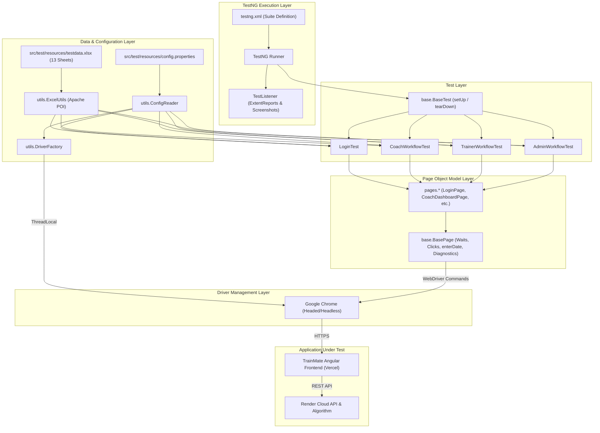

# TrainMate Automation Framework — Architecture & Shared Components

**System Name:** TrainMate — Cohort & Trainer Automatic Allocation System  
**Framework Type:** Data-Driven Page Object Model (POM)  
**Core Technologies:** Java 17, Selenium WebDriver 4.21.0, TestNG 7.10.2, Apache POI 5.2.5, ExtentReports 5.1.1, Log4j2 2.23.1, Maven  
**Application URL:** [https://train-mate-blond.vercel.app/](https://train-mate-blond.vercel.app/)  
**Target Repository:** [https://github.com/nihr0025/trainmate-test-1](https://github.com/nihr0025/trainmate-test-1)  
**Document Version:** 1.0.0 — Final  
**Date:** October 2026  

---

## 1. Executive Summary & Architectural Overview

The TrainMate automation testing framework is an enterprise-grade, data-driven test automation solution designed to validate the automated cohort allocation engine, multi-role user workflows (Coach, Trainer, Admin), and security boundaries of the TrainMate cloud portal.

Built strictly upon the **Page Object Model (POM)** architectural pattern, the framework enforces clean separation of concerns:
- **UI Structure & Locators:** Encapsulated entirely within Page classes (`pages.*`).
- **Base Interactions & Diagnostics:** Standardized within `base.BasePage`.
- **Test Scenarios & Assertions:** Orchestrated strictly within Test classes (`test.*`).
- **Test Data Management:** Maintained externally in Excel (`testdata.xlsx`) and parsed dynamically via Apache POI (`utils.ExcelUtils`).
- **Execution & Diagnostics:** Managed centrally via TestNG listeners (`listeners.TestListener`), Log4j2, and ExtentReports 5.1.



---

## 2. Actual Project Directory Tree

Generated from `C:\Users\nihar\ideaprojects\trainmate-test-1`:

```
C:\Users\nihar\ideaprojects\trainmate-test-1\
├── .git/                                   # Git version control repository
├── docs/                                   # Architectural and team documentation
│   ├── contributions/
│   │   ├── Nihar_Contribution_Report.md
│   │   ├── Avinash_Contribution_Report.md
│   │   ├── Ramya_Contribution_Report.md
│   │   ├── Chavi_Contribution_Report.md
│   │   └── Smitha_Contribution_Report.md
│   ├── TrainMate_Framework_Architecture_and_Shared_Components.md
│   ├── TrainMate_TestCase_Traceability_Matrix.md
│   ├── TrainMate_Team_Contribution_Summary.md
│   └── TrainMate_Documentation_Source_Index.md
├── pom.xml                                 # Maven build and dependency configuration
├── README.md                               # Project quickstart and setup guide
└── src/
    ├── main/
    │   └── java/
    │       ├── base/
    │       │   └── BasePage.java           # Foundation Page Object with diagnostics & date engine
    │       ├── listeners/
    │       │   └── TestListener.java       # TestNG listener, ExtentReports & failure screenshots
    │       ├── pages/
    │       │   ├── AdminCohortsPage.java   # Admin All Cohorts & manual reassignment POM
    │       │   ├── AdminDashboardPage.java # Admin Dashboard metrics & navigation POM
    │       │   ├── BatchUploadPage.java    # Coach Batch Excel upload POM
    │       │   ├── CoachDashboardPage.java # Coach Dashboard & Create Cohort modal POM
    │       │   ├── CohortPage.java         # Coach My Cohorts, filter & edit modal POM
    │       │   ├── LoginPage.java          # Universal Login POM with async auth sync
    │       │   ├── TrainerCohortsPage.java # Trainer Assigned Cohorts & details modal POM
    │       │   ├── TrainerDashboardPage.java# Trainer Dashboard & metrics POM
    │       │   ├── TrainerMailboxPage.java # Trainer Notification Mailbox POM
    │       │   └── TrainerManagementPage.java# Admin Trainer Pool & registration POM
    │       └── utils/
    │           ├── ConfigReader.java       # Properties reader with CLI override support
    │           ├── DriverFactory.java      # ThreadLocal WebDriver lifecycle manager
    │           ├── ExcelDataInitializer.java# Self-healing Excel workbook template generator
    │           ├── ExcelUtils.java         # Apache POI Excel dynamic data parser & date engine
    │           ├── LoggerUtils.java        # Log4j2 safe logging wrapper
    │           └── ScreenshotUtils.java    # Full-page PNG screenshot capture utility
    └── test/
        ├── java/
        │   ├── base/
        │   │   └── BaseTest.java           # Base TestNG lifecycle setup & teardown
        │   └── test/
        │       ├── AdminWorkflowTest.java  # Admin test scenarios A-01 to A-10
        │       ├── CoachWorkflowTest.java  # Coach test scenarios C-01 to C-10
        │       ├── LoginTest.java          # Authentication scenarios L-01 and L-02
        │       └── TrainerWorkflowTest.java# Trainer test scenarios T-01 to T-09
        └── resources/
            ├── config.properties           # Framework configuration properties
            ├── config.properties.example   # Configuration template
            ├── log4j2.xml                  # Log4j2 appenders and log levels
            ├── testdata.xlsx               # Master Excel workbook (13 worksheets)
            └── testng.xml                  # Master TestNG suite XML configuration
```

---

## 3. Maven Build & Dependency Management

The project is managed via Maven with Java 17 compiler compliance (`pom.xml`):

| Dependency | Artifact Coordinates | Version | Purpose in Framework |
| :--- | :--- | :--- | :--- |
| **Selenium Java** | `org.seleniumhq.selenium:selenium-java` | `4.21.0` | Browser automation, element locators, explicit waits, and JavaScript execution. |
| **TestNG** | `org.testng:testng` | `7.10.2` | Test execution engine, `@Test`, `@DataProvider`, and `@BeforeMethod`/`@AfterMethod` lifecycle. |
| **Apache POI** | `org.apache.poi:poi` | `5.2.5` | Core library for reading binary Microsoft formats. |
| **Apache POI OOXML** | `org.apache.poi:poi-ooxml` | `5.2.5` | Office Open XML parser for reading and generating `.xlsx` workbooks (`XSSFWorkbook`). |
| **ExtentReports** | `com.aventstack:extentreports` | `5.1.1` | Rich interactive HTML test execution reporting with failure screenshot embedding. |
| **Log4j2 Core** | `org.apache.logging.log4j:log4j-core` | `2.23.1` | Enterprise logging implementation routing output to console and `logs/trainmate-test.log`. |
| **Log4j2 SLF4J** | `org.apache.logging.log4j:log4j-slf4j2-impl` | `2.23.1` | Slf4j binding routing third-party library logging into Log4j2. |

---

## 4. WebDriver Lifecycle & Parallel Execution (`DriverFactory.java`)

Browser initialization is managed centrally via `utils.DriverFactory`:
- **`ThreadLocal<WebDriver>` Pattern:** Ensures that each test thread owns an isolated, dedicated WebDriver instance. This eliminates cross-thread browser state leakage and guarantees thread safety for parallel test execution.
- **Cross-Browser Support:** Factory supports `chrome`, `firefox`, and `edge` via `ConfigReader.getBrowser()`.
- **Headed vs Headless Mode:** Defaults to **visible (headed)** execution (`headless=false`). Can be toggled via `config.properties` or overridden on the command line (`-Dheadless=true`).
- **Defensive Browser Arguments:**
  - `--no-sandbox`, `--disable-dev-shm-usage`: Prevents shared-memory crashes in virtualized environments.
  - `--window-size=1920,1080`: Maximizes viewport consistency across displays.
  - `--remote-allow-origins=*`: Bypasses Chrome 111+ WebSocket origin restrictions.
- **Teardown Lifecycle:** `DriverFactory.quitDriver()` invokes `driver.quit()` in a `try-finally` block, removing the thread-local reference to prevent memory leaks even if an unhandled exception occurs.

---

## 5. Reusable Base Classes (`BasePage.java` & `BaseTest.java`)

### 5.1 `base.BaseTest`
- Standardizes test setup and teardown across all 4 test classes.
- `@BeforeMethod(alwaysRun = true)`: Launches fresh browser instance and navigates to target URL (`ConfigReader.getAppUrl()`).
- `@AfterMethod(alwaysRun = true)`: Quits browser and cleans up thread-local driver context.

### 5.2 `base.BasePage`
The core engine for element interactions and diagnostics:

```java
// Key BasePage Capabilities:
protected WebElement waitForVisibility(By locator, int timeoutSeconds);
protected WebElement waitForClickable(By locator);
protected void click(By locator);                       // Click with retry and JS fallback
protected void clearField(By locator);                  // Clean clear with Angular event dispatch
protected void enterText(By locator, String text);      // Text entry with input/change/blur dispatch
public void enterDate(By locator, String dateStr);      // Robust HTML5 date entry & verification
public static String normalizeDateString(String dateStr);// Validates 4-digit ISO format
public void selectDropdown(By locator, String valueOrText);// Text, value, and partial matching
public void waitForPageReady(By identifyingElement, String pageName); // Document readyState wait
public String captureDiagnostics(By locator, String action, Exception ex); // Comprehensive failure triage
```

#### The `enterDate()` Innovation:
Resolves the chronic Chrome shadow-DOM appending defect (`202026`) and Angular two-way binding lag:
1. Normalizes input date to ISO `yyyy-MM-dd` and validates that the year is 4 digits (`1900 <= year <= 2100`).
2. Clears existing values via JavaScript: `arguments[0].value = '';`.
3. If input is empty (for negative mandatory validation tests), dispatches `input`, `change`, and `blur` events and returns.
4. Sets validated date: `arguments[0].value = arguments[1];`.
5. Dispatches `Event('input')`, `Event('change')`, and `Event('blur')`, triggering Angular dirty checking and reactive form validation.
6. Verifies that `element.getAttribute("value")` matches the expected date, falling back to keyboard clear and sendKeys if required.

---

## 6. Dynamic Excel Data Engine (`ExcelUtils.java`)

Data-driven testing is powered by `utils.ExcelUtils` using Apache POI:
- **`getSheetDataAsMap(filePath, sheetName)`:** Reads rows dynamically into a `List<Map<String, String>>` where keys are derived from row 0 header names.
- **Date Column Recognition (`isDateColumn`):** Identifies date columns based on header keywords (`date`, `available`, `from`, `till`).
- **Unformatted Numeric Serial Conversion:** When POI encounters an unformatted numeric cell in a date column (e.g. `46296.0`), `ExcelUtils` invokes `DateUtil.getLocalDateTime(num).toLocalDate()` and formats it as `yyyy-MM-dd` rather than returning raw integers.
- **Multi-Format String Parsing (`parseDateSafely`):** Standardizes multiple date representations (`yyyy-MM-dd`, `dd-MM-yyyy`, `dd/MM/yyyy`, `MM/dd/yyyy`, `d-MMM-yyyy`) to ISO format.
- **Self-Healing Capability:** If `testdata.xlsx` is missing on a fresh clone, `ExcelUtils` automatically invokes `ExcelDataInitializer.main()` to regenerate all 13 worksheets from reference specifications.

---

## 7. Diagnostics, Reporting & Logging

### 7.1 Automatic Failure Screenshot & Logging (`listeners.TestListener`)
- Implements `org.testng.ITestListener`.
- `onTestStart()`: Creates an `ExtentTest` node in ExtentReports.
- `onTestSuccess()`: Marks test as `Status.PASS` and records execution duration.
- `onTestFailure()`: Automatically triggers `ScreenshotUtils.captureScreenshot()`, captures a full-browser PNG in `screenshots/`, and embeds the screenshot directly into the ExtentReports HTML report.
- `onFinish()`: Flushes the ExtentSparkReporter to disk at `reports/ExtentReport.html`.

### 7.2 Failure Diagnostics (`BasePage.captureDiagnostics`)
Whenever an explicit wait times out, `BasePage` logs an exhaustive forensic snapshot:
- Failed Action and Target Locator
- Current Browser URL & Page Title (flagging if redirected to `/login`)
- DOM Presence: Whether element exists in DOM, matches count, visibility, enablement, screen coordinates, and bounding box dimensions.
- Active Overlays: Number of blocking `.modal-backdrop` or `.blocking-action-overlay` elements present.
- Browser Console Logs: All `SEVERE` or `WARNING` JavaScript errors from Chrome devtools.

---

## 8. Shared Framework Class Dependency Matrix

| Shared Component | Class Path | Dependent Page Objects | Dependent Test Classes | Purpose |
| :--- | :--- | :--- | :--- | :--- |
| **`BasePage`** | `base.BasePage` | All 10 Page Objects | Indirectly all tests | Core interaction, wait, date entry, and diagnostic engine |
| **`BaseTest`** | `base.BaseTest` | None | All 4 Test Classes | WebDriver lifecycle setup (`@BeforeMethod`) and teardown (`@AfterMethod`) |
| **`DriverFactory`** | `utils.DriverFactory` | None | `BaseTest`, `TestListener` | ThreadLocal browser instance factory |
| **`ConfigReader`** | `utils.ConfigReader` | `BasePage`, `LoginPage` | `BaseTest`, All Test Classes | Central property configuration and CLI parameter overrides |
| **`ExcelUtils`** | `utils.ExcelUtils` | None | `LoginTest`, `CoachWorkflowTest`, `TrainerWorkflowTest`, `AdminWorkflowTest` | Apache POI Excel dynamic data parsing and date conversion |
| **`ScreenshotUtils`**| `utils.ScreenshotUtils` | None | `TestListener`, `BasePage` | Full-browser failure PNG screenshot capture |
| **`LoggerUtils`** | `utils.LoggerUtils` | All Page Objects | All Test Classes, Utilities | Safe Log4j2 logging wrapper |
| **`TestListener`** | `listeners.TestListener`| None | Configured in `testng.xml` | ExtentReports 5.1 generation and failure capture |

---

## 9. Test Execution Commands & Maven Profiles

To execute tests from command line or CI/CD pipelines:

```powershell
# 1. Compile project and verify dependencies
mvn clean test-compile

# 2. Run the entire TestNG regression suite (all 4 modules)
mvn clean test

# 3. Run individual workflow test classes:
mvn test -Dtest=LoginTest
mvn test -Dtest=CoachWorkflowTest
mvn test -Dtest=TrainerWorkflowTest
mvn test -Dtest=AdminWorkflowTest

# 4. Run a specific test method:
mvn test -Dtest=CoachWorkflowTest#testC04_CreateCohortWithValidDetails

# 5. Run in headless mode:
mvn test -Dheadless=true
```

---

## 10. Known Gaps & Maintenance Recommendations

1. **Cloud Cold-Start Synchronization:** The application backend on Render (`https://trainmate-o6tv.onrender.com/api`) sleeps after inactivity. The framework includes 60s page timeouts, but the first login attempt after idle periods may take 30-45s.
2. **Dynamic Data Reset:** As test runs create new cohorts and trainers, test data grows. Automated database seeding/cleanup scripts via REST endpoints would further improve long-term CI/CD cleanliness.
