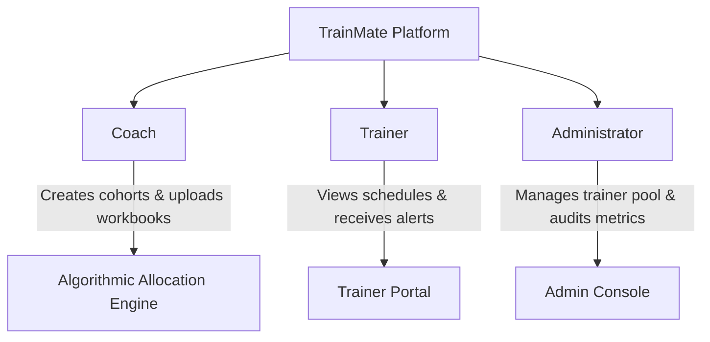
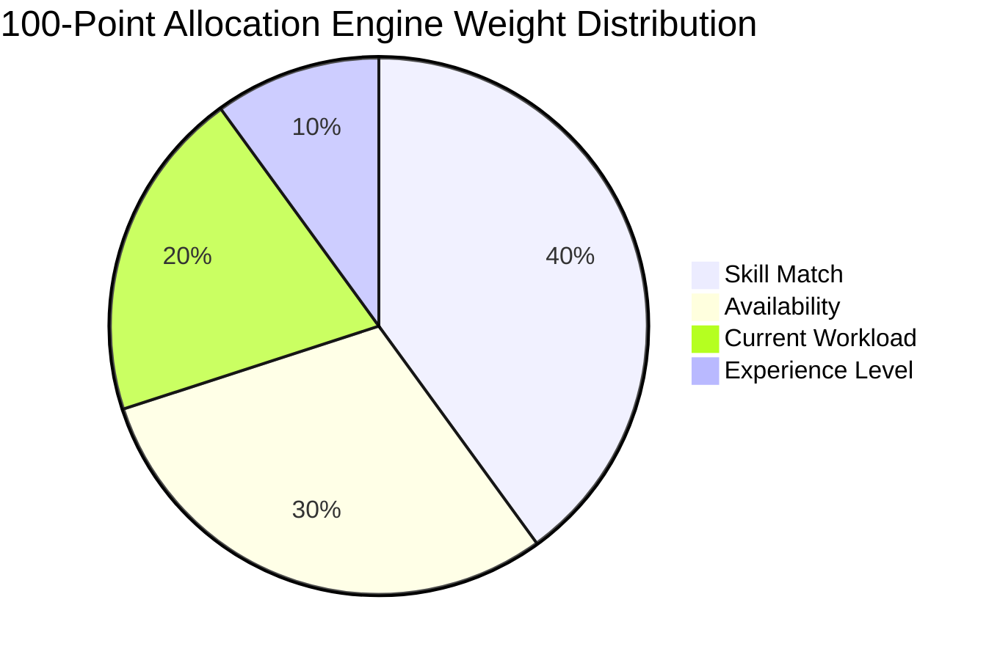

# Document 01 — TrainMate Project Overview

**Project Name:** TrainMate — Cohort & Trainer Automatic Allocation System  
**Application URL:** [https://train-mate-blond.vercel.app/](https://train-mate-blond.vercel.app/)  
**Document Purpose:** Clear, beginner-friendly introduction to the business problem, user roles, core matching engine, and test framework scope.

---

## 1. What is TrainMate?

**TrainMate** is an enterprise web application designed to automate how training batches (called **Cohorts**) are scheduled and paired with qualified corporate instructors (called **Trainers**).

In large IT corporations and consultancies, hundreds of fresh college graduates and lateral employees join every month across diverse technologies—such as Java Full-Stack, Python Data Science, AWS Cloud Architecture, and Automation QA. Scheduling these batches and finding available, skilled trainers used to be done manually using chaotic Excel spreadsheets, phone calls, and email threads.

TrainMate eliminates this manual overhead by providing a centralized web platform with a **proprietary 100-point automatic allocation engine**.

---

## 2. What Problem Does TrainMate Solve?

Before TrainMate was built, training management faced four chronic operational problems:

1. **Scheduling Conflicts & Double-Booking:** Trainers were often assigned to two overlapping batches because schedulers lacked real-time visibility into trainer calendars.
2. **Skill Mismatches:** Instructors were frequently assigned to technologies they were not certified or experienced to teach, harming training quality.
3. **Uneven Workload Distribution:** Some popular trainers were overwhelmed with multiple consecutive batches, while other qualified trainers remained idle.
4. **Slow Turnaround Time:** Creating a cohort, finding an instructor, obtaining approvals, and notifying stakeholders took days. TrainMate does this in seconds.

---

## 3. Who Uses TrainMate? (User Roles)

TrainMate is built around three distinct user roles, each with strict role-based access control (RBAC):

### 3.1 What a Coach Does
- Logs into the Coach Portal (`/coach/dashboard`).
- Schedules single training cohorts by filling out course parameters: cohort code, required skills, trainee count, service line (e.g., ADM, QEA), stream, start date, end date, location, and industry vertical.
- Triggers batch uploads by uploading an Excel workbook (`.xlsx`) containing multiple cohorts at once.
- Reviews algorithmic trainer matches and inspects the 100-point allocation score breakdown.
- Edits existing cohorts when project start dates or required skills change.

### 3.2 What a Trainer Does
- Logs into the Trainer Portal (`/trainer/dashboard`).
- Views their allocated cohorts and upcoming teaching schedules.
- Monitors personal metrics: active teaching batches and completed courses.
- Searches and filters their training schedules by cohort code or technology skill.
- Receives automated alerts in an in-app Mailbox whenever they are assigned to a new batch or reassigned.
- **Security constraint:** Cannot access Admin settings or Coach cohort creation tools.

### 3.3 What an Administrator Does
- Logs into the Admin Console (`/admin/dashboard`).
- Monitors enterprise-wide health metrics: total cohorts, assigned cohorts, unassigned cohorts, and trainer pool capacity.
- Manages the Trainer Pool (`/admin/trainers`): onboard new corporate trainers, sets skill certifications, defines availability dates, and caps maximum workload ceilings (e.g., maximum 5 concurrent batches).
- Performs global cohort searches and multi-faceted filtering across all business service lines.
- Overrides the automated algorithm by manually reassigning trainers during operational emergencies.
- Exports system-wide allocation reports for executive reporting.

---

## 4. What is Cohort Creation and Trainer Allocation?

- **Cohort Creation:** A Coach inputs a demand for training into the system. For example: *"We need a 25-person Java & Spring Boot batch for the Banking Financial Services (BFS) vertical running in Chennai from November 10, 2026 to December 24, 2026."*
- **Trainer Allocation:** The moment the Coach clicks Submit, the TrainMate backend runs an automatic evaluation algorithm across all trainers in the database to select and assign the single best candidate.

---

## 5. The 100-Point Allocation Engine Explained

The heart of TrainMate is its **100-point algorithmic allocation engine**. When matching a cohort to trainers, the system evaluates four weighted pillars:

1. **Skill Match (40 Points Max):** Does the trainer possess the exact primary skills required by the cohort? (e.g., Java, Spring Boot, Microservices). Full match gets 40 points; partial matches receive proportional points.
2. **Availability Calendar (30 Points Max):** Is the trainer free between the cohort's Start Date and End Date? Trainers with overlapping active cohorts receive 0 points.
3. **Current Workload (20 Points Max):** How many batches is the trainer currently teaching relative to their `Max Workload` ceiling? A trainer teaching 1 of 5 batches gets higher points than a trainer teaching 4 of 5 batches.
4. **Experience Level (10 Points Max):** How many years of corporate training or industry experience does the trainer possess?

### What Happens on a No-Match?
If no trainer in the pool meets the threshold (e.g., all Java trainers are fully booked or have overlapping dates), the system strictly marks the cohort status as **`UNASSIGNED`**. It does not corrupt data by arbitrarily assigning an unqualified or overbooked trainer.

---

## 6. A Real-World Example: Step-by-Step

Let's walk through how TrainMate works in practice:

1. **Demand Arises:** Coach `coach01` needs a training batch for 30 trainees in AWS Cloud & DevOps starting next Monday.
2. **Coach Enters Data:** The Coach opens the Create Cohort modal and enters code `AWS26CS001`, Trainees `30`, Skills `AWS, Docker, Kubernetes`, Dates `2026-11-15` to `2026-12-30`.
3. **System Calculates:** The 100-point engine scans 50 trainers:
   - *Trainer Rajesh:* Skills match (40 pts), Available (30 pts), Teaching 0 batches (20 pts), 8 yrs exp (10 pts) = **Total 100 Points**.
   - *Trainer Priya:* Skills match (40 pts), but teaching 2 batches (10 pts workload) = **Total 80 Points**.
4. **Assignment:** Rajesh is awarded the cohort.
5. **Real-Time Notification:** Rajesh's Trainer Mailbox displays an alert: *"You have been assigned to cohort AWS26CS001"*.
6. **Executive Visibility:** Admin dashboard counter for Assigned Cohorts increments by 1.

---

## 7. Application vs. Selenium Automation Framework

It is vital to distinguish between the **TrainMate Web Application** and the **Selenium Automation Framework**:

| Aspect | TrainMate Web Application | Our Automation Testing Framework |
| :--- | :--- | :--- |
| **What it is** | The Angular web software deployed on the cloud. | A standalone Java project that tests the web software. |
| **URL / Path** | `https://train-mate-blond.vercel.app/` | `src/test/java/test/` in IntelliJ IDEA. |
| **Technologies** | Angular, TypeScript, HTML5, CSS3, REST APIs. | Java 17, Selenium WebDriver 4, TestNG, Maven, Apache POI. |
| **Users** | Real Coaches, Trainers, and System Admins. | QA Automation Engineers and CI/CD pipelines. |
| **Purpose** | To run business training operations. | To automatically verify that the web application works properly. |

---

## 8. What Does Our Automation Framework Test?

Our framework provides **100% end-to-end automation coverage** across all user workflows:
1. **Authentication Gateway:** Multi-role login with Excel credentials and unauthorized URL navigation blocking.
2. **Coach Workflow Part 1:** Cohort creation, mandatory field validation, invalid date boundary checks (Start Date > End Date), and algorithmic 100-point score modal verification.
3. **Coach Workflow Part 2:** Data-driven cohort search, lifecycle status filtering, dynamic editing/reallocation, and bulk Excel file ingestion via hidden input elements.
4. **Trainer Workflow:** Role access security trimming, empty-state dashboard rendering, numerical metric validation, cohort schedule search, and notification mailbox management.
5. **Admin Workflow:** System-wide dashboard metrics audit, global multi-strategy search, service-line filtering, negative/positive trainer registration with dynamic unique emails, trainer workload modification, and cohort status synchronization.

---

## 9. Framework Capabilities: What It Verifies vs Cannot Verify

### What It Can Verify:
- UI element visibility, clickability, and enabled states.
- Exact text matching, numerical parsing, and table row counts.
- Dynamic filtering responses for searches and dropdown selections.
- Client-side form validation error messages.
- HTTP route guards and redirection behavior.
- Automatic capture of failure screenshots and HTML reports.

### What It Cannot Verify (Without External Tools):
- Underlying database SQL table rows directly (it verifies data via the UI table reflection).
- Email delivery to real Outlook/Gmail inboxes (it verifies the internal web application Mailbox).
- Server hardware performance, network packet loss, or sub-millisecond API response latency (which require tools like JMeter).
