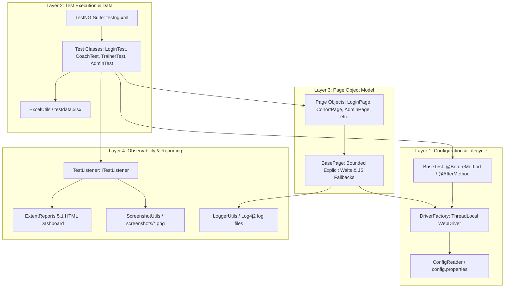
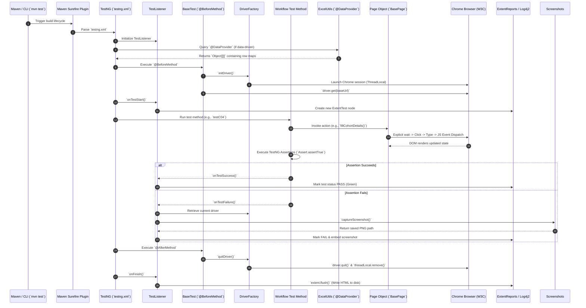

# Document 05 — Framework Architecture & Execution Flow

**Project Name:** TrainMate — Cohort & Trainer Automatic Allocation System  
**Document Purpose:** Complete architectural breakdown of the test execution lifecycle, ThreadLocal WebDriver flow, component interactions, and step-by-step sequence diagrams.

---

## 1. High-Level Architectural Layers

Our automation framework is built around **four decoupled layers**:



---

## 2. The 10-Step Execution Flow of a Test

Here is the exact step-by-step path every single test case follows:



---

## 3. Detailed Walkthrough of the 10 Execution Steps

### Step 1: Triggering the Build
The test engineer or CI/CD server triggers execution using Maven:
```bash
mvn test -Dtest=CoachWorkflowTest#testC04_CreateCohortWithValidDetails
```
Maven parses `pom.xml`, downloads dependencies, compiles the classes, and invokes `maven-surefire-plugin`.

### Step 2: TestNG Suite Initialization
Surefire invokes TestNG, which parses `src/test/resources/testng.xml`. TestNG instantiates our registered listener `listeners.TestListener`.

### Step 3: Test Data Extraction (Apache POI)
If the test method uses `@DataProvider`, TestNG executes the data provider method first. `ExcelUtils.getSheetData()` opens `src/test/resources/testdata.xlsx`, selects the target sheet, loops through rows, validates dates and strings, and passes them as an `Object[][]` array of `Map<String, String>` into the test method.

### Step 4: Environment & Browser Initialization (`@BeforeMethod`)
Before each test runs, TestNG invokes `BaseTest.setUp()`. It calls `DriverFactory.initDriver()`. `DriverFactory` queries `ConfigReader` to check the browser type (`chrome`), headless status (`false`), and timeouts. It creates a new `ChromeDriver` with maximized window options and binds it to `driverThreadLocal.set(driver)`. Finally, it opens the application URL: `driver.get("https://train-mate-blond.vercel.app/")`.

### Step 5: Listener Test Node Registration
`TestListener.onTestStart()` intercepts the execution. It reads the test method name and the human-readable `@Test(description = "...")` attribute, creating a new node in ExtentReports.

### Step 6: Test Method Execution & Page Object Interaction
The test method runs:
```java
CoachDashboardPage dashboard = loginAsCoach();
dashboard.openCreateCohortModal();
dashboard.fillCohortDetails(uniqueCode, ...);
dashboard.submitCreateCohort();
```
The test method contains **no raw Selenium calls** (`driver.findElement`). Instead, it communicates strictly through readable page object methods.

### Step 7: Bounded Explicit Waiting & Angular Synchronization
Inside `BasePage`, every action is synchronized:
- `waitForVisibility(locator)` polls the DOM for up to 20 seconds.
- `enterText()` clears existing text and dispatches synthetic Angular `input`, `change`, and `blur` events so the underlying reactive form detects the typed input.
- `enterDate()` executes JavaScript to inject dates into HTML5 pickers, completely eliminating Chrome keystroke-duplication bugs.

### Step 8: Assertions & Outcome Verification
Once the action completes, the test performs TestNG assertions:
```java
Assert.assertTrue(cohortPage.getDisplayedCohortsCount() >= 1, 
        "Newly created cohort should appear in table");
```
- If the condition is true, the test passes.
- If false, TestNG halts execution and throws an `AssertionError`.

### Step 9: Listener Interception & Visual Artifact Capture
- **On Pass:** `TestListener.onTestSuccess()` logs a green PASS entry in ExtentReports.
- **On Failure:** `TestListener.onTestFailure()` retrieves the current thread's driver, calls `ScreenshotUtils.captureScreenshot()`, writes a timestamped PNG file into `screenshots/`, and embeds the image directly into the ExtentReport HTML log. Simultaneously, `BasePage.captureDiagnostics()` logs browser console errors and DOM states into `logs/trainmate-test.log`.

### Step 10: Teardown & Report Flushing
- **Browser Teardown:** TestNG invokes `BaseTest.tearDown()`, which calls `DriverFactory.quitDriver()`. The browser window closes, and `driverThreadLocal.remove()` frees memory.
- **Report Flushing:** When all tests in the suite finish, `TestListener.onFinish()` calls `extent.flush()`, writing the complete interactive HTML report to `reports/ExtentReport.html`.
