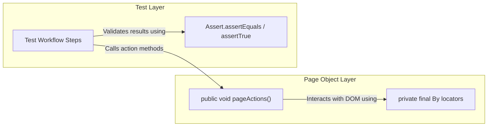
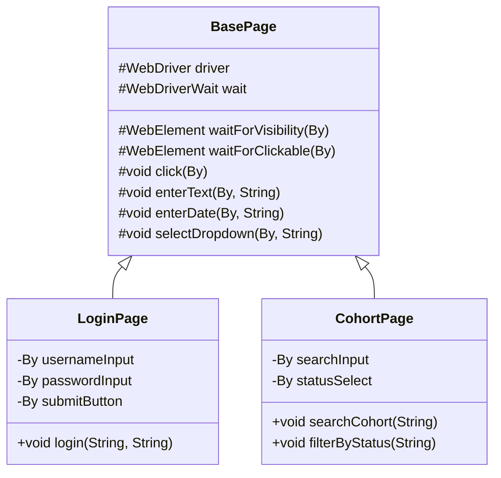

# Document 07 — Page Object Model (POM) Explained

**Project Name:** TrainMate — Cohort & Trainer Automatic Allocation System  
**Document Purpose:** Clear, beginner-friendly guide to understanding the Page Object Model (POM) design pattern, why it was chosen, and how it is implemented across our 10 Page Object classes.

---

## 1. What is the Page Object Model (POM)?

The **Page Object Model (POM)** is a design pattern in test automation where each web page (or distinct UI component) in the application is modeled as an independent **Java Class**.

In POM:
1. **The Page Object Class** holds the web element locators (`By` objects) and the methods that interact with them (typing, clicking, reading text).
2. **The Test Class** contains only test logic, workflow steps, and assertions. It never contains raw Selenium `driver.findElement()` calls.



---

## 2. What Problem Does POM Solve?

To understand why POM is valuable, let's look at what happens without it.

### Without POM (Anti-Pattern: Spaghetti Code)
Imagine you write 15 test cases for the Trainer module without POM. In every single test method, you write:
```java
// Anti-Pattern Example (DO NOT DO THIS)
driver.findElement(By.cssSelector("input[name='username']")).sendKeys("trainer01");
driver.findElement(By.cssSelector("input[name='password']")).sendKeys("Train@123");
driver.findElement(By.cssSelector("button.btn-login-submit")).click();
```
**What happens when the UI developer changes `button.btn-login-submit` to `button#btn-sign-in`?**
- You must manually open and edit 15 different test methods across multiple files.
- If you miss even one line, tests fail.
- Code duplication is enormous.

### With POM (Our Framework's Implementation)
With POM, the login button locator is defined **exactly once** in `LoginPage.java`:
```java
public class LoginPage extends BasePage {
    private final By loginButton = By.cssSelector("button[type='submit']");

    public void clickLogin() {
        click(loginButton);
    }
}
```
If the developer changes the button's CSS selector tomorrow, you update **only one line in `LoginPage.java`**. All 15 test cases immediately work without touching a single test method!

---

## 3. Before and After Illustration

````carousel
```java
// BEFORE POM: Brittle, duplicated test code
public class AntiPatternLoginTest {
    @Test
    public void testLogin() {
        WebDriver driver = new ChromeDriver();
        driver.get("https://train-mate-blond.vercel.app/login");
        // Locators, actions, and assertions all mixed together:
        driver.findElement(By.name("username")).sendKeys("trainer01");
        driver.findElement(By.name("password")).sendKeys("Train@123");
        driver.findElement(By.cssSelector("button[type='submit']")).click();
        
        WebElement heading = driver.findElement(By.cssSelector(".dashboard-title"));
        Assert.assertEquals(heading.getText(), "Trainer Dashboard");
        driver.quit();
    }
}
```
<!-- slide -->
```java
// AFTER POM: Clean, decoupled, maintainable code
// 1. The Page Object (Encapsulates HTML details)
public class LoginPage extends BasePage {
    private final By usernameField = By.name("username");
    private final By passwordField = By.name("password");
    private final By submitButton = By.cssSelector("button[type='submit']");

    public void login(String user, String pass) {
        enterText(usernameField, user);
        enterText(passwordField, pass);
        click(submitButton);
    }
}

// 2. The Test Class (Contains only business logic & assertions)
public class LoginTest extends BaseTest {
    @Test
    public void testTrainerLogin() {
        LoginPage loginPage = new LoginPage(driver);
        loginPage.login("trainer01", "Train@123");
        TrainerDashboardPage dashboard = new TrainerDashboardPage(driver);
        Assert.assertTrue(dashboard.isLoaded(), "Trainer dashboard should open");
    }
}
```
````

---

## 4. The 10 Page Object Classes in Our Framework

Our framework implements 10 dedicated Page Object classes under `src/main/java/pages/`:

| Page Object Class | Web Route | Screen / Component Represented | Why It Was Created |
| :--- | :--- | :--- | :--- |
| **`LoginPage.java`** | `/login` | Authentication Portal | Universal gateway for all actor logins and error message checks. |
| **`CoachDashboardPage.java`** | `/coach/dashboard` | Coach Overview & Creation Modal | Manages coach summary metrics, opens cohort creation popup, and inputs form data. |
| **`CohortPage.java`** | `/coach/cohorts` | Coach My Cohorts Repository | Handles cohort table search, status dropdowns, edit modal, and 100-pt score modal. |
| **`BatchUploadPage.java`** | `/coach/upload` | Bulk Excel Upload Screen | Targets file upload dropzone and transmits `.xlsx` paths directly to `<input type='file'>`. |
| **`TrainerDashboardPage.java`**| `/trainer/dashboard` | Trainer Landing Portal | Verifies metric counters (Active/Completed) and asserts security trimming (hidden Admin tabs). |
| **`TrainerCohortsPage.java`** | `/trainer/cohorts` | Trainer Schedule Table | Searches schedules, filters by lifecycle status, and opens assigned cohort details modal. |
| **`TrainerMailboxPage.java`** | `/trainer/mailbox` | Notification Mailbox | Inspects allocation alert cards and interacts with 'Mark All as Read'. |
| **`AdminDashboardPage.java`** | `/admin/dashboard` | Executive System Console | Audits system metrics (Total, Assigned, Unassigned) and triggers allocation export. |
| **`AdminCohortsPage.java`** | `/admin/cohorts` | Global Cohort Management | Executes multi-strategy global search, filters by Service Line, and handles reassignment modal. |
| **`TrainerManagementPage.java`**| `/admin/trainers` | Enterprise Trainer Pool | Opens Register Trainer modal, fills details using `enterDate()`, searches pool, and edits workload. |

---

## 5. How Shared Browser Interactions Flow Through `BasePage`

Notice that no page object calls Selenium's `driver.findElement()` directly. Every page object extends `BasePage`:



**Benefits of this architecture:**
1. **Unified Wait Strategy:** If we want to change explicit wait timeout from 20 seconds to 25 seconds, we change one property in `config.properties`, and all 10 page objects automatically inherit it.
2. **Centralized Error Diagnostics:** If any element cannot be found, `BasePage.captureDiagnostics()` intercepts the failure and captures the DOM state, active modal backdrops, and browser console errors automatically.
3. **Resilient Event Handling:** Angular-specific event dispatches (`input`, `change`, `blur`) are implemented once in `BasePage.enterText()` and reused across every input field in the entire project.

---

## 6. Interview Questions on Page Object Model

### 1. What is the Page Object Model (POM)?
> *"The Page Object Model is an architectural design pattern in automation testing where web pages are represented as Java classes. The class holds element locators and action methods, keeping HTML details separate from test assertions. This significantly improves maintainability and reusability."*

### 2. Can we put assertions inside Page Object classes?
> *"As a best practice, **no**. Page Objects should only perform actions and return page states, text, or boolean flags (e.g. `isLoaded()`). Assertions belong exclusively in test classes (e.g. `Assert.assertTrue(dashboard.isLoaded())`). Keeping assertions in test classes allows Page Objects to be reused across different test scenarios with different expectations."*

### 3. How does your framework handle page navigation in POM?
> *"When a page action causes the browser to navigate to a new screen, the method in the current Page Object initializes and returns the new Page Object. For example, `CoachDashboardPage.navigateToCohorts()` clicks the Cohorts link and returns `new CohortPage(driver)`. This creates an intuitive, fluent API in our test methods."*

### 4. What is the difference between Page Object Model and Page Factory?
> *"Page Object Model is the overall design pattern. Page Factory is a built-in Selenium utility that uses `@FindBy` annotations and `PageFactory.initElements()`. In modern frameworks, many teams prefer standard `By` locators with explicit waits in `BasePage` rather than Page Factory because Page Factory uses lazy evaluation, which can make fine-grained synchronization with dynamic Angular frameworks more difficult."*
