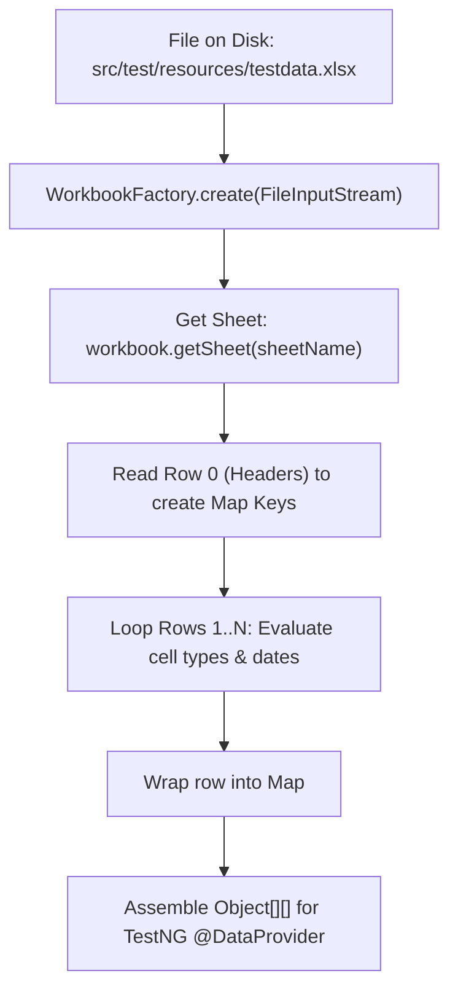

# Document 09 — Excel Data-Driven Testing & Date Handling

**Project Name:** TrainMate — Cohort & Trainer Automatic Allocation System  
**Document Purpose:** Detailed technical analysis of Apache POI implementation, the 13 Excel worksheets, date-cell serial number parsing, and resolving date-duplication bugs.

---

## 1. Why Data-Driven Testing (DDT) with Excel?

In an enterprise allocation platform like TrainMate, testing a single happy-path cohort is insufficient. We need to verify:
- What happens if trainee count is negative?
- What happens if the start date is in the past?
- What happens if the end date is earlier than the start date?
- What happens when searching for rare skills like Golang vs common skills like Java?

If we hardcoded all these values directly into Java code, our test files would be thousands of lines long and impossible to maintain. By utilizing **Apache POI** and **`testdata.xlsx`**, business analysts and QA engineers can add, edit, or remove test scenarios directly in Excel without recompiling Java code.

---

## 2. The 13 Worksheets in `testdata.xlsx`

Our master test workbook (`src/test/resources/testdata.xlsx`) contains **13 dedicated worksheets**:

| # | Worksheet Name | Referenced By | Key Columns | Purpose |
|---|---|---|---|---|
| 1 | **`LoginData`** | `LoginTest.java` (`L-01`) | `username`, `password`, `Expected output` | Multi-role positive and negative login credentials. |
| 2 | **`Cohort_Creation`** | `CoachWorkflowTest.java` (`C-03`, `C-03b`, `C-04`) | `Cohort Code`, `Trainees Count`, `Required Skills`, `Service Line`, `Stream`, `Start Date`, `End Date`, `Industry Vertical`, `Training Location`, `Expected Output` | Form validation and positive creation scenarios. |
| 3 | **`Cohort_Editing_By_Coach`** | `CoachWorkflowTest.java` (`C-08`) | `Cohort Code`, `Trainees Count`, `Required Skills`, `Service Line`, `Stream`, `Start Date`, `End Date`, `Training Location`, `Expected Output` | Positive updates and negative date boundary edits. |
| 4 | **`Cohort_Search_By_Coach`** | `CoachWorkflowTest.java` (`C-07`) | `CohortCode_Or_Skill_Or_Trainer`, `Expected Output` | Coach-level search terms across codes, skills, and trainers. |
| 5 | **`CohortStatusfilter_By_Coach`** | `CoachWorkflowTest.java` (`C-07b`) | `Status`, `Expected Output` | Coach lifecycle status filtering (Assigned, Unassigned, Active, etc.). |
| 6 | **`Cohort_or_Skill_SearchByTrainer`** | `TrainerWorkflowTest.java` (`T-06`) | `CohortCode_or_Skill`, `Expected Output` | Trainer schedule search terms. |
| 7 | **`CohortStatusFilter_By_Trainer`** | `TrainerWorkflowTest.java` (`T-07`) | `Status`, `Expected Output` | Trainer schedule status filtering. |
| 8 | **`Cohort_Search_By_Admin`** | `AdminWorkflowTest.java` (`A-03`) | `CohortCode_Or_Skill_Or_Trainer_Or_Coach`, `Expected Output` | Admin global cohort search keywords. |
| 9 | **`CohortSLfilter_By_Admin`** | `AdminWorkflowTest.java` (`A-03b`) | `Service Line`, `Expected Output` | Global cohort filtering by Service Line (ADM, QEA). |
| 10| **`CohortStatusfilter_By_Admin`** | `AdminWorkflowTest.java` (`A-03c`) | `Status`, `Expected Output` | Global cohort filtering by lifecycle status. |
| 11| **`Trainer_Search_By_Admin`** | `AdminWorkflowTest.java` (`A-07`) | `Search by skill/name/service line`, `Expected Output` | Trainer pool search keywords. |
| 12| **`TrainerFilterByStatus_By_Admin`** | `AdminWorkflowTest.java` (`A-07b`) | `Status`, `Expected Output` | Trainer availability status filter (Available, At capacity). |
| 13| **`TrainerRegistration_By_Admin`** | `AdminWorkflowTest.java` (`A-05`, `A-05b`, `A-06`) | `Full Name`, `Email`, `Skill Set`, `Experience`, `Available from`, `Available Till`, `Max Workload`, `Expected output` | Trainer registration negative validations and positive onboarding. |

---

## 3. How `ExcelUtils.java` Reads Test Data

The entire Excel reading pipeline follows four sequential stages:



### 3.1 Handling Cell Data Types
In Apache POI, reading a cell directly using `cell.getStringCellValue()` will throw an `IllegalStateException` if the cell contains a number or a formula. In `ExcelUtils.getCellValueAsString(Cell cell)`:
- **`CellType.STRING`:** Returns `cell.getStringCellValue().trim()`.
- **`CellType.BOOLEAN`:** Returns `String.valueOf(cell.getBooleanCellValue())`.
- **`CellType.NUMERIC`:** Checks `DateUtil.isCellDateFormatted(cell)`.
  - If it is a date: formats it to standard ISO string `yyyy-MM-dd`.
  - If it is a normal number: casts integer values (e.g. `25.0` becomes `"25"`) or returns decimal strings.
- **`CellType.BLANK` or `null`:** Returns an empty string `""` rather than `null` to prevent `NullPointerException` in test methods.

---

## 4. The Chronic Date-Handling Challenge & Solution

One of the most complex bugs encountered in this project was the **HTML5 Date Entry Bug**.

### 4.1 The Problem: 5-to-8-Digit Year Appending
In Google Chrome, HTML5 inputs (`<input type="date">`) do not behave like standard text boxes.
1. In Excel, a user might enter `2026-11-15` or Excel might store it as an internal serial number like `46296`.
2. When Selenium used standard `sendKeys("2026-11-15")` on an existing date field, Chrome's internal date widget appended the keystrokes to the existing year, resulting in invalid years like **`20262026`** or **`202026`**.
3. The Angular web application rejected these 5-to-8 digit years with a validation error, causing tests to fail spuriously.

### 4.2 The Solution in `ExcelUtils` and `BasePage`
We solved this using a two-stage date normalization and injection engine:

#### Stage 1: Safe Parsing in `ExcelUtils.java`
```java
// Handles both serial numbers and 9 different date string patterns:
public static LocalDate parseDateSafely(String dateStr) {
    if (dateStr == null || dateStr.trim().isEmpty()) return null;
    String trimmed = dateStr.trim();

    // Check if numeric Excel serial string (e.g. "46296")
    if (trimmed.matches("^\\d{5}$")) {
        double serial = Double.parseDouble(trimmed);
        if (DateUtil.isValidExcelDate(serial)) {
            return DateUtil.getLocalDateTime(serial).toLocalDate();
        }
    }
    // Attempt standard patterns (ISO, dd-MM-yyyy, d-MMM-yyyy, etc.)
    for (DateTimeFormatter formatter : DATE_FORMATTERS) {
        try {
            return LocalDate.parse(trimmed, formatter);
        } catch (DateTimeParseException ignored) {}
    }
    return null;
}
```

#### Stage 2: JavaScript Event Injection in `BasePage.enterDate()`
Instead of sending individual keyboard keystrokes, `BasePage.enterDate()`:
1. Validates that the year is strictly a 4-digit number between 1900 and 2100.
2. Clears the field value via JavaScript.
3. Injects the formatted ISO string directly: `((JavascriptExecutor) driver).executeScript("arguments[0].value = arguments[1];", element, formattedDate);`.
4. Dispatches synthetic `input`, `change`, and `blur` events so Angular's reactive form controls detect the update immediately.
5. Asserts that `element.getAttribute("value")` matches the formatted date, guaranteeing that the value was accepted by the browser.

---

## 5. How Test Methods Consume Excel Data

Test classes connect to Excel using TestNG's `@DataProvider` annotation:

```java
// 1. The DataProvider method queries ExcelUtils
@DataProvider(name = "cohortCreationValidData")
public Object[][] getCohortCreationValidData() {
    String path = ConfigReader.getProperty("testdata.excel.path", "src/test/resources/testdata.xlsx");
    List<Map<String, String>> allRows = ExcelUtils.getSheetDataAsMap(path, "Cohort_Creation");
    List<Map<String, String>> validRows = allRows.stream()
            .filter(r -> "Cohort Created".equalsIgnoreCase(r.get("Expected Output")))
            .toList();
    Object[][] data = new Object[validRows.size()][1];
    for (int i = 0; i < validRows.size(); i++) {
        data[i][0] = validRows.get(i);
    }
    return data;
}

// 2. The Test Method receives each row as a Map parameter
@Test(description = "C-04: Create cohort with valid details", dataProvider = "cohortCreationValidData")
public void testC04_CreateCohortWithValidDetails(Map<String, String> data) {
    String code = data.get("Cohort Code");
    String skills = data.get("Required Skills");
    String trainees = data.get("Trainees Count");
    // Form submission actions...
}
```

---

## 6. Common Interview Questions on Excel & Data-Driven Testing

### 1. What happens if a worksheet name or column header in Excel is misspelled?
> *"In `ExcelUtils.java`, if a sheet name does not exist, `workbook.getSheet(sheetName)` returns `null`. We guard against this by throwing a descriptive `IllegalArgumentException("Sheet '" + sheetName + "' does not exist in workbook")`. If a column header is misspelled, `data.get("Column Header")` returns `null` or empty string, which allows our validation assertions to catch the missing parameter cleanly."*

### 2. How do you handle blank cells in Excel?
> *"In `ExcelUtils.getCellValueAsString()`, if a cell is `null` or `CellType.BLANK`, we return an empty string `""` rather than `null`. This prevents `NullPointerException` when calling `.trim()` or passing the value to Selenium's `sendKeys()`."*

### 3. How does Apache POI convert Excel date serial numbers?
> *"Excel internally stores dates as floating-point numbers representing the number of days since January 1, 1900. Apache POI provides `DateUtil.isCellDateFormatted(cell)` and `DateUtil.getLocalDateTime(serial)`. Our framework detects these serial numbers, converts them to Java `LocalDate`, and formats them to `yyyy-MM-dd`."*

### 4. What is the advantage of passing `Map<String, String>` instead of `String[]` array in DataProvider?
> *"Using an array forces the test method to access parameters by index (`data[0]`, `data[1]`), which breaks if someone inserts a column in the middle of the Excel sheet. Passing a `Map<String, String>` decouples the code from column order—we access values by header name (`data.get("Required Skills")`), making the test suite robust against column order changes."*
