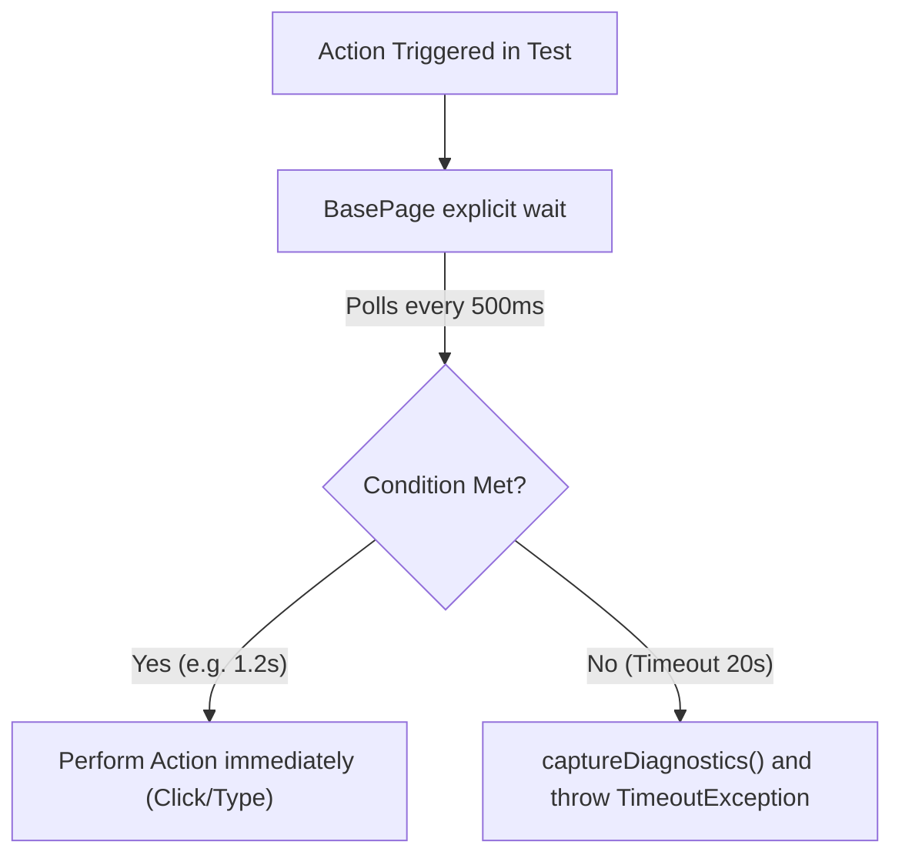

# Document 10 — BasePage, DriverFactory, and Synchronization (Waits)

**Project Name:** TrainMate — Cohort & Trainer Automatic Allocation System  
**Document Purpose:** Detailed technical analysis of WebDriver lifecycle management, bounded synchronization strategies, JavaScript execution fallbacks, and the diagnostics capture engine.

---

## 1. Browser Lifecycle Management (`DriverFactory.java`)

### 1.1 Why ThreadLocal<WebDriver>?
In modern test automation, multiple tests may run concurrently across parallel threads. If `driver` is declared as a standard `public static WebDriver driver`, multiple threads share the same browser window. Thread 1 might click a button while Thread 2 is on a different screen, causing widespread test failures.

In `DriverFactory.java`:
```java
private static final ThreadLocal<WebDriver> driverThreadLocal = new ThreadLocal<>();
```
- Each Java thread gets its own private copy of the `WebDriver` reference.
- Parallel-safe and completely thread-isolated.

### 1.2 Browser Configuration & Chrome Options
`DriverFactory.initDriver()` reads settings from `ConfigReader`:
- **Headless Mode:** Controlled by `headless=false` in `config.properties`. Can be overridden from CLI (`-Dheadless=true`).
- **Standard Desktop Viewport:** `--window-size=1920,1080` guarantees consistent responsive layout without collapsing into mobile hamburger menus.
- **Stability Flags:** `--no-sandbox`, `--disable-dev-shm-usage`, and `--disable-gpu` prevent browser crashes in containerized Linux or CI/CD runners.
- **Timeouts:** Applies `pageLoadTimeout(30s)` and `implicitlyWait(10s)`.

---

## 2. Synchronization Strategy: Explicit vs Implicit Waits

Our framework follows a **bounded explicit wait strategy**:
1. **Global Implicit Wait (10s):** Acts as a low-level baseline safety net for standard DOM queries.
2. **Targeted Explicit Waits (`WebDriverWait`, 20s):** Used for all interactive actions (clicking buttons, typing text, waiting for modal popups).
3. **Never Use `Thread.sleep()`:** Hardcoded sleeps waste execution time if the page loads fast, and cause false failures if the page is slow. Explicit waits poll every 500 milliseconds and resume execution immediately when the condition is met.



---

## 3. Method-by-Method Breakdown of `BasePage.java`

---

### 3.1 `waitForVisibility(By locator, int timeoutSeconds)`
- **Purpose:** Pauses execution until an element is rendered in the DOM and has width and height $> 0$.
- **Inputs:** `By locator`, `int timeoutSeconds`.
- **Output:** `WebElement`.
- **Implementation:**
  ```java
  WebDriverWait customWait = new WebDriverWait(driver, Duration.ofSeconds(timeoutSeconds));
  return customWait.until(ExpectedConditions.visibilityOfElementLocated(locator));
  ```
- **Error Handling:** If it times out, catches `TimeoutException`, invokes `captureDiagnostics()`, and throws an informative exception detailing DOM presence and active overlays.

---

### 3.2 `waitForClickable(By locator)`
- **Purpose:** Waits until an element is both visible and enabled so a click will register.
- **Inputs:** `By locator`.
- **Output:** `WebElement`.
- **Implementation:** Calls `wait.until(ExpectedConditions.elementToBeClickable(locator))`.

---

### 3.3 `waitForInvisibility(By locator)`
- **Purpose:** Waits for temporary loading spinners, modal overlays, or progress bars to disappear before proceeding.
- **Inputs:** `By locator`.
- **Output:** `boolean` (true if element disappeared, false if timed out).

---

### 3.4 `click(By locator)`
- **Purpose:** Clicks an element with automatic stale element retry and intercepted-click JavaScript fallback.
- **Inputs:** `By locator`.
- **Output:** `void`.
- **Implementation Highlights:**
  1. Tries standard `waitForClickable(locator).click()`.
  2. If `StaleElementReferenceException` is caught, retries once.
  3. If `ElementClickInterceptedException` is caught (e.g., an overlay blocked the click), centers the element using `scrollIntoView()` and executes a JavaScript click via `((JavascriptExecutor) driver).executeScript("arguments[0].click();", element)`.

---

### 3.5 `clearField(By locator)` and `enterText(By locator, String text)`
- **Purpose:** Safely types text into input fields while triggering Angular's two-way data binding (`[(ngModel)]`).
- **Inputs:** `By locator`, `String text`.
- **Output:** `void`.
- **Why Special Logic is Needed for Angular:**
  Standard `element.clear()` often fails to notify Angular reactive forms that the input changed. Our implementation:
  1. Clicks the field and sends `Keys.chord(Keys.CONTROL, "a")` + `Keys.BACK_SPACE`.
  2. Calls `element.clear()`.
  3. Sends the string via `element.sendKeys(text)`.
  4. Dispatches synthetic JavaScript events:
     ```javascript
     arguments[0].dispatchEvent(new Event('input', { bubbles: true }));
     arguments[0].dispatchEvent(new Event('change', { bubbles: true }));
     arguments[0].dispatchEvent(new Event('blur', { bubbles: true }));
     ```
  This guarantees that Angular form validation and submit button enablement update immediately.

---

### 3.6 `enterDate(By locator, String dateStr)`
- **Purpose:** Enters a validated `yyyy-MM-dd` date into HTML5 `<input type="date">` fields.
- **Inputs:** `By locator`, `String dateStr`.
- **Output:** `void`.
- **Implementation:**
  - Validates 4-digit years between 1900 and 2100.
  - Injects value via JavaScript: `arguments[0].value = formattedDate;`.
  - Dispatches `input`, `change`, and `blur` events.
  - Asserts that `element.getAttribute("value")` matches the formatted date string.

---

### 3.7 `selectDropdown(By locator, String valueOrText)`
- **Purpose:** Resilient dropdown selection supporting 4 fallback strategies.
- **Inputs:** `By locator`, `String valueOrText`.
- **Output:** `void`.
- **Strategy Sequence:**
  1. Exact visible text match (`select.selectByVisibleText(target)`).
  2. Exact value attribute match (`select.selectByValue(target)`).
  3. Case-insensitive text or value match (iterates `select.getOptions()`).
  4. Partial text or value match (iterates `select.getOptions()` using `.contains()`).

---

### 3.8 `uploadFile(By fileInputLocator, String absoluteFilePath)`
- **Purpose:** Ingests local files without dealing with operating system file dialog windows.
- **Inputs:** `By fileInputLocator`, `String absoluteFilePath`.
- **Output:** `void`.
- **Implementation:** Locates the underlying HTML `<input type='file'>` and sends the absolute file path directly using `fileInput.sendKeys(absoluteFilePath)`.

---

### 3.9 `captureDiagnostics(By locator, String action, Exception ex)`
- **Purpose:** Captures an exhaustive technical triage report at the exact moment of failure.
- **Output:** Formatted `String` containing:
  - Failed action and target locator.
  - Current browser URL and Page Title.
  - **Login Redirect Check:** Warns if the browser was unexpectedly kicked back to `/login`.
  - **DOM Presence Check:** Checks if the element exists in the DOM, matches count, location, dimensions, and visibility state.
  - **Overlay Detection:** Checks for active `.modal-backdrop` or `.blocking-action-overlay` elements.
  - **Screenshot Path:** Captures timestamped PNG and logs path.
  - **Browser Console Errors:** Reads Chrome SEVERE and WARNING console log entries.

---

## 4. Common Synchronization Interview Questions

### 1. What happens when an explicit wait times out?
> *"The `WebDriverWait` throws a `org.openqa.selenium.TimeoutException`. In our framework, `BasePage` intercepts this exception, invokes `captureDiagnostics()` to record DOM presence and browser console logs, and re-throws the exception with full diagnostic information attached."*

### 2. How do you handle `StaleElementReferenceException`?
> *"A stale element reference occurs when an element has been removed from the DOM or the page was refreshed after the element was located. In `BasePage.click()`, we catch `StaleElementReferenceException`, log a warning, and re-locate and click the element once more."*

### 3. How do you handle `ElementClickInterceptedException`?
> *"This occurs when another element (like an overlay, spinner, or toast notification) sits on top of the target element. Our framework catches this exception, scrolls the element into the center of the viewport via JavaScript `scrollIntoView()`, and triggers a direct JavaScript click `arguments[0].click()`."*
