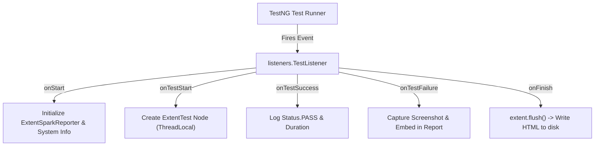

# Document 11 — TestNG Listeners, Logging & ExtentReports

**Project Name:** TrainMate — Cohort & Trainer Automatic Allocation System  
**Document Purpose:** Complete analysis of TestNG listener event hooks, ExtentReports 5.1 HTML generation, automatic failure screenshot binding, and Log4j2 audit trails.

---

## 1. What is a TestNG Listener?

A **TestNG Listener** is a Java class that implements interfaces provided by TestNG (such as `ITestListener`, `ISuiteListener`, or `IRetryAnalyzer`). It allows developers to "listen" to test execution events and execute custom actions when a test starts, succeeds, fails, or is skipped.

In our project, `src/main/java/listeners/TestListener.java` implements **`ITestListener`**. It connects TestNG directly to **ExtentReports 5.1** and **ScreenshotUtils**.



---

## 2. Event Lifecycle in `TestListener.java`

---

### 2.1 `onStart(ITestContext context)`
- **When it runs:** Once at the very beginning of the test suite execution.
- **What it does:**
  1. Checks if `extent` is already initialized (singleton check).
  2. Reads `report.path` from `config.properties` (defaults to `reports/ExtentReport.html`).
  3. Ensures parent directory `reports/` exists, creating it via `parentDir.mkdirs()` if missing.
  4. Configures `ExtentSparkReporter` (document title, report name, UTF-8 encoding, standard theme).
  5. Attaches system environment metadata to the report: Application Name, Environment, Browser, Headless flag, Java Version, and Operating System.

---

### 2.2 `onTestStart(ITestResult result)`
- **When it runs:** Immediately before any `@Test` method begins executing.
- **What it does:**
  1. Reads the human-readable `@Test(description = "...")` attribute. If empty, falls back to the Java method name.
  2. Calls `extent.createTest(description)` to create a test node.
  3. Stores the node in `private static final ThreadLocal<ExtentTest> testNode = new ThreadLocal<>()` to ensure thread-safe reporting in parallel runs.
  4. Prints a formatted banner in the console and logs `=== STARTED TEST: ... ===` in Log4j2.

---

### 2.3 `onTestSuccess(ITestResult result)`
- **When it runs:** When a test method completes without throwing any uncaught exceptions or assertion errors.
- **What it does:**
  1. Retrieves the active `ExtentTest` node via `testNode.get()`.
  2. Logs `Status.PASS: Test executed successfully`.
  3. Calculates execution duration: `(result.getEndMillis() - result.getStartMillis())` ms.
  4. Logs the pass outcome to console and Log4j2.

---

### 2.4 `onTestFailure(ITestResult result)`
- **When it runs:** As soon as an assertion fails (`AssertionError`) or an unhandled exception (`TimeoutException`, `NoSuchElementException`) is thrown.
- **What it does:**
  1. Retrieves the current thread's `WebDriver` from `DriverFactory.getDriver()`.
  2. Calls `ScreenshotUtils.captureScreenshot(driver, result.getName())`.
  3. Saves a timestamped PNG image inside `screenshots/`.
  4. Logs `Status.FAIL` with the full exception stack trace in ExtentReports.
  5. **Embeds the Screenshot:** Uses `MediaEntityBuilder.createScreenCaptureFromPath(screenshotPath).build()` to embed the PNG directly inside the HTML report.
  6. Emits error logs to console and `logs/trainmate-test.log`.

---

### 2.5 `onFinish(ITestContext context)`
- **When it runs:** Once after all test methods and suites have finished running.
- **What it does:**
  1. Calls `extent.flush()`.
  2. Writes all collected memory logs, test nodes, timestamps, and embedded images to the physical HTML file: `reports/ExtentReport.html`.

---

## 3. How Screenshots Are Captured (`ScreenshotUtils.java`)

`src/main/java/utils/ScreenshotUtils.java` captures screenshots cleanly using Selenium's native `TakesScreenshot` interface:

```java
public static String captureScreenshot(WebDriver driver, String screenshotName) {
    if (driver == null) return null;
    try {
        File dir = new File("screenshots");
        if (!dir.exists()) dir.mkdirs();

        String timestamp = new SimpleDateFormat("yyyyMMdd_HHmmss_SSS").format(new Date());
        String fileName = sanitizeFileName(screenshotName) + "_" + timestamp + ".png";
        File destination = new File(dir, fileName);

        File source = ((TakesScreenshot) driver).getScreenshotAs(OutputType.FILE);
        Files.copy(source.toPath(), destination.toPath(), StandardCopyOption.REPLACE_EXISTING);
        return destination.getAbsolutePath();
    } catch (Exception e) {
        LoggerUtils.error(ScreenshotUtils.class, "Failed to capture screenshot", e);
        return null;
    }
}
```

---

## 4. Logging with Log4j2 (`LoggerUtils.java`)

### 4.1 Configuration: `src/test/resources/log4j2.xml`
Log4j2 is configured with two active appenders:
1. **Console Appender (`STDOUT`):** Prints colored real-time logs in IntelliJ IDEA console.
2. **File Appender (`RollingFile`):** Appends detailed timestamped logs to `logs/trainmate-test.log`.

### 4.2 Logging vs. Reporting: How to Investigate Failures

When a test fails during a run, we use a **two-step investigation process**:

```text
Step 1: Check the ExtentReport HTML (Executive View)
        -> Open reports/ExtentReport.html
        -> See the red FAILED badge
        -> Look at the embedded screenshot (shows what was on screen)

Step 2: Check logs/trainmate-test.log (Engineering View)
        -> Search for the test name or timestamp
        -> View the exact Java stack trace, BasePage diagnostics,
           DOM element matches, and browser console warnings.
```

---

## 5. Common Interview Questions on Listeners & Reporting

### 1. Where do you register your TestNG listener?
> *"In our project, `TestListener` is registered globally inside `src/test/resources/testng.xml` under the root `<suite>` tag: `<listeners><listener class-name="listeners.TestListener"/></listeners>`. It can also be registered at the class level using `@Listeners(listeners.TestListener.class)`."*

### 2. Why must `extent.flush()` be called in `onFinish()`?
> *"ExtentReports builds the report in memory during test execution. If `extent.flush()` is never called, the memory buffer is never committed to disk, resulting in an empty or ungenerated HTML file."*

### 3. How do you ensure screenshots are thread-safe when running parallel tests?
> *"In `TestListener.java`, we maintain `private static final ThreadLocal<ExtentTest> testNode = new ThreadLocal<>()`. When `onTestFailure()` runs, it calls `testNode.get()`, ensuring the screenshot is attached to the exact test node running on that specific thread without cross-thread contamination."*

### 4. What is the difference between `ITestListener` and `ISuiteListener`?
> *"`ITestListener` operates at the individual test method level (`onTestStart`, `onTestSuccess`, `onTestFailure`). `ISuiteListener` operates at the broader `<suite>` level (`onStart`, `onFinish`) before and after any tests run in that suite."*
