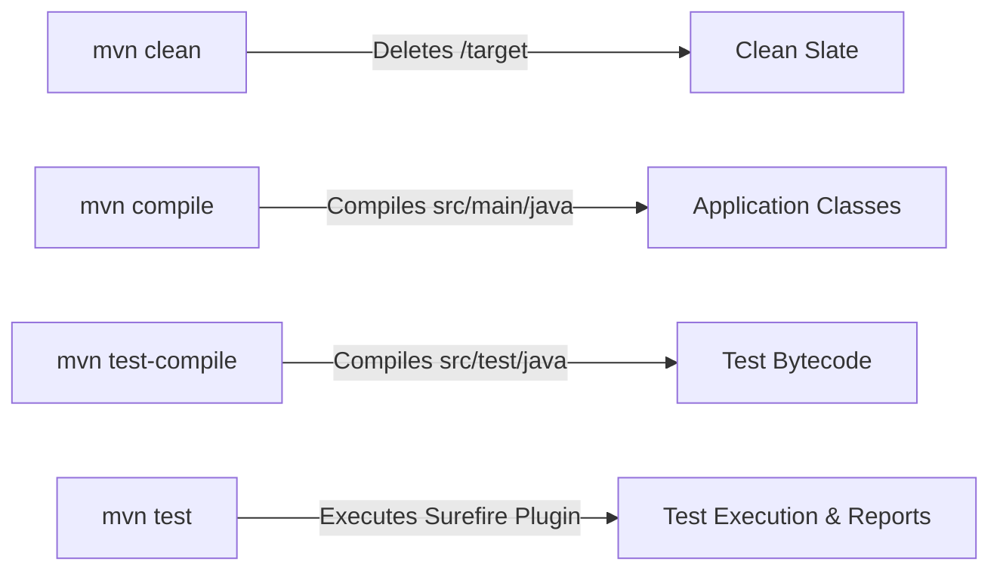

# Document 12 — Configuration Management & Maven Build Automation

**Project Name:** TrainMate — Cohort & Trainer Automatic Allocation System  
**Document Purpose:** Detailed explanation of Maven build lifecycles, Surefire test execution, TestNG suite organization, `config.properties`, and command-line overrides.

---

## 1. Maven Architecture & Build Lifecycles

**Apache Maven** is our project management and build automation tool. It handles two major responsibilities:
1. **Dependency Management:** Automatically downloads libraries (Selenium, TestNG, POI, ExtentReports) from Maven Central into `~/.m2/repository`.
2. **Build Lifecycle Orchestration:** Compiles Java code and runs tests through plugins defined in `pom.xml`.



---

## 2. Key Differences in Maven & Testing Concepts

### 2.1 Dependencies vs. Plugins
- **Dependencies (`<dependencies>`):** External Java JAR libraries that our code imports and compiles against (e.g., `selenium-java`, `testng`, `poi-ooxml`).
- **Plugins (`<plugins>`):** Executable tools that Maven runs during the build lifecycle (e.g., `maven-compiler-plugin` compiles Java; `maven-surefire-plugin` executes tests).

### 2.2 `mvn clean` vs. `mvn test-compile` vs. `mvn test`
- **`mvn clean`:** Deletes the `target/` directory, wiping away previous compiled `.class` files, temporary logs, and surefire reports.
- **`mvn test-compile`:** Compiles both `src/main/java` and `src/test/java` to verify that there are zero Java syntax or import errors, without launching any browsers.
- **`mvn test`:** Compiles the project and immediately executes all test cases bound to the Surefire plugin.

### 2.3 Headed Mode vs. Headless Mode
- **Headed Mode (`headless=false`):** A visible Google Chrome window physically opens on your desktop. You can watch Selenium click buttons, type text, and navigate pages in real time. (Mandatory for local debugging).
- **Headless Mode (`headless=true`):** Chrome runs in memory in the background without rendering a physical window on screen. It is significantly faster and is required for Linux CI/CD build agents (like Jenkins, GitHub Actions, or Docker) that do not have physical monitors or graphical displays (X11).

---

## 3. Configuration Management (`ConfigReader.java` & `config.properties`)

### 3.1 Properties File: `src/test/resources/config.properties`
```properties
# Base Application URL
baseUrl=https://train-mate-blond.vercel.app/

# Browser Execution Settings
browser=chrome
headless=false

# Timeouts in Seconds
timeout.implicit=10
timeout.explicit=20
timeout.pageload=60

# Test User Accounts
coach.username=coach01
coach.password=coach123
trainer.username=trainer01
trainer.password=trainer123
admin.username=admin01
admin.password=admin123

# File Paths
testdata.excel.path=src/test/resources/testdata.xlsx
report.path=reports/ExtentReport.html
```

### 3.2 Dynamic CLI Overrides in `ConfigReader.java`
Our `ConfigReader` implements a smart fallback pattern: **CLI System Properties take precedence over `.properties` file values**:

```java
public static String getProperty(String key, String defaultValue) {
    // 1. Check if passed via command line (-Dkey=value)
    String systemValue = System.getProperty(key);
    if (systemValue != null && !systemValue.trim().isEmpty()) {
        return systemValue.trim();
    }
    // 2. Fall back to config.properties file
    String fileValue = properties.getProperty(key);
    return (fileValue != null) ? fileValue.trim() : defaultValue;
}
```
**Why this is useful:**
You can change the target browser or run in headless mode from the terminal without editing any files on disk:
```bash
mvn test -Dbrowser=edge -Dheadless=true
```

---

## 4. Master Command Reference

Here are the verified Maven commands for our project:

| Execution Goal | Exact Working Command Line |
| :--- | :--- |
| **Verify Compilation Only** | `mvn test-compile` |
| **Clean & Run Full Test Suite** | `mvn clean test` |
| **Run Only Trainer Workflow** | `mvn test -Dtest=TrainerWorkflowTest` |
| **Run Only Coach Workflow** | `mvn test -Dtest=CoachWorkflowTest` |
| **Run Only Admin Workflow** | `mvn test -Dtest=AdminWorkflowTest` |
| **Run Single Test Case (e.g. C-04)** | `mvn test -Dtest=CoachWorkflowTest#testC04_CreateCohortWithValidDetails` |
| **Run in Headless Mode** | `mvn test -Dheadless=true` |
| **Run in Microsoft Edge** | `mvn test -Dbrowser=edge` |

---

## 5. Locating Test Execution Artifacts

After running any Maven command, outputs are written to:

1. **ExtentReports HTML Dashboard:** `reports/ExtentReport.html` (Open in Chrome/Edge to view interactive charts, descriptions, and screenshots).
2. **Log4j2 Execution Logs:** `logs/trainmate-test.log` (Contains technical diagnostics, element states, and DOM logs).
3. **Failure Screenshots:** `screenshots/*.png` (Full-page captures taken at the exact moment of assertion failure).
4. **Surefire XML Reports:** `target/surefire-reports/` (Standard XML files consumed by Jenkins / CI/CD tools).
