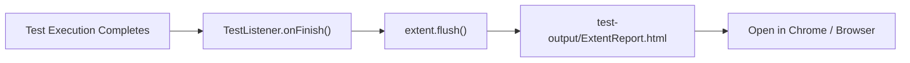

# 15. Project Demo and Live Execution Guide

## Overview

During a technical interview, you may be asked:
- *"Can you open your IDE and show me your test execution?"*
- *"Can you run a single test class or a single test method right now?"*
- *"Where do the execution reports get generated, and what information do they show?"*
- *"What happens if the web application is down or slow during a live demo?"*

This guide gives you an exact, step-by-step playbook to confidently demo the **TrainMate Automation Framework** in IntelliJ IDEA or from the command line, show live execution, navigate HTML reports, and handle unexpected issues with ease.

---

## 1. Pre-Demo Checklist (5 Minutes Before the Interview)

Before sharing your screen, verify these items:

| # | Item | Verification Step | Desired State |
|---|---|---|---|
| 1 | **Project Workspace** | Open IntelliJ IDEA with `trainmate-test-1` | Clean workspace, no unresolved red imports |
| 2 | **JDK Configuration** | Check `File -> Project Structure -> Project SDK` | Set to **Java 17** (or Eclipse Temurin 17) |
| 3 | **Maven Sync** | Click Maven tool window -> Reload icon | Build tool window reports `BUILD SUCCESS` |
| 4 | **Chrome Browser** | Open Google Chrome manually | Ensure Chrome is updated to the latest version |
| 5 | **Target Web App** | Open `https://train-mate-blond.vercel.app/` | Verify login screen is responsive and operational |
| 6 | **Reports Folder** | Inspect `test-output/ExtentReport.html` | Ensure prior clean report exists for demonstration |
| 7 | **Terminal Ready** | Open IntelliJ Terminal window | Directory points to project root directory |

```text
Pre-Flight Shell Check:
mvn clean test-compile
```
*Expected result: `[INFO] BUILD SUCCESS` in 2–4 seconds.*

---

## 2. Option A: Executing via IntelliJ IDEA GUI

Running tests directly inside IntelliJ IDEA is visually compelling and demonstrates familiarity with modern developer tools.

### Step 1: Open the Test File
Navigate through the Project Explorer:
`src/test/java/test/` $\rightarrow$ choose a test class, e.g., [`TrainerWorkflowTest.java`](file:///c:/Users/nihar/ideaprojects/trainmate-test-1/src/test/java/test/TrainerWorkflowTest.java).

### Step 2: Running a Specific Test Method
1. Find the test method, for example `testT01_TrainerLoginAndDashboardSummary()`.
2. Look at the left gutter next to the method declaration. You will see a **green play icon** ($\blacktriangleright$).
3. Click the green icon and select:
   **Run 'TrainerWorkflowTest.testT01_TrainerLoginAndDashboardSummary()'**

```
 ┌────────────────────────────────────────────────────────┐
 │ ▶ [Green Icon] public void testT01_TrainerLoginAnd... │
 └────────────────────────────────────────────────────────┘
```

### Step 3: What the Interviewer Sees on Screen
1. **IntelliJ Run Window Opens:** Shows TestNG tree structure on the left pane and console output on the right.
2. **Chrome Browser Spawns:** Maximizes smoothly to $1920 \times 1080$, opens `https://train-mate-blond.vercel.app/`.
3. **Execution Steps:**
   - Navigates to `/login`.
   - Types `trainer01` and `Password@123`.
   - Clicks "Sign in".
   - Waits for `/trainer/dashboard` URL.
   - Asserts metric cards ("Assigned Cohorts", "Upcoming Sessions").
4. **Browser Closes:** `DriverFactory.quitDriver()` gracefully closes Chrome.
5. **Run Window Status:** Shows green checkmark $\checkmark$ with execution duration (e.g., `3.42s`).

### What to Say While It Runs:
> *"I am executing our first Trainer workflow test, `testT01`. You can see Selenium WebDriver launch Chrome via DriverFactory, maximize the viewport, authenticate as trainer01 using our testdata.xlsx credentials, verify the dashboard cards through our TrainerDashboardPage object, and close the session cleanly. The entire execution takes about 3 to 4 seconds."*

---

## 3. Option B: Executing the Complete Suite via TestNG XML

To run the entire end-to-end regression suite covering all 37 test cases:

1. In the Project Explorer, expand `src/test/resources/`.
2. Right-click on [`testng.xml`](file:///c:/Users/nihar/ideaprojects/trainmate-test-1/src/test/resources/testng.xml).
3. Select **Run '.../testng.xml'**.

```
Project Explorer:
└── src
    └── test
        └── resources
            └── testng.xml  <--- [Right Click -> Run 'testng.xml']
```

### Execution Progression
TestNG executes test classes sequentially as declared in the suite file:
1. **Smoke Tests:** `LoginWorkflowTest` (L-01, L-02)
2. **Coach Workflow:** `CoachWorkflowTest` (C-01 to C-10)
3. **Trainer Workflow:** `TrainerWorkflowTest` (T-01 to T-09)
4. **Admin Workflow:** `AdminWorkflowTest` (A-01 to A-10)

As each test finishes, `TestListener.java` logs the result to console and writes step records into the Extent Report memory buffer.

---

## 4. Option C: Executing via Maven Command Line

Running tests from Maven is essential for CI/CD pipelines (Jenkins, GitHub Actions). Demonstrating CLI mastery impresses technical interviewers.

### Command 1: Run Full Test Suite
```bash
mvn clean test
```
- Compiles source and test directories.
- Cleans old reports in `test-output/`.
- Executes `testng.xml` configured in `maven-surefire-plugin`.

### Command 2: Run a Specific Test Class
```bash
mvn test -Dtest=TrainerWorkflowTest
```
- Bypasses the XML suite and runs only `TrainerWorkflowTest`.

### Command 3: Run a Single Test Method
```bash
mvn test -Dtest=TrainerWorkflowTest#testT01_TrainerLoginAndDashboardSummary
```
- Executes only method `testT01`. Perfect for quick live verification.

### Command 4: Override Parameters Dynamically
```bash
mvn test -Dbrowser=chrome -Denv=qa -Dheadless=false
```
- Demonstrates how your framework reads runtime flags to override defaults in `config.properties`.

---

## 5. Walkthrough: Demonstrating ExtentReports to the Interviewer

Once test execution completes, transition seamlessly to the test reporting artifact.

### How to Open the Report
1. In IntelliJ IDEA, expand the project folder `test-output/`.
2. Locate [`ExtentReport.html`](file:///c:/Users/nihar/ideaprojects/trainmate-test-1/test-output/ExtentReport.html).
3. Right-click `ExtentReport.html` $\rightarrow$ **Open In** $\rightarrow$ **Browser** $\rightarrow$ **Chrome**.



### Key Report Sections to Highlight to the Interviewer:

```
┌────────────────────────────────────────────────────────────────────────┐
│                        TrainMate Automation Report                     │
├──────────────────┬─────────────────────────────────────────────────────┤
│ Dashboard Cards  │ Total Tests: 37  |  Passed: 37  |  Failed: 0        │
├──────────────────┼─────────────────────────────────────────────────────┤
│ Category Tabs    │ Coach Workflow | Trainer Workflow | Admin Workflow   │
├──────────────────┼─────────────────────────────────────────────────────┤
│ Test Details     │ testT01_TrainerLoginAndDashboardSummary             │
│                  │  ├─ [PASS] Navigated to login page                  │
│                  │  ├─ [PASS] Entered credentials for trainer01        │
│                  │  ├─ [PASS] Verified dashboard URL /trainer/dashboard│
│                  │  └─ [PASS] Cohort cards counter verified = 3        │
├──────────────────┼─────────────────────────────────────────────────────┤
│ Failed Test View │ [If Any Failure Occurred]:                          │
│                  │  ├─ [FAIL] Timeout waiting for element visibility   │
│                  │  ├─ Stacktrace snippet with line number             │
│                  │  └─ Clickable inline screenshot thumbnail           │
└──────────────────┴─────────────────────────────────────────────────────┘
```

### What to Explain:
> *"Here is our ExtentReports HTML dashboard. In the top bar, we capture system metrics: operating system, Java version, user, and execution duration. Each test case is categorized by author and role. If a test fails, our TestListener captures a full-resolution screenshot using ScreenshotUtils and embeds it directly into the report alongside the exact stack trace, making defect triage immediate for our development team."*

---

## 6. Walkthrough: Demonstrating Logging and Console Output

Open the console or inspect `logs/automation.log`:

```text
2026-03-29 10:15:22 [main] INFO  base.BaseTest - ==================== STARTING SUITE: TrainMate Automation Suite ====================
2026-03-29 10:15:23 [main] INFO  base.BaseTest - Launching browser: chrome for test: testT01_TrainerLoginAndDashboardSummary
2026-03-29 10:15:24 [main] INFO  pages.LoginPage - Navigating to: https://train-mate-blond.vercel.app/login
2026-03-29 10:15:25 [main] INFO  pages.LoginPage - Logging in with username: trainer01
2026-03-29 10:15:27 [main] INFO  pages.TrainerDashboardPage - Verifying trainer dashboard elements...
2026-03-29 10:15:27 [main] INFO  pages.TrainerDashboardPage - Total assigned cohorts card is visible: 3
2026-03-29 10:15:28 [main] INFO  base.BaseTest - Test PASSED: testT01_TrainerLoginAndDashboardSummary
2026-03-29 10:15:28 [main] INFO  driver.DriverFactory - Quitting browser driver session for thread: 1
```

### What to Explain:
> *"We use Log4j2 with asynchronous logging to avoid I/O bottlenecks. Notice that every page object operation is logged with meaningful contextual info: the page URL, the user logging in, the action taken, and the element verification result. These logs write both to standard output and to rolling daily log files in the `logs/` directory."*

---

## 7. What to Do If the Web Application Fails or Freezes During the Live Demo

In live technical interviews, web apps on cloud platforms (like Vercel or cloud databases) might experience network latency, cold starts, or downtime.

### Contingency Strategy & Professional Dialogue:

#### Scenario 1: A Page Takes 10 Seconds to Load (Network Slowness)
* **What happens:** Your test doesn't crash immediately because `BasePage.waitForVisibility()` has an explicit wait of 10 seconds.
* **What to say:**
  > *"Notice that the framework does not use brittle Thread.sleep(). Even though the Vercel cloud server is taking an extra 4 seconds to respond, our explicit WebDriverWait polling dynamically checks the DOM every 500 milliseconds. As soon as the DOM updates, the test proceeds immediately without wasting unnecessary time."*

#### Scenario 2: Element Click Intercepted (Toast Notification or Loading Spinner)
* **What happens:** A standard Selenium `.click()` throws `ElementClickInterceptedException`.
* **What to say & show:**
  > *"In modern single-page applications like Angular/React, temporary backdrop overlays or animation banners can intercept standard clicks. In our `BasePage.java`, we engineered a resilient `clickElement()` method. If a standard click throws `ElementClickInterceptedException`, it automatically catches it and falls back to a JavaScript executor click `arguments[0].click()`, allowing the test to remain stable."*

#### Scenario 3: Internet Connection Drops or Site Returns 500 Error
* **What happens:** Test fails with `TimeoutException` or `NoSuchElementException`.
* **What to do:**
  1. Do not panic or apologize excessively.
  2. Open `test-output/ExtentReport.html` or inspect `target/screenshots/`.
  3. Show the screenshot taken at the exact moment of failure.
* **What to say:**
  > *"The live web service just returned a 504 Gateway Timeout on that endpoint. Notice how our framework handled that failure gracefully: `TestListener` caught the failure event, `ScreenshotUtils` captured the screen state showing the 504 server error, and attached it to ExtentReports. This proves that our failure reporting works as intended: any team member can immediately distinguish between an automation script bug and an environment outage without having to re-run the test."*

---

## 8. 5-Minute Live Demo Script (Step-by-Step)

Follow this exact script when the interviewer says: *"Go ahead and walk us through your framework live."*

| Timestamp | Your Action | Your Spoken Words |
|---|---|---|
| **0:00 - 1:00** | Screen share IntelliJ; show Project Explorer structure. | *"This is our Maven-based Selenium 4 framework for the TrainMate application. We implemented Page Object Model with 10 distinct page classes, a robust BasePage with explicit waits and JS fallbacks, ThreadLocal WebDriver management in DriverFactory, and Apache POI data-driven testing."* |
| **1:00 - 2:00** | Open `src/test/resources/testdata.xlsx` and `ExcelUtils.java`. | *"All our test data is externalized in Excel across 13 role-specific worksheets. Our ExcelUtils utility reads rows into `Map<String, String>` structures so tests stay clean and readable without hardcoded indices."* |
| **2:00 - 3:15** | Run `TrainerWorkflowTest.java` (or method `testT01`). | *"Let me execute `testT01` from the Trainer workflow. You see Chrome launch, navigate to the TrainMate login page, sign in as `trainer01`, verify dashboard metric cards, and close the session in under 4 seconds."* |
| **3:15 - 4:15** | Open `test-output/ExtentReport.html` in Chrome. | *"After the test finishes, TestNG triggers our TestListener, which flushes this ExtentReports dashboard. It displays step-by-step logs, execution times, test categories, and inline failure screenshots if any step fails."* |
| **4:15 - 5:00** | Open `testng.xml` and `pom.xml`. | *"Finally, our complete 37-test suite is orchestrated via `testng.xml` and configured in Maven Surefire, enabling headless execution in CI/CD pipelines via `mvn clean test`."* |

---

## 9. Key Demonstration Rules

> [!TIP]
> 1. **Never apologize for automated test failures:** In testing, discovering an issue or showing how your framework handles errors proves the diagnostic strength of your code.
> 2. **Keep the Project Explorer clean:** Collapse unused folders so the interviewer can focus on `src/main/java`, `src/test/java`, and `test-output`.
> 3. **Be ready to run any test class on demand:** Know which tests run the fastest (`LoginWorkflowTest` and `TrainerWorkflowTest` execute in under 30 seconds combined).
> 4. **Highlight your individual contribution:** If asked what part you built, point directly to your assigned workflows and architectural modules as detailed in Document 13.
