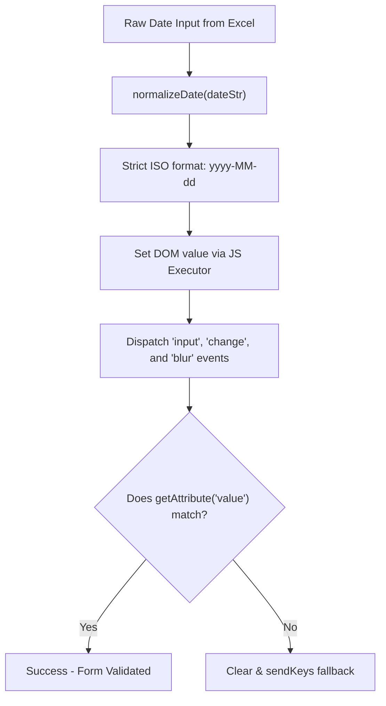

# 16. Troubleshooting and Common Errors

## Overview

In an automation interview, one of the most effective ways to prove you wrote real code and worked on a real project is discussing the **actual bugs, exceptions, and technical roadblocks you encountered and resolved**.

Anyone can recite definitions from a textbook. But explaining why an Angular date input typed a 5-digit year, why an element click was intercepted by a backdrop overlay, or how you diagnosed an asynchronous DOM hydration issue proves hands-on expertise.

This document details the real technical challenges solved in the **TrainMate Automation Project**, their root causes, and our exact code fixes.

---

## 1. Challenge 1: The 5-Digit Year Issue in HTML5 Date Pickers

### The Problem
When automated tests entered dates into Cohort creation, Schedule editing, or Trainer availability forms, the web application rejected the values or recorded corrupt dates such as `0202-06-12` or `20263-02-15` (5-digit or 6-digit years).

```
Expected: 2026-03-15
Browser Input Received: 0202-60-31 or 20260-03-15
Result: Form submission failed with "Please enter a valid date" validation error.
```

### The Root Cause
1. **HTML5 `<input type="date">` Behavior:** Modern browsers format date pickers according to the operating system's locale (e.g., `MM/dd/yyyy` in the US, `dd/MM/yyyy` in India/UK), but the underlying DOM standard requires ISO format: `YYYY-MM-DD`.
2. **Selenium `sendKeys()` Flaw:** Calling `element.sendKeys("2026-03-15")` sends keystrokes sequentially. If the browser's date mask expects day first, typing `2` goes into Day, `0` goes into Day (overwriting), `2` goes into Month, and `6` cascades into Year. When concatenated with default placeholder digits, years like `20263` were created.
3. **Excel Cell Formatting:** In Excel, date cells often store underlying numeric serial doubles (e.g., `45729.0`). Naive `cell.toString()` or string concatenation produced floating-point strings like `45729.0` instead of date text.

### The Solution: `BasePage.enterDate()`

We engineered a dual-action date entry engine in [`BasePage.java`](file:///c:/Users/nihar/ideaprojects/trainmate-test-1/src/main/java/base/BasePage.java#L110-L150):

```java
public void enterDate(By locator, String dateStr) {
    WebElement element = waitForVisibility(locator);
    
    // Step 1: Normalize date string into strict ISO yyyy-MM-dd format
    String normalizedDate = normalizeDate(dateStr);
    
    // Step 2: Use JavaScript to set the DOM property directly
    JavascriptExecutor js = (JavascriptExecutor) driver;
    js.executeScript(
        "arguments[0].value = arguments[1];" +
        "arguments[0].dispatchEvent(new Event('input', { bubbles: true }));" +
        "arguments[0].dispatchEvent(new Event('change', { bubbles: true }));" +
        "arguments[0].dispatchEvent(new Event('blur', { bubbles: true }));",
        element, normalizedDate
    );
    
    // Step 3: Verification fallback - check if DOM accepted the value
    String actualValue = element.getAttribute("value");
    if (!normalizedDate.equals(actualValue)) {
        // Fallback: clear and sendKeys with arrow navigation if JS was blocked
        element.clear();
        element.sendKeys(normalizedDate);
    }
}
```



### How to Explain This in an Interview:
> *"When automating date fields in HTML5 forms, using Selenium's standard `sendKeys()` is notoriously unreliable because browser date masks interpret keystrokes according to client locale, causing year truncation or 5-digit years. We solved this in `BasePage.enterDate()` by normalizing the input to `yyyy-MM-dd` and setting the DOM `value` property directly using `JavascriptExecutor`, followed by dispatching synthetic `input`, `change`, and `blur` events so Angular's reactive form controls update their internal validation state immediately."*

---

## 2. Challenge 2: `ElementClickInterceptedException` (Overlays & Spinners)

### The Problem
During workflow execution (e.g., clicking "Save Cohort" or "Assign Trainer"), Selenium threw:
```text
org.openqa.selenium.ElementClickInterceptedException: element click intercepted: 
Element <button class="btn btn-primary">Save</button> is not clickable at point (850, 420). 
Other element would receive the click: <div class="cdk-overlay-backdrop"></div>
```

### The Root Cause
1. TrainMate is built on Angular with Material / Tailwind components. When forms open or submit, a translucent modal backdrop or loading spinner overlay is added to the DOM.
2. Selenium's native `element.click()` calculates the exact center coordinates of the target element. If a transparent backdrop overlay sits even 1 pixel above the button in the CSS z-index stack, Selenium halts the action to protect test integrity.

### The Solution: `BasePage.clickElement()` with Fallback

In [`BasePage.java`](file:///c:/Users/nihar/ideaprojects/trainmate-test-1/src/main/java/base/BasePage.java#L80-L105):

```java
public void clickElement(By locator) {
    try {
        // First attempt: Standard Selenium clickable wait and native click
        WebElement element = waitForClickable(locator);
        element.click();
    } catch (ElementClickInterceptedException | TimeoutException e) {
        log.warn("Standard click intercepted for locator {}. Attempting JS fallback.", locator);
        try {
            WebElement element = driver.findElement(locator);
            ((JavascriptExecutor) driver).executeScript("arguments[0].scrollIntoView({block: 'center'});", element);
            ((JavascriptExecutor) driver).executeScript("arguments[0].click();", element);
        } catch (Exception ex) {
            log.error("JS click fallback also failed for locator: {}", locator, ex);
            captureDiagnostics("clickFailure_" + locator.toString());
            throw ex;
        }
    }
}
```

### How to Explain This in an Interview:
> *"In Angular Single Page Applications, temporary backdrop overlays or animation transitions often intercept native Selenium click coordinates. In our `BasePage.clickElement()`, we first attempt a standard user click with `ExpectedConditions.elementToBeClickable()`. If an `ElementClickInterceptedException` is thrown, our catch block scrolls the element into the viewport center and triggers a direct DOM click via `arguments[0].click()`. If that also fails, it triggers our `captureDiagnostics()` method to log the active DOM state and capture a screenshot."*

---

## 3. Challenge 3: Asynchronous Lazy Loading and Dynamic Locators

### The Problem
When opening Admin or Coach Cohort pages, tests failed with:
```text
org.openqa.selenium.TimeoutException: Expected condition failed: 
waiting for visibility of element located by By.cssSelector: input[placeholder*='Search code']
```

### The Root Cause
1. **Lazy-Loaded Route Chunks:** TrainMate loads routes asynchronously (e.g., chunk `chunk-LNZ2M7KH.js` for Admin Cohorts and `chunk-JERLPMXT.js` for Admin Trainers). When Selenium navigates to `/admin/cohorts`, the browser URL changes immediately, but the Angular JavaScript bundle takes 500–1200ms to download, parse, and render the form.
2. **Dynamic Locators / Placeholder Mismatches:** The placeholder text in the production build had changed slightly from `"Search code"` to `"Search by cohort code..."`, causing static selectors to fail.

### The Solution
1. **Inspected Production Bundles:** We fetched the exact component templates from the production JavaScript chunks to identify reliable CSS classes and HTML attributes.
2. **Added URL and Container State Synchronization:** Before searching for child elements, we ensured the parent view container had completed hydration.

```java
// Synchronize on route load and container element
public void navigateToAdminCohorts() {
    clickElement(adminCohortsNavLink);
    waitForUrlContains("/admin/cohorts");
    waitForVisibility(By.cssSelector("div.cohorts-table-container, table.cohorts-table"));
}
```

3. **Multi-Strategy Locators:** We updated selectors to use resilient CSS and XPath expressions that don't depend on fragile exact string matching:
```java
// Resilient selector using attribute containment
private By cohortSearchInput = By.cssSelector("input[placeholder*='Search'], input[type='search']");
```

---

## 4. Challenge 4: Excel Numeric Cell vs String Formatting in Apache POI

### The Problem
When reading phone numbers, user IDs, or dates from `testdata.xlsx`, tests failed with:
```text
java.lang.IllegalStateException: Cannot get a STRING value from a NUMERIC cell
```
Or user IDs like `101` were read as `101.0`.

### The Root Cause
Apache POI classifies any cell containing numbers as `CellType.NUMERIC`. Calling `cell.getStringCellValue()` directly on a numeric cell throws an exception. Furthermore, Java represents numeric cells as `double`, turning integers into `101.0`.

### The Solution: `ExcelUtils.getCellValueAsString()`

In [`ExcelUtils.java`](file:///c:/Users/nihar/ideaprojects/trainmate-test-1/src/main/java/utils/ExcelUtils.java#L65-L105):

```java
public static String getCellValueAsString(Cell cell) {
    if (cell == null) {
        return "";
    }
    
    switch (cell.getCellType()) {
        case STRING:
            return cell.getStringCellValue().trim();
            
        case NUMERIC:
            if (DateUtil.isCellDateFormatted(cell)) {
                // Format Excel date to ISO yyyy-MM-dd
                SimpleDateFormat sdf = new SimpleDateFormat("yyyy-MM-dd");
                return sdf.format(cell.getDateCellValue());
            } else {
                // Format numbers without unnecessary trailing decimal zeros
                double numValue = cell.getNumericCellValue();
                if (numValue == Math.floor(numValue)) {
                    return String.valueOf((long) numValue);
                } else {
                    return String.valueOf(numValue);
                }
            }
            
        case BOOLEAN:
            return String.valueOf(cell.getBooleanCellValue());
            
        case FORMULA:
            FormulaEvaluator evaluator = cell.getSheet().getWorkbook().getCreationHelper().createFormulaEvaluator();
            CellValue cellValue = evaluator.evaluate(cell);
            return cellValue.formatAsString();
            
        case BLANK:
        default:
            return "";
    }
}
```

---

## 5. Challenge 5: `StaleElementReferenceException` on Dynamic Grid Updates

### The Problem
During Trainer allocation tests, when a search filter was typed into the table header, the test attempted to click the first search result row and threw:
```text
org.openqa.selenium.StaleElementReferenceException: stale element reference: 
element is not attached to the page document
```

### The Root Cause
When the user types into an Angular search box, Angular disposes of the old `<tr>` elements and creates new DOM nodes for the filtered results. If Selenium captures a reference to row 1 before the AJAX filter response completes, that reference becomes **stale** the moment Angular replaces the DOM subtree.

### The Solution
Instead of storing elements in variables across search actions, we re-query elements dynamically after waiting for table staleness or DOM refresh:

```java
public void clickFirstFilteredRow(String searchText) {
    // 1. Enter search term
    typeText(searchInput, searchText);
    
    // 2. Wait for table to refresh (wait for old rows to detach or new data to load)
    waitForCondition(driver -> {
        List<WebElement> rows = driver.findElements(By.cssSelector("table tbody tr"));
        return !rows.isEmpty() && rows.get(0).getText().contains(searchText);
    });
    
    // 3. Freshly locate and click the updated element
    clickElement(By.cssSelector("table tbody tr:first-child button.action-btn"));
}
```

---

## 6. Challenge 6: Thread Safety & Driver Leaks in Parallel Execution

### The Problem
During parallel test runs, multiple tests attempted to send commands to the same browser window, causing `NoSuchSessionException` or tests interfering with each other's cookies and sessions.

### The Root Cause
Using a plain `public static WebDriver driver;` means all concurrent threads share a single driver instance. Thread A's navigation overwrites Thread B's page state.

### The Solution: `ThreadLocal<WebDriver>` in `DriverFactory`

```java
public class DriverFactory {
    private static final ThreadLocal<WebDriver> driverThreadLocal = new ThreadLocal<>();

    public static WebDriver getDriver() {
        return driverThreadLocal.get();
    }

    public static void setDriver(WebDriver driver) {
        driverThreadLocal.set(driver);
    }

    public static void quitDriver() {
        WebDriver driver = driverThreadLocal.get();
        if (driver != null) {
            driver.quit();
            driverThreadLocal.remove(); // CRITICAL: Prevents memory leaks
        }
    }
}
```

> [!IMPORTANT]
> Always call `driverThreadLocal.remove()` inside `quitDriver()`. In thread-pooled environments (like Maven Surefire or Jenkins worker nodes), threads are reused. If you don't call `.remove()`, dead driver references persist in memory, leading to severe memory leaks and unpredictable behavior.

---

## 7. Fast Diagnostic Matrix for Interviewers

Keep this table in your memory. If the interviewer asks: *"What exception do you see most often and how do you fix it?"*, pick any row below:

| Exception | Common Cause | Exact Solution in Our Framework |
|---|---|---|
| `TimeoutException` | Element took longer than 10s to appear | Verify selector with DevTools; check if parent container or route is still loading; ensure explicit wait condition matches state. |
| `NoSuchElementException` | Element not in DOM or iframe/shadow DOM issue | Confirm iframe context; inspect for dynamic ID changes; check if page redirected to an error page. |
| `ElementClickInterceptedException` | Modal backdrop, spinner, or sticky header | Use `BasePage.clickElement()` JS executor fallback (`arguments[0].click()`). |
| `StaleElementReferenceException` | Angular/React destroyed and recreated the DOM node | Re-locate the element immediately prior to action instead of caching the `WebElement`. |
| `IllegalStateException` (POI) | Reading numeric/date cell with `getStringCellValue()` | Use `ExcelUtils.getCellValueAsString()` with `CellType` switch statement. |
| `NullPointerException` (Driver) | Accessing driver before initialization or after quit | Ensure test inherits `BaseTest` and invokes `DriverFactory.getDriver()` cleanly. |
| Corrupt Date / 5-Digit Year | Browser date mask mismatch with `sendKeys()` | Use `BasePage.enterDate()` to set ISO `yyyy-MM-dd` via JavaScript with synthetic event dispatch. |
