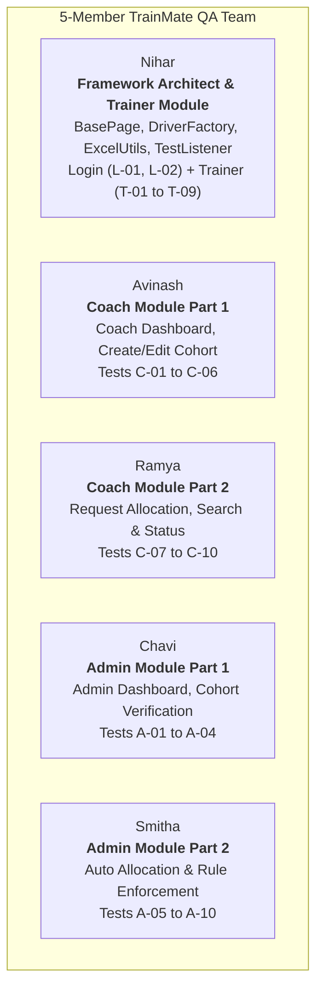

# 17. Revision Notes and Cheat Sheet

## Overview

This is your **high-yield, 10-minute cheat sheet**. Review this document right before your interview to keep all vital project metrics, class names, architectural decisions, and key technical answers fresh in your mind.

---

## 1. Project at a Glance (The Key Numbers)

Memorize these key numbers. They demonstrate immediate authority when speaking about your project:

| Metric | Exact Number | Context / Detail |
|---|---|---|
| **Application Name** | TrainMate | Cohort & Trainer Automatic Allocation System |
| **Application URL** | `https://train-mate-blond.vercel.app/` | Angular SPA hosted on Vercel |
| **Total Test Cases** | **37 Automated Tests** | 2 Login + 12 Coach + 9 Trainer + 14 Admin |
| **Team Size** | **5 Engineers** | Nihar, Avinash, Ramya, Chavi, Smitha |
| **Page Objects** | **10 Classes** | `pages.*` package implementing Page Object Model |
| **Test Workflows** | **4 Test Classes** | `LoginWorkflowTest`, `CoachWorkflowTest`, `TrainerWorkflowTest`, `AdminWorkflowTest` |
| **Excel Data Sheets** | **13 Worksheets** | Located in `src/test/resources/testdata.xlsx` |
| **Explicit Wait Timeout** | **10 Seconds** | Standard timeout across all `BasePage` methods |
| **Selenium Version** | **4.21.0** | Native Chrome/Firefox/Edge DevTools support |
| **Java Version** | **Java 17 (LTS)** | Modern Java features, records, enhanced switches |
| **TestNG Version** | **7.10.2** | Test orchestration, data providers, listeners |
| **Apache POI Version** | **5.2.5** | Excel reading via XSSFWorkbook & XSSFSheet |
| **ExtentReports Version** | **5.1.1** | Rich HTML reporting with embedded screenshots |
| **Log4j2 Version** | **2.23.1** | Thread-safe logging to console and rolling files |

---

## 2. Framework Architecture in 6 Sentences

1. **Design Pattern:** We implemented the **Page Object Model (POM)** to separate UI locators and user actions from test assertion logic.
2. **Driver Lifecycle:** `DriverFactory` manages browser sessions using a thread-safe `ThreadLocal<WebDriver>`, allowing parallel execution without state contamination.
3. **Synchronization:** We rely on explicit waits via `WebDriverWait` (10s) in `BasePage` and eliminated brittle `Thread.sleep()` calls.
4. **Data-Driven Engine:** Apache POI reads external test data from `testdata.xlsx` into `Map<String, String>` structures fed through TestNG `@DataProvider`.
5. **Execution Reporting:** `TestListener` implements TestNG's `ITestListener` to generate `ExtentReport.html` and automatically captures screenshots on failure via `ScreenshotUtils`.
6. **Build Automation:** Maven coordinates dependencies and plugins (`maven-surefire-plugin`) to trigger suites through `testng.xml` from the command line or CI/CD pipelines.

---

## 3. Team Member Work Split (Who Built What)



---

## 4. Key Code Snippets to Memorize

### 1. ThreadLocal Driver Management (`DriverFactory.java`)
```java
public class DriverFactory {
    private static final ThreadLocal<WebDriver> driverThreadLocal = new ThreadLocal<>();

    public static WebDriver getDriver() {
        return driverThreadLocal.get();
    }

    public static void setDriver(WebDriver driver) {
        driverThreadLocal.set(driver);
    }

    public static void quitDriver() {
        WebDriver driver = driverThreadLocal.get();
        if (driver != null) {
            driver.quit();
            driverThreadLocal.remove(); // Prevent thread pool memory leaks
        }
    }
}
```

### 2. Resilient Click with JS Fallback (`BasePage.java`)
```java
public void clickElement(By locator) {
    try {
        waitForClickable(locator).click();
    } catch (ElementClickInterceptedException | TimeoutException e) {
        WebElement element = driver.findElement(locator);
        ((JavascriptExecutor) driver).executeScript("arguments[0].scrollIntoView({block: 'center'});", element);
        ((JavascriptExecutor) driver).executeScript("arguments[0].click();", element);
    }
}
```

### 3. HTML5 Date Picker Injection (`BasePage.java`)
```java
public void enterDate(By locator, String dateStr) {
    WebElement element = waitForVisibility(locator);
    String normalized = normalizeDate(dateStr); // yyyy-MM-dd
    JavascriptExecutor js = (JavascriptExecutor) driver;
    js.executeScript(
        "arguments[0].value = arguments[1];" +
        "arguments[0].dispatchEvent(new Event('input', { bubbles: true }));" +
        "arguments[0].dispatchEvent(new Event('change', { bubbles: true }));" +
        "arguments[0].dispatchEvent(new Event('blur', { bubbles: true }));",
        element, normalized
    );
}
```

### 4. Excel Data to Map (`ExcelUtils.java`)
```java
public static Object[][] getSheetData(String sheetName) {
    Sheet sheet = workbook.getSheet(sheetName);
    int rowCount = sheet.getPhysicalNumberOfRows();
    Row headerRow = sheet.getRow(0);
    int colCount = headerRow.getPhysicalNumberOfCells();

    Object[][] data = new Object[rowCount - 1][1];
    for (int i = 1; i < rowCount; i++) {
        Row row = sheet.getRow(i);
        Map<String, String> rowMap = new LinkedHashMap<>();
        for (int j = 0; j < colCount; j++) {
            String key = getCellValueAsString(headerRow.getCell(j));
            String value = getCellValueAsString(row.getCell(j));
            rowMap.put(key, value);
        }
        data[i - 1][0] = rowMap;
    }
    return data;
}
```

---

## 5. Essential TestNG Annotations Used

| Annotation | Placement | Purpose in TrainMate |
|---|---|---|
| `@BeforeSuite` | `BaseTest` | Initialize ExtentReports and load global properties. |
| `@BeforeMethod` | `BaseTest` | Initialize browser session (`DriverFactory.initDriver()`), maximize window, navigate to base URL. |
| `@AfterMethod` | `BaseTest` | Capture screenshot if failed; clean up driver via `DriverFactory.quitDriver()`. |
| `@AfterSuite` | `BaseTest` | Flush ExtentReports via `extent.flush()` and finalize log files. |
| `@Test` | Test Methods | Mark test execution, assign `priority`, `groups`, or `dataProvider`. |
| `@DataProvider` | Test Classes | Feeds row-by-row Excel test data from `ExcelUtils`. |
| `@Listeners` | `testng.xml` | Connects `TestListener.java` to test execution events. |

---

## 6. Essential Maven CLI Commands

```bash
# Compile project and verify no syntax errors
mvn clean test-compile

# Run complete test suite defined in testng.xml
mvn clean test

# Run a single test class
mvn test -Dtest=TrainerWorkflowTest

# Run a single test method
mvn test -Dtest=TrainerWorkflowTest#testT01_TrainerLoginAndDashboardSummary

# Run tests headlessly in CI
mvn test -Dheadless=true
```

---

## 7. 20 Rapid-Fire Interview Questions & Answers

1. **Q: What is the main design pattern in your project?**  
   *A: Page Object Model (POM), separating UI locators and interactions from test logic.*
2. **Q: How do you handle multi-threading and parallel execution?**  
   *A: Using `ThreadLocal<WebDriver>` in `DriverFactory` to give each thread its own isolated browser session.*
3. **Q: Why don't you use `Thread.sleep()`?**  
   *A: It wastes time and creates brittle tests. We use explicit waits (`WebDriverWait`) that dynamically poll every 500ms until expected conditions are met.*
4. **Q: How do you handle `ElementClickInterceptedException`?**  
   *A: We catch it in `BasePage.clickElement()`, scroll the element into view, and dispatch a JavaScript click via `arguments[0].click()`.*
5. **Q: How do you enter dates into Angular HTML5 date inputs?**  
   *A: We normalize dates to ISO `yyyy-MM-dd` and inject them using JavaScript while dispatching `input`, `change`, and `blur` events so Angular form validation fires.*
6. **Q: How is test data managed?**  
   *A: Externalized in `src/test/resources/testdata.xlsx` across 13 sheets and loaded via Apache POI into `Map<String, String>` structures.*
7. **Q: How do you handle Excel numeric cells vs string cells in POI?**  
   *A: Our `ExcelUtils.getCellValueAsString()` checks `CellType`. If numeric, it uses `DateUtil.isCellDateFormatted()` for dates, or formats whole numbers as longs to prevent `.0` decimals.*
8. **Q: How do you generate reports?**  
   *A: We use ExtentReports 5.1.1 configured via `TestListener` (`ITestListener`). It generates `test-output/ExtentReport.html` with pass/fail charts and failure screenshots.*
9. **Q: When is a screenshot taken?**  
   *A: Automatically in `TestListener.onTestFailure()` and attached directly to the Extent test report.*
10. **Q: How do you pass browser choice dynamically?**  
    *A: We pass `-Dbrowser=firefox` via Maven CLI, which `ConfigReader` or `DriverFactory` reads using `System.getProperty("browser", defaultVal)`.*
11. **Q: What logging library do you use?**  
    *A: Log4j2 (`org.apache.logging.log4j`), logging to both the console and daily rolling log files in `logs/automation.log`.*
12. **Q: How do you verify successful login?**  
    *A: By asserting both that the current URL contains the target dashboard path (e.g., `/trainer/dashboard`) and that a key page element (like the welcome banner) is visible.*
13. **Q: What is the purpose of `BaseTest`?**  
    *A: It provides standard setup (`@BeforeMethod`) and teardown (`@AfterMethod`) logic for all test classes, ensuring consistent browser initialization and cleanup.*
14. **Q: What is the purpose of `BasePage`?**  
    *A: It is the superclass of all page objects containing reusable wrapper methods (`clickElement`, `typeText`, `waitForVisibility`, `enterDate`, `captureDiagnostics`).*
15. **Q: What is `captureDiagnostics()`?**  
    *A: A custom helper in `BasePage` that captures the current URL, DOM title, browser console logs, and a screenshot whenever an action fails.*
16. **Q: Why call `driverThreadLocal.remove()` in `quitDriver()`?**  
    *A: In thread pools, threads are reused. If you don't call `.remove()`, dead driver references remain in memory, causing memory leaks.*
17. **Q: How does TrainMate allocate trainers?**  
    *A: The Coach requests allocation with tech stack and date requirements, and the Admin executes auto-allocation based on trainer availability and skills.*
18. **Q: How many test cases are automated?**  
    *A: Exactly 37 test cases: 2 Login, 12 Coach, 9 Trainer, and 14 Admin.*
19. **Q: What user roles exist in TrainMate?**  
    *A: Three roles: Coach (creates cohorts, requests allocation), Trainer (views assigned cohorts, updates status), and Admin (manages allocations, enforces rules).*
20. **Q: How do you run the suite in CI/CD?**  
    *A: Using `mvn clean test -Dheadless=true` triggered by Jenkins or GitHub Actions pipelines.*

---

## 8. 10-Minute Pre-Interview Confidence Ritual

Follow these steps 10 minutes before joining your interview call:

1. **Step 1 (Breathe & Review):** Read Section 1 (Project at a Glance) and Section 3 (Team Member Work Split).
2. **Step 2 (Script Practice):** Whisper your 1-minute elevator pitch from [Document 02](file:///c:/Users/nihar/ideaprojects/trainmate-test-1/docs/interview-preparation/02_Project_Presentation_Script.md) out loud once.
3. **Step 3 (Recall Challenges):** Remember the two biggest challenges you solved: **HTML5 5-digit date formatting** and **backdrop overlay click interception**.
4. **Step 4 (Setup Check):** Make sure IntelliJ is open, `trainmate-test-1` is loaded, and `ExtentReport.html` is ready to open in Chrome if asked.
5. **Step 5 (Mindset):** Remember that you know this framework inside and out. Speak calmly, focus on how your code solves real problems, and you will do great!
