# 19. Complete TrainMate Project Interview Handbook

## Master Handbook Overview

Welcome to the **Complete TrainMate Project Interview Handbook**. This document consolidates the complete architectural knowledge, design patterns, testing strategies, code references, and interview defense scripts into one unified master guide.

Whether you have two weeks or two hours before your interview, reading this handbook provides everything you need to confidently represent yourself as an experienced Selenium Automation Engineer who designed, automated, debugged, and verified the **TrainMate Automation Framework**.

---

## 1. Executive Summary & Elevator Pitch

### What is TrainMate?
**TrainMate** is a web-based **Cohort & Trainer Automatic Allocation System** designed for enterprise learning and development organizations. It eliminates manual scheduling bottlenecks by automatically matching training cohorts with qualified, available corporate trainers based on skill taxonomy, date availability, and maximum weekly bandwidth rules.

### Your 1-Minute Project Pitch (Memorize This)
> *"For our project, we automated **TrainMate**, an enterprise single-page application built on Angular and hosted on Vercel that manages trainer allocation across three distinct roles: Coach, Trainer, and Admin.*
>
> *I helped architect a production-ready automation framework using **Java 17, Selenium 4.21, TestNG 7.10, Apache POI 5.2, ExtentReports 5.1, and Maven**. We implemented the **Page Object Model** across 10 page classes, externalized test data into 13 Excel worksheets, managed browser sessions with **ThreadLocal WebDriver** in `DriverFactory`, and eliminated test flakiness by engineering resilient explicit waits with JavaScript execution fallbacks in `BasePage`.*
>
> *Our regression suite covers **37 end-to-end test cases**, generates interactive HTML reports with failure screenshots, logs asynchronously using Log4j2, and executes seamlessly in headless mode for CI/CD pipelines."*

---

## 2. Complete Technology Stack Reference

| Layer / Role | Technology Selected | Version | Why Selected Over Alternatives |
|---|---|---|---|
| **Programming Language** | Java (LTS) | `17.0.x` | Industry gold standard; strong static typing, records, and LTS enterprise stability. |
| **Automation Engine** | Selenium WebDriver | `4.21.0` | Native W3C WebDriver standardization; bidirectional DevTools support; no third-party bridge. |
| **Test Runner & Assertions** | TestNG | `7.10.2` | Superior test orchestration, suite XML control, `@DataProvider`, and listener hooks compared to JUnit 5. |
| **Build & Dependency Tool** | Apache Maven | `3.9.x` | Declarative dependency management and industry-standard CI plugin (`maven-surefire-plugin`). |
| **Data-Driven Engine** | Apache POI | `5.2.5` | Native parsing of `.xlsx` OpenXML workbooks for clean separation of test logic from data. |
| **Execution Reporting** | ExtentReports | `5.1.1` | Rich, executive-ready HTML dashboards with pass/fail charts and embedded failure screenshots. |
| **Enterprise Logging** | Apache Log4j2 | `2.23.1` | High-performance asynchronous logging to console and rolling daily log files. |

---

## 3. High-Level Framework Architecture

```mermaid
flowchart TD
    subgraph TestNG_Maven ["Test Orchestration & Execution"]
        POM["pom.xml / Maven Surefire"] --> TNG["testng.xml Suite"]
        TNG --> LIST["listeners.TestListener (ITestListener)"]
    end

    subgraph Tests ["Test Layer (src/test/java)"]
        TNG --> BT["base.BaseTest (@BeforeMethod / @AfterMethod)"]
        BT --> LWT["LoginWorkflowTest (2 Tests)"]
        BT --> CWT["CoachWorkflowTest (12 Tests)"]
        BT --> TWT["TrainerWorkflowTest (9 Tests)"]
        BT --> AWT["AdminWorkflowTest (14 Tests)"]
    end

    subgraph Data ["Data Layer"]
        EXCEL["testdata.xlsx (13 Sheets)"] --> POI["utils.ExcelUtils"]
        CONFIG["config.properties"] --> CR["utils.ConfigReader"]
        POI --> Tests
        CR --> BT
    end

    subgraph FrameworkCore ["Core Engine (src/main/java)"]
        DF["driver.DriverFactory<br>(ThreadLocal WebDriver)"]
        BP["base.BasePage<br>(Explicit Waits, JS Fallbacks, Date Engine)"]
    end

    subgraph Pages ["Page Object Layer (10 Page Classes)"]
        BP --> P1["LoginPage"]
        BP --> P2["CoachDashboardPage"]
        BP --> P3["CreateCohortPage"]
        BP --> P4["EditCohortPage"]
        BP --> P5["RequestAllocationPage"]
        BP --> P6["CoachCohortsPage"]
        BP --> P7["TrainerDashboardPage"]
        BP --> P8["TrainerCohortsPage"]
        BP --> P9["AdminDashboardPage"]
        BP --> P10["AdminCohortsPage"]
    end

    subgraph Reporting ["Reporting & Diagnostics"]
        LIST --> EXT["test-output/ExtentReport.html"]
        LIST --> SCR["utils.ScreenshotUtils (target/screenshots/)"]
        Tests --> LOG["logs/automation.log (Log4j2)"]
    end

    Tests --> Pages
    BT --> DF
```

---

## 4. End-to-End Execution Flow (10 Distinct Steps)

1. **Trigger:** User runs `mvn clean test` from CLI or right-clicks `testng.xml` in IntelliJ IDEA.
2. **Configuration:** `ConfigReader` loads `src/test/resources/config.properties`, applying CLI overrides (`-Dbrowser=chrome`).
3. **Suite Initialization:** `TestListener.onStart()` initializes `ExtentSparkReporter` and configures report metadata.
4. **Data Loading:** `@DataProvider` methods invoke `ExcelUtils.getSheetData()` to cache rows from `testdata.xlsx` into memory as `Map<String, String>`.
5. **Session Spawning:** `@BeforeMethod` in `BaseTest` calls `DriverFactory.initDriver()`, setting an isolated browser session into `ThreadLocal<WebDriver>`.
6. **Window & Navigation:** Browser window is maximized; driver navigates to target base URL (`https://train-mate-blond.vercel.app/`).
7. **Page Object Interaction:** Test delegates user actions (`clickElement()`, `typeText()`, `enterDate()`) to Page Objects inheriting `BasePage`.
8. **Synchronization:** `BasePage` ensures all elements are visible and interactable using `WebDriverWait` (10s) with JavaScript fallbacks.
9. **Assertion & Verification:** TestNG assertions (`Assert.assertEquals()`, `Assert.assertTrue()`) validate UI responses, route changes, or database badge statuses.
10. **Teardown & Flush:** `@AfterMethod` invokes `DriverFactory.quitDriver()` and removes the thread reference. `TestListener.onFinish()` flushes `ExtentReport.html`.

---

## 5. Requirements Traceability Matrix (37 Tests Across 5 Stories)

| Story ID | User Story Title | Test ID Range | Total Tests | Role | Primary Owner |
|---|---|---|---|---|---|
| **US-01** | User Authentication & Role Redirection | `L-01` to `L-02` | 2 Tests | All Roles | Nihar |
| **US-02** | Coach Cohort Management & Allocation | `C-01` to `C-10` | 12 Tests | Coach | Avinash (C1–C6) & Ramya (C7–C10) |
| **US-03** | Trainer Cohort Acceptance & Scheduling | `T-01` to `T-09` | 9 Tests | Trainer | Nihar |
| **US-04** | Admin Cohort & Trainer Governance | `A-01` to `A-04` | 5 Tests | Admin | Chavi |
| **US-05** | Admin Automatic Allocation Engine & Rules | `A-05` to `A-10` | 9 Tests | Admin | Smitha |

---

## 6. Individual Team Member Contributions

### 1. Nihar — Framework Architect & Trainer Module Lead
- **Architecture:** Engineered `DriverFactory` (ThreadLocal), `BasePage` (explicit waits & JS fallbacks), `ExcelUtils` (Apache POI), and `TestListener` (ExtentReports 5.1).
- **Workflows:** Built `LoginWorkflowTest` (`L-01`, `L-02`) and `TrainerWorkflowTest` (`T-01` to `T-09`).
- **Page Objects:** `LoginPage.java`, `TrainerDashboardPage.java`, `TrainerCohortsPage.java`.

### 2. Avinash — Coach Module Part 1 Lead
- **Workflows:** Built Coach Cohort Creation and Modification (`C-01` to `C-06`, including `C-03b`).
- **Page Objects:** `CoachDashboardPage.java`, `CreateCohortPage.java`, `EditCohortPage.java`.
- **Specialty:** Solved single-page form validation and dynamic date picker entry for cohort schedules.

### 3. Ramya — Coach Module Part 2 Lead
- **Workflows:** Built Coach Allocation Requests and Status Tracking (`C-07` to `C-10`, including `C-07b`).
- **Page Objects:** `RequestAllocationPage.java`, `CoachCohortsPage.java`.
- **Specialty:** Automated skill multi-select tags, allocation slot count validation, and cohort search filters.

### 4. Chavi — Admin Module Part 1 Lead
- **Workflows:** Built Admin Dashboard and Cohort Oversight (`A-01` to `A-04`, including `A-03b`, `A-03c`).
- **Page Objects:** `AdminDashboardPage.java`, `AdminCohortsPage.java`.
- **Specialty:** Automated global service-line dropdown filters, cohort search pagination, and metric KPI card assertions.

### 5. Smitha — Admin Module Part 2 Lead
- **Workflows:** Built Admin Allocation Engine and Rule Enforcement (`A-05` to `A-10`, including `A-05b`, `A-07b`).
- **Page Objects:** `AdminCohortsPage.java` (Modal & Allocation Extensions).
- **Specialty:** Automated multi-rule allocation validation (preventing trainer double-booking and enforcing skill matching).

---

## 7. The Three Biggest Technical Challenges & Solutions

### Challenge 1: The 5-Digit HTML5 Date Picker Bug
* **Symptom:** Entering dates with `sendKeys("2026-03-15")` produced corrupted years like `20263-02-15` or `0202-06-12`.
* **Root Cause:** Standard Selenium `sendKeys()` sends individual keystrokes that collide with browser locale-specific date masks.
* **Resolution:** Built `BasePage.enterDate()` which normalizes dates to strict ISO `yyyy-MM-dd` and sets the DOM `value` property directly using `JavascriptExecutor`, followed by dispatching synthetic `input`, `change`, and `blur` events so Angular form validation reacts immediately.

### Challenge 2: `ElementClickInterceptedException` (Backdrop Overlays)
* **Symptom:** Clicks on buttons were intercepted by Angular CDK backdrop overlays or modal transitions.
* **Root Cause:** Single-page application animation frames and translucent backdrop divs sat above target buttons in the z-index stack.
* **Resolution:** Engineered `BasePage.clickElement()` with a dynamic fallback: if a standard clickable wait fails, it scrolls the element to the viewport center and triggers an immediate DOM click via `arguments[0].click()`.

### Challenge 3: Apache POI Numeric vs String Type Conflicts
* **Symptom:** Calling `cell.getStringCellValue()` on user IDs or date cells threw `IllegalStateException: Cannot get a STRING value from a NUMERIC cell`.
* **Root Cause:** Excel stores numbers and dates internally as IEEE 754 floating-point doubles.
* **Resolution:** Built `ExcelUtils.getCellValueAsString()` using an exhaustive `switch (cell.getCellType())` with `DateUtil.isCellDateFormatted()` to parse dates into ISO strings and whole numbers as longs without `.0` decimals.

---

## 8. Master Interview Questions & Top Model Answers

### Q1: What makes your framework robust against test flakiness?
> *"We eliminated test flakiness at three key layers:*
> 1. *Explicit Synchronization:* We banned `Thread.sleep()` and standardized on explicit `WebDriverWait` polling every 500ms in `BasePage`.*
> 2. *Action Fallbacks:* Our `clickElement()` automatically recovers from intercepted clicks using JavaScript executor fallbacks.*
> 3. *Thread Isolation:* By wrapping WebDriver inside `ThreadLocal`, each test thread operates in complete isolation with zero shared mutable state.*

### Q2: Why did you choose Page Object Model (POM)?
> *"POM enforces clean separation of concerns. If a developer changes a button locator in the UI, we update it in exactly one place—the Page Object class. None of our test classes break, keeping maintenance costs minimal as the application evolves."*

### Q3: How do you support running tests in CI/CD pipelines?
> *"Our framework is fully integrated with Maven. In a CI pipeline like Jenkins or GitHub Actions, we run `mvn clean test -Dheadless=true`. The Maven Surefire plugin picks up `testng.xml`, executes tests headlessly in virtual displays, and generates JUnit XML and ExtentReports HTML artifacts for build reports."*

### Q4: How do you handle test failures in reports?
> *"Our `TestListener` implements `ITestListener`. When `onTestFailure()` triggers, it automatically invokes `ScreenshotUtils` to capture a full-resolution PNG of the screen, attaches the image to the test step in `ExtentReports`, and logs the full stack trace for immediate defect triage."*

---

## 9. 10-Minute Pre-Interview Confidence Checklist

| Check | Action | Status |
|---|---|---|
| $\square$ | Read Section 1 (Elevator Pitch) out loud twice. | Ready |
| $\square$ | Verify that you know your assigned module and test IDs by heart. | Ready |
| $\square$ | Review the 3 technical challenges in Section 7. | Ready |
| $\square$ | Have IntelliJ IDEA open with `trainmate-test-1` project loaded. | Ready |
| $\square$ | Verify that `test-output/ExtentReport.html` opens cleanly in Chrome. | Ready |

---

## 10. Final Word of Encouragement

You have an exceptional, production-grade automation framework. You understand the architecture, the code, the design decisions, and the real-world challenges you solved.

Speak clearly, explain the **why** behind each design choice, walk through the actual Java classes and methods, and you will give an outstanding performance in your interview!
