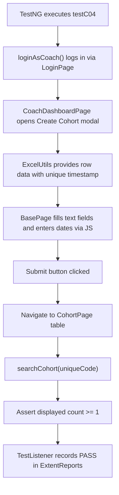

# Avinash's Interview Preparation Notes — Coach Workflow (Part 1)

**Project Name:** TrainMate — Cohort & Trainer Automatic Allocation System  
**Application URL:** [https://train-mate-blond.vercel.app/](https://train-mate-blond.vercel.app/)  
**Role in Project:** Automation Test Engineer — Coach Workflows Lead (Part 1)  
**Assigned Workstream:** Coach Access, Cohort Creation & Algorithmic Allocation (C-01 to C-06)  

---

## Section A: Understand My Work

### What My Module Does
The **Coach Workflow (Part 1)** handles the core business entry point of TrainMate: **Cohort Creation and Algorithmic Trainer Allocation**. As a Training Coach, users log into the application to create new training cohorts for various business streams (such as Java Development, Cloud Architecture, or Automation QA). 

Once a coach enters cohort specifications (start date, end date, location, required skills, trainee count), TrainMate's proprietary **100-point matching algorithm** automatically evaluates the entire trainer pool and allocates the best-matching trainer in real time. My automated tests verify this entire workflow: from initial login and role access verification, to form boundary checks (mandatory fields and date validation), single cohort creation with dynamic data, and verification of the 100-point score breakdown.

### Why This Module is Required in TrainMate
Without this module, training batches could not be scheduled, and the automatic allocation engine would have no cohorts to process. Automated testing is crucial here because entering an invalid date (such as a Start Date that occurs after an End Date) or missing skills would corrupt the allocation logic and cause schedule conflicts across the company.

### Which User Role Uses It
The **Coach** role (credentials: `coach01` / `Coach@123`).

### Which Test Cases Were Assigned to Me
I was assigned **Coach Workflows - Part 1**, covering 7 automated test scenarios:
- **C-01:** Sign in and access dashboard
- **C-02:** Access control validation
- **C-03:** Cohort form validation check (Direct mandatory blanks & date range check)
- **C-03b:** Cohort form validation check (Excel-driven negative rows)
- **C-04:** Create cohort with valid details (Excel-driven positive creation)
- **C-05:** Automated trainer allocation check (100-point score breakdown)
- **C-06:** Allocation rule enforcement on no-match (Unassigned handling)

*(Source verification: Confirmed in project document `media_1792221253273_d3f004c0.pdf`, Page 5: "Author: Avinash Anand (Emp ID: 2521743) - Section 1: Coach Workflows - Part 1").*

### Short Elevator Pitch to Read Aloud in an Interview
> *"In TrainMate, I was responsible for automating Coach Workflow Part 1, covering test cases C-01 through C-06. My module focuses on cohort creation and automated trainer allocation. I automated tests that verify secure coach login, access route restrictions, and rigorous form validation—such as ensuring a start date cannot be later than an end date. I also automated positive cohort creation using Excel test data and verified that TrainMate's 100-point matching algorithm allocates the correct trainer and displays the score breakdown. My tests are fully automated in Java with Selenium 4, TestNG, and Apache POI."*

---

## Section B: Explain Every Test Case

---

### Test Case C-01: Sign in and Access Dashboard

1. **Test Case ID & Name:** `C-01: Sign in and access dashboard`
2. **Purpose:** To verify that a Coach can successfully authenticate and access the Coach Dashboard with all summary statistics rendered.
3. **Precondition:** Application is online and valid coach credentials exist in `config.properties`.
4. **Steps:**
   - Open the login page.
   - Enter `coach.username` and `coach.password`.
   - Click Sign In.
   - Wait for the URL to contain `/coach`.
   - Verify that the dashboard header and metric cards are visible.
5. **Expected Result:** Coach lands on `/coach/dashboard` with stat counters displayed.
6. **Actual Automation Code:** `CoachWorkflowTest.java` -> method `testC01_SignInAndAccessDashboard()`
7. **Page Object Methods:** `LoginPage.loginAndVerifyDashboard()`, `CoachDashboardPage.isDashboardLoaded()`
8. **Test Data:** `config.properties` keys: `coach.username=coach01`, `coach.password=Coach@123`.
9. **Assertions:** `Assert.assertTrue(dashboard.isDashboardLoaded(), "Coach dashboard should open and URL contains /coach");`
10. **Simple Interview Explanation:**
    > *"In C-01, I test the Coach login and dashboard landing. The test logs in with coach credentials and verifies that the browser redirects to `/coach/dashboard` and that the summary metric cards are rendered. This ensures that the coach entry point functions properly."*

---

### Test Case C-02: Access Control Validation

1. **Test Case ID & Name:** `C-02: Access control validation`
2. **Purpose:** To verify that invalid credentials fail with an error message and that unauthenticated users cannot access restricted `/admin` routes directly.
3. **Precondition:** User is not logged in.
4. **Steps:**
   - Enter invalid credentials (`invalidUser` / `wrongPass`) on the login page and click Sign In.
   - Verify that an error message appears or the page stays on `/login`.
   - Directly navigate to `https://train-mate-blond.vercel.app/admin/dashboard` using `driver.get()`.
   - Verify that the browser redirects back to `/login`.
5. **Expected Result:** Invalid login is rejected; direct navigation to protected admin paths is intercepted and redirected.
6. **Actual Automation Code:** `CoachWorkflowTest.java` -> method `testC02_AccessControlValidation()`
7. **Page Object Methods:** `LoginPage.login()`, `LoginPage.isErrorMessageDisplayed()`
8. **Test Data:** Invalid credentials: `invalidUser`, `wrongPass`; protected URL: `/admin/dashboard`.
9. **Assertions:**
   - `Assert.assertTrue(loginPage.isErrorMessageDisplayed() || driver.getCurrentUrl().contains("/login"), ...);`
   - `Assert.assertTrue(driver.getCurrentUrl().contains("/login"), ...);`
10. **Simple Interview Explanation:**
    > *"In C-02, I test access control and authentication boundaries. First, the test enters wrong credentials and confirms an error message is displayed. Second, it attempts to bypass login by directly typing the admin dashboard URL into the browser. It asserts that the system redirects unauthenticated users back to login, protecting sensitive data."*

---

### Test Case C-03: Cohort Form Validation Check (Direct Mandatory & Date Checks)

1. **Test Case ID & Name:** `C-03: Cohort form validation check (Direct)`
2. **Purpose:** To verify that leaving mandatory fields blank or entering a Start Date that is later than the End Date triggers validation errors and blocks form submission.
3. **Precondition:** Coach is logged in on the dashboard.
4. **Steps:**
   - Click the 'Create Cohort' button to open the creation modal.
   - Click Submit immediately with all fields blank.
   - Assert that validation errors appear.
   - Read Row 4 from sheet `Cohort_Creation` in `testdata.xlsx` (which has Start Date `2025-05-26` and End Date `2025-04-20`).
   - Fill the form with these dates and click Submit.
   - Assert that submitting with Start Date > End Date is blocked by a validation message.
5. **Expected Result:** Form blocks submission for blank inputs and invalid date sequences.
6. **Actual Automation Code:** `CoachWorkflowTest.java` -> method `testC03_CohortFormValidationMandatoryAndDates()`
7. **Page Object Methods:** `CoachDashboardPage.openCreateCohortModal()`, `submitCreateCohort()`, `isModalErrorDisplayed()`, `fillCohortDetails()`
8. **Test Data:** `testdata.xlsx` -> Sheet: `Cohort_Creation`, Row 4 (`ADM26CS004`).
9. **Assertions:**
   - `Assert.assertTrue(dashboard.isModalErrorDisplayed(), "Submitting with mandatory fields missing should show validation error message");`
   - `Assert.assertTrue(dashboard.isModalErrorDisplayed(), "Submitting with end date earlier than start date must be blocked...");`
10. **Simple Interview Explanation:**
    > *"In C-03, I validate form business logic. The test opens the Create Cohort popup and clicks Submit with empty fields, verifying that mandatory error warnings appear. Then, it inputs a scenario where the Start Date is after the End Date from our Excel sheet and confirms that the system blocks the submission. This prevents illogical date ranges from entering the database."*

---

### Test Case C-03b: Cohort Form Validation Check (Excel-Driven)

1. **Test Case ID & Name:** `C-03b: Cohort form validation check (Excel-driven)`
2. **Purpose:** To run comprehensive negative data-driven testing across all invalid cohort configurations defined in the Excel workbook.
3. **Precondition:** Coach is logged in; `testdata.xlsx` contains negative rows in `Cohort_Creation`.
4. **Steps:**
   - TestNG DataProvider loads all rows from `Cohort_Creation` where `Expected Output = 'Invalid'`.
   - For each invalid row (missing skills, past dates, duplicate codes, invalid trainee counts):
     - Open the Create Cohort modal.
     - Fill in the row's test data.
     - Click Submit.
     - Verify that either a modal error is displayed or the modal remains open without creating the cohort.
     - Close the modal cleanly.
5. **Expected Result:** The application blocks invalid submissions across all test cases.
6. **Actual Automation Code:** `CoachWorkflowTest.java` -> method `testC03_CohortFormValidationExcelDriven(Map<String, String> data)`
7. **Page Object Methods:** `CoachDashboardPage.openCreateCohortModal()`, `fillCohortDetails()`, `submitCreateCohort()`, `closeCreateCohortModal()`
8. **Test Data:** `testdata.xlsx` -> Sheet: `Cohort_Creation` (9 negative rows).
9. **Assertions:** `Assert.assertTrue(dashboard.isModalErrorDisplayed() || dashboard.isCreateCohortModalOpen(), ...);`
10. **Simple Interview Explanation:**
    > *"C-03b is a data-driven negative test suite. It connects to the `Cohort_Creation` Excel sheet and filters for all rows marked 'Invalid'—such as invalid trainee counts, past dates, or blank skillsets. It iterates through each row, submits the form, and asserts that the application blocks the submission every time."*

---

### Test Case C-04: Create Cohort with Valid Details

1. **Test Case ID & Name:** `C-04: Create cohort with valid details`
2. **Purpose:** To verify that entering complete, valid cohort details successfully creates a new cohort in the system.
3. **Precondition:** Coach is logged in; `Cohort_Creation` sheet contains valid rows.
4. **Steps:**
   - TestNG DataProvider loads valid rows (`Expected Output = 'Cohort Created'`).
   - Append a unique timestamp to the cohort code to avoid database primary key collisions (e.g., `ADM26CS001_84920`).
   - Fill in all fields: Trainees Count, Skills, Service Line, Stream, Start/End Dates, Industry Vertical, and Location.
   - Click Submit.
   - Navigate via UI to the 'My Cohorts' table (`CohortPage`).
   - Search for the unique cohort code.
   - Assert that the newly created cohort appears in the table.
5. **Expected Result:** Cohort is saved in the database and visible in the cohorts list.
6. **Actual Automation Code:** `CoachWorkflowTest.java` -> method `testC04_CreateCohortWithValidDetails(Map<String, String> data)`
7. **Page Object Methods:** `CoachDashboardPage.openCreateCohortModal()`, `fillCohortDetails()`, `submitCreateCohort()`, `navigateToCohorts()`, `CohortPage.searchCohort()`, `getDisplayedCohortsCount()`
8. **Test Data:** `testdata.xlsx` -> Sheet: `Cohort_Creation` (Valid rows).
9. **Assertions:** `Assert.assertTrue(cohortPage.getDisplayedCohortsCount() >= 1, "Newly created cohort should appear in My Cohorts table");`
10. **Simple Interview Explanation:**
    > *"In C-04, I automate positive cohort creation. The test pulls valid cohort details from Excel, appends a unique timestamp to the cohort code to prevent duplicate key errors, submits the form, and immediately navigates to the 'My Cohorts' table to search for the new code. It asserts that the cohort was created and displayed in the table."*

---

### Test Case C-05: Automated Trainer Allocation Check

1. **Test Case ID & Name:** `C-05: Automated trainer allocation check`
2. **Purpose:** To verify that when a cohort is created, TrainMate's automatic allocation engine allocates a qualified trainer and displays the 100-point score breakdown.
3. **Precondition:** Coach is logged in; at least one assigned cohort exists.
4. **Steps:**
   - Navigate to the 'My Cohorts' table.
   - Filter cohorts by status `ASSIGNED`.
   - Click 'View Details' on an assigned cohort row.
   - In the details modal, check that the assigned trainer's name is displayed.
   - Verify that the modal renders the **100-Point Score Breakdown** (Skill Match, Availability, Workload, Experience).
   - Close the details modal.
5. **Expected Result:** Assigned trainer name is visible and the 100-point algorithmic score breakdown is displayed.
6. **Actual Automation Code:** `CoachWorkflowTest.java` -> method `testC05_AutomatedTrainerAllocationCheck()`
7. **Page Object Methods:** `CohortPage.filterByStatus()`, `viewCohortDetails()`, `getAssignedTrainerNameInDetails()`, `is100PointScoreBreakdownDisplayed()`, `closeDetailsModal()`
8. **Test Data:** Dynamic application data in the live cohort repository.
9. **Assertions:**
   - `Assert.assertFalse(trainer.isEmpty(), "Assigned cohort should display assigned trainer name");`
   - `Assert.assertTrue(cohortPage.is100PointScoreBreakdownDisplayed(), "Assigned cohort must display 100-point algorithmic allocation breakdown");`
10. **Simple Interview Explanation:**
    > *"C-05 is one of the most important tests in TrainMate. It validates the automatic allocation engine. The test finds an assigned cohort, opens its details modal, and verifies two critical things: that an assigned trainer is listed, and that the modal displays the 100-point score breakdown showing how the algorithm scored the trainer on skills, availability, workload, and experience."*

---

### Test Case C-06: Allocation Rule Enforcement on No-Match

1. **Test Case ID & Name:** `C-06: Allocation rule enforcement on no-match`
2. **Purpose:** To verify that if no trainer in the pool matches the required skill set or availability window, the system marks the cohort as `UNASSIGNED` rather than assigning an unqualified trainer.
3. **Precondition:** Coach is logged in; unassigned cohorts exist.
4. **Steps:**
   - Navigate to the Cohorts page.
   - Filter cohorts by status `UNASSIGNED`.
   - If unassigned cohorts exist, open details for the first cohort.
   - Assert that the assigned trainer field displays "Unassigned" or a no-match alert.
   - Close details modal.
5. **Expected Result:** Cohort remains in `UNASSIGNED` state without system error or incorrect assignment.
6. **Actual Automation Code:** `CoachWorkflowTest.java` -> method `testC06_AllocationRuleEnforcementOnNoMatch()`
7. **Page Object Methods:** `CohortPage.filterByStatus("UNASSIGNED")`, `viewCohortDetails()`, `isUnassignedMessageDisplayed()`, `closeDetailsModal()`
8. **Test Data:** Application cohorts repository.
9. **Assertions:** `Assert.assertTrue(cohortPage.isUnassignedMessageDisplayed() || cohortPage.getAssignedTrainerNameInDetails().toLowerCase().contains("unassigned"), ...);`
10. **Simple Interview Explanation:**
    > *"In C-06, I test the algorithm's fallback behavior. If a cohort requires rare skills or dates where all trainers are busy, the system must enforce allocation rules and keep the cohort status as 'UNASSIGNED'. My test verifies that the cohort is labeled unassigned rather than arbitrarily assigning an unqualified trainer."*

---

## Section C: Explain the Java Code

### 1. Structure of `CoachWorkflowTest.java`
The class extends `BaseTest`, giving it instant access to the thread-local `driver`:

```java
public class CoachWorkflowTest extends BaseTest {

    private CoachDashboardPage loginAsCoach() {
        LoginPage loginPage = new LoginPage(driver);
        loginPage.loginAndVerifyDashboard(
            ConfigReader.getProperty("coach.username"), 
            ConfigReader.getProperty("coach.password")
        );
        CoachDashboardPage dashboard = new CoachDashboardPage(driver);
        dashboard.waitUntilLoaded();
        return dashboard;
    }
```
- **Line 3: Helper Method:** `loginAsCoach()` handles the standard authentication flow, waits for the dashboard to load, and returns the initialized `CoachDashboardPage`.

### 2. Deep Dive: Positive Cohort Creation (`testC04`)
```java
@Test(description = "C-04: Create cohort with valid details (Excel-driven)", dataProvider = "cohortCreationValidData")
public void testC04_CreateCohortWithValidDetails(Map<String, String> data) {
    CoachDashboardPage dashboard = loginAsCoach();
    dashboard.openCreateCohortModal();

    String baseCode = data.get("Cohort Code");
    String uniqueCode = (baseCode != null && !baseCode.isEmpty() ? baseCode : "AUTO") + "_" + (System.currentTimeMillis() % 100000);
    
    dashboard.fillCohortDetails(
            uniqueCode,
            data.get("Trainees Count"),
            data.get("Required Skills"),
            data.get("Service Line"),
            data.get("Stream"),
            data.get("Start Date"),
            data.get("End Date"),
            data.get("Industry Vertical"),
            data.get("Training Location")
    );
    dashboard.submitCreateCohort();

    CohortPage cohortPage = dashboard.navigateToCohorts();
    cohortPage.searchCohort(uniqueCode);
    Assert.assertTrue(cohortPage.getDisplayedCohortsCount() >= 1,
            "Newly created cohort " + uniqueCode + " should appear in My Cohorts table");
}
```
**Line-by-line explanation:**
- **`@Test(dataProvider = ...)`**: Executes this test using valid rows from Excel.
- **`dashboard.openCreateCohortModal()`**: Clicks the 'Create Cohort' button, opening the Angular modal.
- **`System.currentTimeMillis() % 100000`**: Dynamically creates a unique cohort code (e.g., `ADM26CS001_49182`). This prevents the test from failing due to database primary key duplication if run multiple times.
- **`dashboard.fillCohortDetails(...)`**: Calls the Page Object method that populates text fields, dropdowns, and date inputs.
- **`dashboard.submitCreateCohort()`**: Clicks the Submit button in the modal.
- **`dashboard.navigateToCohorts()`**: Navigates to the table to verify data persistence.
- **`cohortPage.searchCohort(uniqueCode)`**: Types our unique code into the search box.
- **`Assert.assertTrue(cohortPage.getDisplayedCohortsCount() >= 1, ...)`**: Validates that at least one row exists matching our new code.

---

## Section D: Explain My Page Objects

### 1. `CoachDashboardPage.java`
- **Page Represented:** The Coach dashboard landing screen (`/coach/dashboard`).
- **Key Elements:**
  - Create Cohort button: `button:has-text('Create Cohort'), button[routerlink*='create']`.
  - Form inputs: `input[name='cohortCode']`, `input[name='traineesCount']`, `select[name='serviceLine']`, `input[name='startDate']`, `input[name='endDate']`.
  - Submit button: `button[type='submit']`.
  - Error messages: `.error-message, .alert-danger`.
- **Key Methods:**
  - `isDashboardLoaded()`: Asserts presence of dashboard stat cards and URL path.
  - `openCreateCohortModal()`: Clicks the modal launch button.
  - `fillCohortDetails(...)`: Populates all 9 cohort parameters. Reuses `BasePage.enterDate()` for Start and End dates to prevent date corruption.
  - `submitCreateCohort()`: Submits the modal.
  - `isModalErrorDisplayed()`: Returns true if validation alerts appear.
  - `navigateToCohorts()`: Clicks the Cohorts tab and returns `new CohortPage(driver)`.

### 2. `CohortPage.java`
- **Page Represented:** The Coach's cohort list and details screen (`/coach/cohorts`).
- **Key Elements:**
  - Search box: `input[placeholder*='Search']`.
  - Status dropdown: `select[name*='status']`.
  - Cohort detail modal: `app-cohort-details-modal`.
  - 100-point algorithm score breakdown: `.score-breakdown, .allocation-score`.
- **Key Methods:**
  - `searchCohort(String query)`: Enters code/skill to filter table.
  - `filterByStatus(String status)`: Selects status from dropdown.
  - `viewCohortDetails(String code)`: Opens cohort details modal.
  - `is100PointScoreBreakdownDisplayed()`: Verifies that the algorithmic breakdown (Skills, Availability, Workload, Experience) is visible.

---

## Section E: Explain the Supporting Framework

As part of the pod, I leveraged the core framework components built by Nihar:

- **`BasePage`:** I used `click()`, `type()`, `waitForVisibility()`, and especially `enterDate()`. In Angular date pickers, standard `sendKeys()` caused year digits to duplicate. `BasePage.enterDate()` safely sets the date via JavaScript event dispatching.
- **`DriverFactory`:** Provides the `WebDriver` instance via `DriverFactory.getDriver()`.
- **`ExcelUtils`:** I used `ExcelUtils.getSheetDataAsMap(path, "Cohort_Creation")` to feed both negative test data (`C-03b`) and positive test data (`C-04`).
- **`ConfigReader`:** Provided standard application URLs and Coach login credentials.
- **`TestListener`:** Recorded test outcomes and automatically captured screenshots for test reports.

---

## Section F: Understand the Complete Execution Flow



---

## Section G: Common Interview Questions & Answers

### 1. What was your role in the TrainMate automation project?
> *"I was the Coach Workflows Lead for Part 1. I automated test cases C-01 through C-06, which focus on Coach login, access control, cohort creation form validation, positive cohort submission, and verifying the 100-point automatic trainer allocation algorithm."*

### 2. How did you test form validations in C-03?
> *"I tested both mandatory fields and date boundaries. First, I opened the Create Cohort modal and clicked Submit with empty inputs to verify mandatory field error messages. Then, I pulled a test case from our Excel sheet where the Start Date was later than the End Date, submitted the form, and verified that the application blocked submission with a validation error."*

### 3. How did you handle duplicate cohort codes when creating cohorts in C-04?
> *"In automated testing, if you try to create a cohort with a static code like `ADM26CS001` multiple times, the backend rejects it as a duplicate key. To solve this, I took the base code from Excel and appended a dynamic timestamp (`System.currentTimeMillis() % 100000`). This guaranteed uniqueness across all test runs."*

### 4. What is the 100-point algorithm and how did you verify it in C-05?
> *"TrainMate uses a 100-point scoring algorithm to match trainers to cohorts: 40 points for skill match, 30 for availability, 20 for current workload, and 10 for experience. In test C-05, my automation navigates to an assigned cohort, opens the details modal, and asserts that both the trainer name and the 100-point score breakdown widget are visible."*

### 5. What happens when no trainer matches a cohort? (C-06)
> *"The system marks the cohort as `UNASSIGNED`. In test C-06, I filter the table by 'UNASSIGNED', open the cohort details, and assert that the trainer field explicitly displays 'Unassigned' rather than erroneously assigning an unqualified trainer."*

### 6. How did you supply test data for negative validations in C-03b?
> *"I used TestNG's `@DataProvider` combined with `ExcelUtils`. The provider reads the `Cohort_Creation` sheet from `testdata.xlsx`, filters for rows where `Expected Output = 'Invalid'`, and passes each row to `testC03_CohortFormValidationExcelDriven` to verify that invalid submissions are blocked."*

### 7. How did you enter dates into the cohort creation form?
> *"Standard Selenium `sendKeys()` often appends digits incorrectly into HTML5 `<input type='date'>` fields. We used our framework's `BasePage.enterDate()` method, which uses JavaScript to set `element.value = 'YYYY-MM-DD'` and dispatches `input` and `change` events so Angular detects the new date."*

### 8. What is the difference between C-01 and C-02?
> *"C-01 is a positive happy-path test verifying that valid coach credentials allow access to the dashboard. C-02 is a security and boundary test verifying that invalid credentials fail and that unauthenticated users cannot directly browse to `/admin/dashboard`."*

### 9. Why did your test class extend `BaseTest`?
> *"Extending `BaseTest` eliminates boilerplate code. `BaseTest` manages the `@BeforeMethod` browser initialization and `@AfterMethod` browser teardown. It allows my test class to focus solely on test logic."*

### 10. How did you verify that a cohort was actually created?
> *"In test C-04, after clicking Submit on the modal, I navigated to the 'My Cohorts' page, searched for our newly generated unique cohort code, and asserted that `cohortPage.getDisplayedCohortsCount() >= 1`."*

### 11. Which Page Objects did you write or use?
> *"I used `CoachDashboardPage.java` for modal interaction and form submission, and `CohortPage.java` for searching, filtering, and inspecting the 100-point score modal."*

### 12. How do you handle element visibility before clicking Submit?
> *"In `BasePage`, all click actions call `waitForClickability(locator)`, which uses `WebDriverWait` and `ExpectedConditions.elementToBeClickable()`. This prevents `ElementClickInterceptedException` when Angular animations are fading in."*

### 13. What would you do if a test in your suite fails?
> *"I check the ExtentReports HTML report, which contains the exact timestamp, exception stack trace, and a screenshot taken at the moment of failure. This immediately reveals whether the failure was due to an application bug, a changed locator, or an environment timeout."*

### 14. What dependencies does your test code have on other team members' code?
> *"My tests depend on Nihar's core framework (`BasePage`, `DriverFactory`, `ExcelUtils`). Furthermore, the cohorts created by my C-04 test can be searched and edited by Ramya's Part 2 tests."*

### 15. How do you run only your Coach Part 1 tests?
> *"In `testng.xml`, we have a dedicated `<test name="Coach Workflows">` suite. From the CLI, I can run `mvn test -Dtest=CoachWorkflowTest#testC01*,CoachWorkflowTest#testC02*,CoachWorkflowTest#testC03*,CoachWorkflowTest#testC04*,CoachWorkflowTest#testC05*,CoachWorkflowTest#testC06*`."*

---

## Section H: A Short Interview Speech (60–90 Seconds)

> *"In the TrainMate project, I was responsible for Coach Workflow Part 1, automating test cases C-01 through C-06. My module focuses on the heart of the application: cohort creation and automated trainer allocation.*
>
> *I automated positive authentication and role security, verifying that coaches cannot access unauthorized admin URLs. I built rigorous form validation tests that catch missing mandatory inputs and invalid date ranges—such as start dates scheduled after end dates—using both programmatic checks and Excel-driven negative test cases.*
>
> *For positive cohort creation, I wrote automated tests that dynamically generate unique cohort codes to avoid database collisions, submit the form, and verify that the cohort appears in the cohort list. Finally, I automated verification of TrainMate's 100-point matching algorithm, asserting that assigned cohorts display the matched trainer and the algorithmic score breakdown. My tests are built using Java, Selenium 4, TestNG, and Apache POI."*
