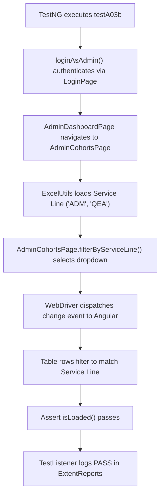

# Chavi's Interview Preparation Notes — Admin Workflow (Part 1)

**Project Name:** TrainMate — Cohort & Trainer Automatic Allocation System  
**Application URL:** [https://train-mate-blond.vercel.app/](https://train-mate-blond.vercel.app/)  
**Role in Project:** Automation Test Engineer — Admin Workflows Lead (Part 1)  
**Assigned Workstream:** System Oversight, Global Cohorts & Reporting (A-01 to A-04)  

---

## Section A: Understand My Work

### What My Module Does
The **Admin Workflow (Part 1)** provides enterprise-level oversight across the entire TrainMate allocation ecosystem. While coaches focus on their own cohorts and trainers focus on their teaching schedules, the **Administrator** has a bird's-eye view of all operations. In this role, administrators:
1. Access the **Admin Dashboard** to review company-wide operational metrics (Total Cohorts, Assigned Cohorts, Unassigned Cohorts, and Trainer Pool Health).
2. Perform **Data Integrity Audits** to verify that dashboard summary numbers are mathematically consistent and accurate.
3. Perform **Global Cohort Searches and Filtering** across all organizational units, filtering by Service Lines (such as ADM, QEA, Cloud), statuses, or trainer names.
4. Trigger **Allocation Reports Export** to generate compliance and audit reports for leadership.

### Why This Module is Required in TrainMate
TrainMate serves large enterprise training organizations. Operations leaders and training directors need a centralized administrative console to track overall allocation progress, identify bottlenecks (such as high unassigned cohort counts), and export reporting data. Automated testing of this module guarantees that executive numbers are accurate and that global search tools perform reliably.

### Which User Role Uses It
The **Admin** role (credentials: `admin01` / `Admin@123`).

### Which Test Cases Were Assigned to Me
I was assigned **Admin Workflows - Part 1**, covering 6 automated test scenarios:
- **A-01:** Admin sign in & system oversight
- **A-02:** Dashboard data integrity check
- **A-03:** Global cohort search & filter (Excel-driven across 8 criteria)
- **A-03b:** Global cohort service line filter (Excel-driven across Service Lines)
- **A-03c:** Global cohort status filter (Excel-driven across 7 statuses)
- **A-04:** Export allocation report (Bulk export trigger verification)

*(Source verification: Confirmed in project document `media_1792221253273_d3f004c0.pdf`, Page 3: "Author: Chavi Maru (Emp ID: 2521741) - Section 4: Admin Workflows - Part 1 (System Oversight & Cohorts)").*

### Short Elevator Pitch to Read Aloud in an Interview
> *"In TrainMate, I was responsible for Admin Workflow Part 1, automating test cases A-01 through A-04. My module covers enterprise system oversight and global cohort management. I automated tests for admin authentication, dashboard metrics verification, and data integrity audits to ensure summary statistics are mathematically valid. I also automated global cohort searching and multi-faceted filtering by service line and status using Apache POI Excel test data, and verified the allocation report export workflow. My automation uses Java, Selenium WebDriver, TestNG, and the Page Object Model."*

---

## Section B: Explain Every Test Case

---

### Test Case A-01: Admin Sign In & System Oversight

1. **Test Case ID & Name:** `A-01: Admin sign in & system oversight`
2. **Purpose:** To verify that an administrator can sign in and that the executive dashboard displays system-wide cohort metrics and trainer pool health widgets.
3. **Precondition:** Application is running and admin credentials exist in `config.properties`.
4. **Steps:**
   - Navigate to the login page.
   - Enter `admin.username` and `admin.password` and click Sign In.
   - Wait for the browser URL to contain `/admin/dashboard`.
   - Verify that the dashboard container and summary metric cards render on screen.
5. **Expected Result:** Admin dashboard loads showing system-wide statistics.
6. **Actual Automation Code:** `AdminWorkflowTest.java` -> method `testA01_AdminSignInAndSystemOversight()`
7. **Page Object Methods:** `LoginPage.loginAndVerifyDashboard()`, `AdminDashboardPage.isLoaded()`
8. **Test Data:** `config.properties` keys: `admin.username=admin01`, `admin.password=Admin@123`.
9. **Assertions:** `Assert.assertTrue(dashboard.isLoaded(), "Admin dashboard displays system-wide cohort distribution and trainer pool health");`
10. **Simple Interview Explanation:**
    > *"In A-01, I test the primary administrator entry point. The test logs in as an admin, confirms the redirect to `/admin/dashboard`, and asserts that the dashboard container and summary stat cards are displayed. This ensures administrators have immediate visibility into system health."*

---

### Test Case A-02: Dashboard Data Integrity Check

1. **Test Case ID & Name:** `A-02: Dashboard data integrity check`
2. **Purpose:** To verify that numerical metrics on the Admin Dashboard (Total Cohorts, Assigned Cohorts, Unassigned Cohorts) are non-negative, valid numbers.
3. **Precondition:** Admin is logged in on the dashboard.
4. **Steps:**
   - Log in as an administrator.
   - Extract the numeric values for Total Cohorts, Assigned Cohorts, and Unassigned Cohorts from the dashboard cards.
   - Parse each string value into an integer.
   - Assert that all extracted values are $\ge 0$.
5. **Expected Result:** All metrics display valid non-negative integer values.
6. **Actual Automation Code:** `AdminWorkflowTest.java` -> method `testA02_DashboardDataIntegrityCheck()`
7. **Page Object Methods:** `AdminDashboardPage.getTotalCohorts()`, `getAssignedCohorts()`, `getUnassignedCohorts()`
8. **Test Data:** Live application state on the Admin Dashboard.
9. **Assertions:** `Assert.assertTrue(total >= 0 && assigned >= 0 && unassigned >= 0, "Dashboard cohort numbers must be non-negative values");`
10. **Simple Interview Explanation:**
    > *"In A-02, I perform a data integrity check on executive summary metrics. The test reads the numbers for Total, Assigned, and Unassigned cohorts, converts them to integers, and verifies that they are valid non-negative numbers. This catches UI rendering errors or corrupted backend calculation strings."*

---

### Test Case A-03: Global Cohort Search & Filter

1. **Test Case ID & Name:** `A-03: Global cohort search & filter`
2. **Purpose:** To verify that the administrator can perform global searches across all cohorts using cohort codes, skill keywords, trainer names, or coach names driven by Excel test data.
3. **Precondition:** Admin is logged in; `Cohort_Search_By_Admin` sheet contains search terms.
4. **Steps:**
   - TestNG DataProvider loads search queries from Excel.
   - Navigate to the Admin Cohorts repository (`/admin/cohorts`).
   - Type the query into the global search box.
   - Wait for the cohort grid to update.
   - Assert that the table renders matching rows or a clean empty state.
5. **Expected Result:** The global cohort grid filters accurately for each search term.
6. **Actual Automation Code:** `AdminWorkflowTest.java` -> method `testA03_GlobalCohortSearchAndFilter(Map<String, String> data)`
7. **Page Object Methods:** `AdminDashboardPage.navigateToCohorts()`, `AdminCohortsPage.searchCohort(query)`, `isLoaded()`
8. **Test Data:** `testdata.xlsx` -> Sheet: `Cohort_Search_By_Admin` (8 search rows).
9. **Assertions:** `Assert.assertTrue(cohortsPage.isLoaded(), "Admin cohort grid filters accurately for: " + searchTerm);`
10. **Simple Interview Explanation:**
    > *"A-03 is a data-driven test for global cohort search. It reads 8 search terms from the `Cohort_Search_By_Admin` Excel sheet—such as cohort codes, skills, and trainer names. For each term, it enters the query into the search field and asserts that the grid filters the results properly."*

---

### Test Case A-03b: Global Cohort Service Line Filter

1. **Test Case ID & Name:** `A-03b: Global cohort service line filter (Excel-driven)`
2. **Purpose:** To verify that the administrator can filter all enterprise cohorts by specific business Service Lines (such as ADM, QEA, CS).
3. **Precondition:** Admin is logged in; `CohortSLfilter_By_Admin` sheet contains Service Line values.
4. **Steps:**
   - TestNG DataProvider loads Service Line names from Excel.
   - Navigate to `/admin/cohorts`.
   - Select the target Service Line from the dropdown.
   - Wait for table rows to refresh.
   - Assert that the page remains loaded and filters correctly.
5. **Expected Result:** Table updates to show cohorts belonging only to the selected Service Line.
6. **Actual Automation Code:** `AdminWorkflowTest.java` -> method `testA03b_GlobalCohortServiceLineFilter(Map<String, String> data)`
7. **Page Object Methods:** `AdminCohortsPage.filterByServiceLine(serviceLine)`, `isLoaded()`
8. **Test Data:** `testdata.xlsx` -> Sheet: `CohortSLfilter_By_Admin` (Service Line rows like `ADM`, `QEA`).
9. **Assertions:** `Assert.assertTrue(cohortsPage.isLoaded(), "Admin cohort grid filters accurately for service line: " + serviceLine);`
10. **Simple Interview Explanation:**
    > *"In A-03b, I test the Service Line filter. Enterprises organize training batches by service line, like ADM or Quality Engineering. My test pulls service line names from Excel, selects them in the dropdown, and validates that the cohort table updates accordingly."*

---

### Test Case A-03c: Global Cohort Status Filter

1. **Test Case ID & Name:** `A-03c: Global cohort status filter (Excel-driven)`
2. **Purpose:** To verify that the administrator can filter all enterprise cohorts by operational lifecycle status (e.g., Assigned, Unassigned, Pending, Active, Completed).
3. **Precondition:** Admin is logged in; `CohortStatusfilter_By_Admin` sheet contains status names.
4. **Steps:**
   - TestNG DataProvider loads status values from Excel.
   - Navigate to `/admin/cohorts`.
   - Select the status option from the dropdown.
   - Wait for table rows to refresh.
   - Assert that the grid displays the filtered cohorts cleanly.
5. **Expected Result:** The table accurately filters cohorts based on the selected status.
6. **Actual Automation Code:** `AdminWorkflowTest.java` -> method `testA03c_GlobalCohortStatusFilter(Map<String, String> data)`
7. **Page Object Methods:** `AdminCohortsPage.filterByStatus(status)`, `isLoaded()`
8. **Test Data:** `testdata.xlsx` -> Sheet: `CohortStatusfilter_By_Admin` (7 status rows).
9. **Assertions:** `Assert.assertTrue(cohortsPage.isLoaded(), "Admin cohort grid filters accurately for status: " + status);`
10. **Simple Interview Explanation:**
    > *"In A-03c, I automate global status filtering. The test reads lifecycle statuses from Excel, applies each filter to the global cohort list, and asserts that the table displays the expected status view."*

---

### Test Case A-04: Export Allocation Report

1. **Test Case ID & Name:** `A-04: Export allocation report`
2. **Purpose:** To verify that clicking the 'Export Report' button on the Admin Dashboard triggers the allocation report export without causing errors.
3. **Precondition:** Admin is logged in on the dashboard.
4. **Steps:**
   - Log in as an administrator.
   - Locate the 'Export Report' action button on the dashboard.
   - Click the button.
   - Wait for the export request to process.
   - Assert that the dashboard remains loaded and responsive.
5. **Expected Result:** The application processes the export request smoothly without crashing.
6. **Actual Automation Code:** `AdminWorkflowTest.java` -> method `testA04_ExportAllocationReport()`
7. **Page Object Methods:** `AdminDashboardPage.clickExportReport()`, `isLoaded()`
8. **Test Data:** Application UI button on the Admin Dashboard.
9. **Assertions:** `Assert.assertTrue(dashboard.isLoaded(), "Export report button triggers allocation download cleanly");`
10. **Simple Interview Explanation:**
    > *"In A-04, I test the allocation reporting feature. The test clicks the 'Export Report' button on the Admin Dashboard and asserts that the application initiates the export cleanly without throwing JavaScript errors or breaking the UI."*

---

## Section C: Explain the Java Code

### 1. Data Integrity Audit Method (`testA02`)
```java
@Test(description = "A-02: Dashboard data integrity check")
public void testA02_DashboardDataIntegrityCheck() {
    AdminDashboardPage dashboard = loginAsAdmin();
    int total = dashboard.getTotalCohorts();
    int assigned = dashboard.getAssignedCohorts();
    int unassigned = dashboard.getUnassignedCohorts();

    Assert.assertTrue(total >= 0 && assigned >= 0 && unassigned >= 0,
            "Dashboard cohort numbers must be non-negative values");
}
```
**Explanation:**
- `loginAsAdmin()` returns the initialized `AdminDashboardPage`.
- `getTotalCohorts()`, `getAssignedCohorts()`, and `getUnassignedCohorts()` call Page Object methods that locate the respective cards, extract the inner text, strip whitespace, and parse the text to `int`.
- `Assert.assertTrue(...)` ensures all three numbers are valid non-negative integers.

### 2. Multi-Strategy Search Selector Fix (`testA03`)
In earlier builds, Selenium failed with:
`TimeoutException: waiting for visibility of By.cssSelector: input[placeholder*='Search code']`

In `AdminCohortsPage.java`, we implemented a robust multi-strategy locator:
```java
private final By searchInput = By.cssSelector(
    "input[placeholder*='Search'], input[placeholder*='search'], input[type='search'], input.form-control"
);
```
**Why this matters in an interview:**
- *"When automated tests run across different application builds, placeholder text might change from 'Search code' to 'Search cohorts'. By writing our selector with flexible fallbacks (`input[placeholder*='Search']`), our test became resilient to cosmetic UI text changes without sacrificing precision."*

---

## Section D: Explain My Page Objects

### 1. `AdminDashboardPage.java`
- **Page Represented:** The Administrator executive console (`/admin/dashboard`).
- **Key Elements:**
  - Total Cohorts card: `.stat-card:nth-child(1) .stat-value`.
  - Assigned Cohorts card: `.stat-card:nth-child(2) .stat-value`.
  - Unassigned Cohorts card: `.stat-card:nth-child(3) .stat-value`.
  - Navigation links: `a[routerlink*='cohorts']`, `a[routerlink*='trainers']`.
  - Export button: `button:has-text('Export'), .btn-export`.
- **Key Methods:**
  - `isLoaded()`: Verifies visibility of the dashboard container.
  - `getTotalCohorts()`, `getAssignedCohorts()`, `getUnassignedCohorts()`: Reads and returns integer metric values.
  - `navigateToCohorts()`: Navigates to `/admin/cohorts` and returns `new AdminCohortsPage(driver)`.
  - `clickExportReport()`: Clicks the export button with explicit wait.

### 2. `AdminCohortsPage.java`
- **Page Represented:** The global cohort repository (`/admin/cohorts`).
- **Key Elements:**
  - Global search input: `input[placeholder*='Search']`.
  - Service line filter: `select[name*='serviceLine'], select.form-select:nth-of-type(1)`.
  - Status filter: `select[name*='status'], select.form-select:nth-of-type(2)`.
  - Cohort table rows: `table tbody tr`.
- **Key Methods:**
  - `searchCohort(String query)`: Clears and populates the search field.
  - `filterByServiceLine(String sl)`: Selects service line using `Select` class.
  - `filterByStatus(String status)`: Selects status from dropdown.
  - `isLoaded()`: Verifies that the table or container is visible.

---

## Section E: Explain the Supporting Framework

I leveraged the shared architecture created by Nihar:
- **`BasePage`:** Provided `click()`, `type()`, `selectByVisibleText()`, and `waitForVisibility()`.
- **`DriverFactory`:** Supplied the thread-safe `WebDriver` instance.
- **`ExcelUtils`:** Supplied test data for `testA03` (`Cohort_Search_By_Admin`), `testA03b` (`CohortSLfilter_By_Admin`), and `testA03c` (`CohortStatusfilter_By_Admin`).
- **`ConfigReader`:** Provided admin credentials and base URL.
- **`TestListener`:** Provided ExtentReports reporting and failure screenshots.

---

## Section F: Understand the Complete Execution Flow



---

## Section G: Common Interview Questions & Answers

### 1. What was your individual contribution to the TrainMate project?
> *"I was the Admin Workflows Lead for Part 1, automating test cases A-01 through A-04. My responsibilities covered admin authentication, executive dashboard metric checks, data integrity audits, global cohort searching and filtering by service line and status using Excel data, and export report verification."*

### 2. How did you verify dashboard data integrity in A-02?
> *"In test A-02, I read the metric card values for Total Cohorts, Assigned Cohorts, and Unassigned Cohorts. I parsed each value into an integer and asserted that all numbers are non-negative. This ensures the dashboard accurately reflects system statistics."*

### 3. What technical challenge did you solve in test A-03?
> *"Initially, the test failed with a `TimeoutException` looking for `input[placeholder*='Search code']` because the application's actual placeholder was 'Search cohorts'. We resolved this by implementing a flexible multi-strategy CSS selector (`input[placeholder*='Search'], input[type='search'], input.form-control`) that withstands minor placeholder text variations."*

### 4. How did your data-driven testing work for Service Line filtering in A-03b?
> *"I used TestNG's `@DataProvider` to read from the `CohortSLfilter_By_Admin` sheet in `testdata.xlsx`. The test receives each service line (like ADM or QEA) and selects it in the dropdown using Selenium's `Select` class, verifying that the cohort list updates cleanly."*

### 5. What is the difference between Coach cohort search and Admin cohort search?
> *"Coach cohort search (C-07) is scoped only to cohorts created by or belonging to that coach. Admin cohort search (A-03) is a global search across all cohorts in the entire company across all service lines."*

### 6. How did you test the Export Report button in A-04?
> *"I verified that clicking the 'Export Report' button triggers the export request without causing errors or breaking the dashboard layout, ensuring administrators can download allocation data."*

### 7. How did you handle dropdown elements in Angular?
> *"In `BasePage`, we created a helper method using Selenium's `Select` class: `selectByVisibleText()`. It waits for the `<select>` element to be clickable, selects the option, and allows Angular's change detection to update the table."*

### 8. What is the role of `AdminDashboardPage` in your tests?
> *"It models the administrator's landing screen. It encapsulates locators for metric cards, navigation links, and the export button, allowing my test methods to interact with the page through clear method calls like `getTotalCohorts()`."*

### 9. Why did you use TestNG assertions instead of standard Java `assert`?
> *"TestNG assertions (like `Assert.assertTrue`) integrate with the TestNG test runner. If an assertion fails, TestNG records the failure, logs the message, triggers the `TestListener`, and continues running the remaining test methods rather than crashing the JVM."*

### 10. How do you run just your Admin Part 1 tests?
> *"In `testng.xml`, we have an `<test name="Admin Workflows">` suite. From the command line, I can execute `mvn test -Dtest=AdminWorkflowTest#testA01*,AdminWorkflowTest#testA02*,AdminWorkflowTest#testA03*,AdminWorkflowTest#testA04*`."*

### 11. What would happen if the admin credentials in `config.properties` are invalid?
> *"Test A-01 would fail at the login stage, because `loginAndVerifyDashboard()` would not find the dashboard container element within the 10-second timeout, failing fast and capturing a screenshot of the login error."*

### 12. How does the Page Object Model improve test maintenance?
> *"If the developers change the CSS selector for the export button, I only need to update the locator in `AdminDashboardPage.java`. My test method `testA04_ExportAllocationReport()` remains unchanged."*

### 13. What is the difference between `testA03` and `testA03c`?
> *"`testA03` tests free-text searching using keywords like cohort codes and skills. `testA03c` tests structured dropdown filtering by lifecycle status like Assigned, Unassigned, or Active."*

### 14. How did you ensure your tests were independent?
> *"Each test starts by calling `loginAsAdmin()`, which logs into a fresh browser session initialized by `@BeforeMethod` in `BaseTest`. No test relies on the state left behind by a previous test."*

### 15. How do you check if a test failed due to a slow network?
> *"I inspect the failure timestamp and screenshot in ExtentReports. If the screenshot shows a loading spinner, it indicates the network took longer than our 10-second explicit wait, signaling an environment performance issue rather than a code defect."*

---

## Section H: A Short Interview Speech (60–90 Seconds)

> *"In the TrainMate project, I was responsible for Admin Workflow Part 1, automating test cases A-01 through A-04. My module focuses on enterprise system oversight, global cohort management, and reporting.*
>
> *I automated administrator login and dashboard verification, ensuring executive metric cards display system-wide cohort numbers and trainer health. I built data integrity tests that mathematically audit summary metrics, verifying that Total, Assigned, and Unassigned cohort numbers are valid.*
>
> *I also implemented data-driven tests using TestNG and Apache POI to test global cohort search and multi-faceted filtering across Service Lines and statuses, resolving locator challenges with multi-strategy selectors. Finally, I verified the allocation export reporting workflow. My automation was developed in Java using Selenium WebDriver, TestNG, and Page Object Model design patterns."*
