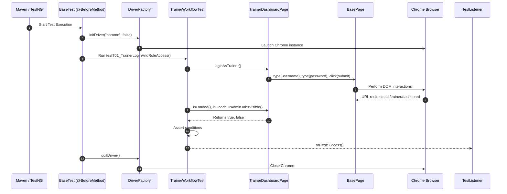

# Nihar's Interview Preparation Notes — Complete Trainer Workflow & Framework Architecture

**Project Name:** TrainMate — Cohort & Trainer Automatic Allocation System  
**Application URL:** [https://train-mate-blond.vercel.app/](https://train-mate-blond.vercel.app/)  
**Role in Project:** Automation Test Engineer (Trainer Workflow Lead) & Framework Architect  
**Assigned Workstream:** Complete Trainer Workflow (T-01 to T-09) + Core Framework Architecture  

---

## Section A: Understand My Work

### What My Module Does
The **Trainer Portal** in TrainMate is designed for corporate technical trainers. Once an administrator or coach creates training cohorts and the system allocates trainers, each trainer logs into this portal to:
1. View their allocated training cohorts and upcoming teaching schedules.
2. Monitor key personal metrics, such as how many cohorts they are actively teaching and how many they have completed.
3. Search and filter their schedules by cohort code, specific technology skills (like Java, Python, AWS), or cohort lifecycle status (such as Active, In Progress, or Completed).
4. Inspect deep cohort details, including start and end dates, trainee headcount, and training locations.
5. Receive system notifications and alerts in a dedicated Mailbox whenever they are assigned or reassigned to a new cohort.

### Why This Module is Required in TrainMate
Without the Trainer Portal, trainers would have no visibility into what classes they are assigned to teach, leading to schedule clashes and communication delays. Furthermore, the portal enforces strict role-based access control (RBAC): trainers must never have access to administrative settings, trainer pool management, or cohort creation tools reserved for Coaches and Admins.

### Which User Role Uses It
The **Trainer** role (e.g., credentials: `trainer01` / `Train@123`).

### Which Test Cases Were Assigned to Me
I was assigned the **Complete Trainer Workflow**, consisting of 9 end-to-end test cases:
- **T-01:** Trainer login and role access
- **T-02:** Trainer unauthorized route check
- **T-03:** Trainer empty-state dashboard
- **T-04:** Trainer metrics after assignment
- **T-05:** View assigned cohort details
- **T-06:** Search assigned cohort schedule
- **T-07:** Filter cohorts by status
- **T-08:** Mailbox assignment notification
- **T-09:** Real-time updates on reassignment

*(Note on Project Allocation History: In the initial exploratory notes, Trainer test cases were shared, but per the master work distribution, I am the designated owner of the complete Trainer workflow. In addition, as the Framework Architect, I designed and built the shared framework engine used by the entire team).*

### Short Elevator Pitch to Read Aloud in an Interview
> *"In TrainMate, I was responsible for automating the complete Trainer workflow, which includes test cases T-01 through T-09, as well as designing the core Selenium automation framework. My automated tests verify that trainers can log in securely, view their assigned training batches, search and filter schedules using Excel test data, and receive mailbox notifications. I also validated security boundaries to ensure trainers cannot access restricted Coach or Admin URLs. On the architecture side, I built the base page object model, the thread-safe WebDriver factory, the Apache POI Excel utility, and TestNG listeners for ExtentReports."*

---

## Section B: Explain Every Test Case

---

### Test Case T-01: Trainer Login & Role Access

1. **Test Case ID & Name:** `T-01: Trainer login & role access`
2. **Purpose:** To verify that a trainer can successfully log into the portal and that restricted Coach and Admin UI tabs are hidden from view.
3. **Precondition:** The TrainMate application is up and valid trainer credentials exist in `config.properties`.
4. **Steps:**
   - Open browser and navigate to the application URL.
   - Enter `trainer.username` and `trainer.password` on the login page and click Sign In.
   - Wait for the dashboard to load.
   - Check if Coach cohort creation buttons and Admin tabs exist on the screen.
5. **Expected Result:** Trainer dashboard opens successfully; Coach creation buttons and Admin navigation tabs are invisible.
6. **Actual Automation Code:** `TrainerWorkflowTest.java` -> method `testT01_TrainerLoginAndRoleAccess()`
7. **Page Object Methods:** `LoginPage.loginAndVerifyDashboard()`, `TrainerDashboardPage.isLoaded()`, `TrainerDashboardPage.isCoachOrAdminTabsVisible()`
8. **Test Data:** `config.properties` keys: `trainer.username=trainer01`, `trainer.password=Train@123`.
9. **Assertions:**
   - `Assert.assertTrue(dashboard.isLoaded(), ...)`
   - `Assert.assertFalse(dashboard.isCoachOrAdminTabsVisible(), ...)`
10. **Simple Interview Explanation:**
    > *"In T-01, I test role-based UI security for trainers. My test logs in as a trainer and verifies two things: first, that the trainer dashboard loads correctly, and second, that privileged tabs like 'Admin' or 'Create Cohort' are not displayed on the screen. This proves that the front-end properly hides unauthorized features from trainers."*

---

### Test Case T-02: Trainer Unauthorized Route Check

1. **Test Case ID & Name:** `T-02: Trainer unauthorized route check`
2. **Purpose:** To verify that a logged-in trainer cannot bypass UI restrictions by directly typing Admin or Coach URLs into the browser address bar.
3. **Precondition:** Trainer is logged into the application.
4. **Steps:**
   - Log in as a trainer.
   - Use `driver.get()` to directly navigate to `https://train-mate-blond.vercel.app/admin/trainers`.
   - Check the resulting browser URL.
   - Use `driver.get()` to navigate to `https://train-mate-blond.vercel.app/coach/cohorts`.
   - Check the resulting browser URL.
5. **Expected Result:** The Angular route guard intercepts the request and redirects the user back to `/login` or blocks access to the protected path.
6. **Actual Automation Code:** `TrainerWorkflowTest.java` -> method `testT02_TrainerUnauthorizedRouteCheck()`
7. **Page Object Methods:** Helper `loginAsTrainer()`
8. **Test Data:** Protected endpoints: `/admin/trainers` and `/coach/cohorts`.
9. **Assertions:**
   - `Assert.assertTrue(accessDenied, "Direct navigation to protected Coach/Admin routes is denied");`
   - `Assert.assertTrue(coachDenied, "Direct navigation to protected Coach route is denied");`
10. **Simple Interview Explanation:**
    > *"T-02 is a critical security test for URL route guarding. Even if a trainer cannot see the Admin button, they might try typing `/admin/trainers` directly into the address bar. My test simulates this exact action and asserts that the application blocks access and redirects them to login. This confirms both frontend and routing security."*

---

### Test Case T-03: Trainer Empty-State Dashboard Check

1. **Test Case ID & Name:** `T-03: Trainer empty state dashboard check`
2. **Purpose:** To verify that the trainer dashboard loads cleanly without runtime errors or crashes even when no batches are assigned.
3. **Precondition:** Application is running.
4. **Steps:**
   - Log in as a trainer.
   - Wait for the dashboard container element to be visible.
   - Verify that page elements render properly.
5. **Expected Result:** Trainer dashboard renders cleanly without unhandled exceptions or blank screens.
6. **Actual Automation Code:** `TrainerWorkflowTest.java` -> method `testT03_TrainerEmptyStateDashboard()`
7. **Page Object Methods:** `TrainerDashboardPage.isLoaded()`
8. **Test Data:** Standard trainer credentials from `config.properties`.
9. **Assertions:** `Assert.assertTrue(dashboard.isLoaded(), "Trainer dashboard loads cleanly without console errors");`
10. **Simple Interview Explanation:**
    > *"In T-03, I verify the resilience of the dashboard under empty or default conditions. When a trainer has no assigned classes, the page must still render headers, navigation links, and placeholder messages cleanly rather than breaking with JavaScript errors."*

---

### Test Case T-04: Trainer Metrics After Assignment

1. **Test Case ID & Name:** `T-04: Trainer metrics after assignment`
2. **Purpose:** To verify that the numerical metric cards for Active Cohorts and Completed Cohorts display valid numbers on the dashboard.
3. **Precondition:** Trainer is logged in.
4. **Steps:**
   - Log in as a trainer.
   - Locate the dashboard stat cards for Active and Completed batches.
   - Extract the text and parse them as integers.
   - Verify that both counters are non-negative numbers (0 or greater).
5. **Expected Result:** Metric cards show valid non-negative integer values.
6. **Actual Automation Code:** `TrainerWorkflowTest.java` -> method `testT04_TrainerMetricsAfterAssignment()`
7. **Page Object Methods:** `TrainerDashboardPage.getActiveCohortsCount()`, `TrainerDashboardPage.getCompletedCohortsCount()`
8. **Test Data:** Live application state on the trainer dashboard.
9. **Assertions:** `Assert.assertTrue(active >= 0 && completed >= 0, "Trainer metric counters are valid numbers");`
10. **Simple Interview Explanation:**
    > *"In T-04, I validate the summary metrics displayed to the trainer. The test reads the numbers shown on the dashboard cards—such as active and completed cohorts—parses them into integers, and asserts that they are valid non-negative values. This ensures the dashboard statistics widget is functioning properly."*

---

### Test Case T-05: View Assigned Cohort Details

1. **Test Case ID & Name:** `T-05: View assigned cohort details`
2. **Purpose:** To verify that clicking on an assigned cohort opens a details modal showing cohort code, required skills, dates, and location.
3. **Precondition:** Trainer is logged in and assigned cohorts exist.
4. **Steps:**
   - Log in as a trainer.
   - Click the 'Cohorts' navigation link to open `TrainerCohortsPage`.
   - Check if any cohorts are listed in the table.
   - If cohorts exist, click the 'View Details' action on the first row.
   - Wait for the modal dialog to appear.
   - Verify that the cohort code inside the modal is not empty.
   - Close the modal.
5. **Expected Result:** Modal opens displaying complete cohort details and closes cleanly.
6. **Actual Automation Code:** `TrainerWorkflowTest.java` -> method `testT05_ViewAssignedCohortDetails()`
7. **Page Object Methods:** `TrainerCohortsPage.getDisplayedCohortsCount()`, `viewCohortDetails()`, `getModalCohortCode()`, `closeModal()`
8. **Test Data:** Dynamic cohort data present in the user interface.
9. **Assertions:**
   - `Assert.assertFalse(code.isEmpty(), "Modal displays cohort code, skills, dates and location");`
   - `Assert.assertTrue(cohortsPage.isLoaded(), "Assigned cohorts view functions properly");`
10. **Simple Interview Explanation:**
    > *"In T-05, I test the cohort details popup. The test navigates to the Trainer's Cohorts page, clicks 'View Details' on an assigned cohort, and verifies that the modal pops up with non-empty cohort information like dates and skills. Finally, it closes the modal to confirm clean dismissal."*

---

### Test Case T-06: Search Assigned Cohort Schedule

1. **Test Case ID & Name:** `T-06: Search assigned cohort schedule`
2. **Purpose:** To verify that the trainer can search their assigned cohorts using cohort codes and skill names driven by an Excel spreadsheet.
3. **Precondition:** Trainer is logged in; Excel data file `testdata.xlsx` has sheet `Cohort_or_Skill_SearchByTrainer`.
4. **Steps:**
   - TestNG DataProvider loads search keywords from Excel.
   - Log in as a trainer and navigate to the Cohorts page.
   - Enter the search term into the search input field.
   - Wait for the table rows to update.
   - Verify that the table updates cleanly without crashing.
5. **Expected Result:** The table filters dynamically to display matching rows or displays a clean empty state.
6. **Actual Automation Code:** `TrainerWorkflowTest.java` -> method `testT06_SearchAssignedCohortSchedule(Map<String, String> data)`
7. **Page Object Methods:** `TrainerCohortsPage.searchCohort(searchTerm)`, `isLoaded()`
8. **Test Data:** `testdata.xlsx` -> Sheet: `Cohort_or_Skill_SearchByTrainer` (Columns: `CohortCode_or_Skill`, `Expected Output`).
9. **Assertions:** `Assert.assertTrue(cohortsPage.isLoaded(), "Matching cohorts or clean empty results appear for: " + searchTerm);`
10. **Simple Interview Explanation:**
    > *"T-06 is a data-driven test using TestNG and Apache POI. It reads search keywords—such as specific cohort codes and technology skills—from an Excel sheet named `Cohort_or_Skill_SearchByTrainer`. For each row, it types the keyword into the search bar and verifies that the table filters the schedule correctly."*

---

### Test Case T-07: Filter Cohorts by Status

1. **Test Case ID & Name:** `T-07: Filter cohorts by status`
2. **Purpose:** To verify that the trainer can filter assigned cohorts by status (e.g., Active, Completed, In Progress) using Excel-driven values.
3. **Precondition:** Trainer is logged in; Excel sheet `CohortStatusFilter_By_Trainer` contains status options.
4. **Steps:**
   - TestNG DataProvider loads status values from Excel.
   - Navigate to the Trainer Cohorts page.
   - Select the target status from the dropdown.
   - Wait for table rows to refresh.
   - Verify that the page updates properly.
5. **Expected Result:** Only cohorts matching the selected status remain displayed.
6. **Actual Automation Code:** `TrainerWorkflowTest.java` -> method `testT07_FilterCohortsByStatus(Map<String, String> data)`
7. **Page Object Methods:** `TrainerCohortsPage.filterByStatus(status)`, `isLoaded()`
8. **Test Data:** `testdata.xlsx` -> Sheet: `CohortStatusFilter_By_Trainer` (Column: `Status`).
9. **Assertions:** `Assert.assertTrue(cohortsPage.isLoaded(), "Filtering by status updates cohort list accurately");`
10. **Simple Interview Explanation:**
    > *"In T-07, I test the status filter dropdown using Excel test data. The test selects each lifecycle status—like 'Active' or 'Completed'—from the dropdown, and asserts that the table re-renders correctly. This proves that trainers can quickly separate upcoming cohorts from past ones."*

---

### Test Case T-08: Mailbox Assignment Notification

1. **Test Case ID & Name:** `T-08: Mailbox assignment notification`
2. **Purpose:** To verify that the trainer can open the Mailbox page to view system assignment alerts and notifications.
3. **Precondition:** Trainer is logged into the portal.
4. **Steps:**
   - Log in as a trainer.
   - Click the 'Mailbox' link in the top navigation bar.
   - Wait for the mailbox container to load.
   - Verify that the notification list or empty-state notification card is visible.
5. **Expected Result:** The Mailbox page loads cleanly showing notification cards.
6. **Actual Automation Code:** `TrainerWorkflowTest.java` -> method `testT08_MailboxAssignmentNotification()`
7. **Page Object Methods:** `TrainerDashboardPage.navigateToMailbox()`, `TrainerMailboxPage.isLoaded()`
8. **Test Data:** Application state at `/trainer/mailbox`.
9. **Assertions:** `Assert.assertTrue(mailboxPage.isLoaded(), "Mailbox loads cleanly showing notifications and alerts");`
10. **Simple Interview Explanation:**
    > *"In T-08, I verify the trainer's internal mailbox system. The test navigates to the mailbox tab and verifies that the page loads properly with notification cards. When a trainer is assigned a new cohort by the algorithm, this is where the automated alert appears."*

---

### Test Case T-09: Real-Time Updates on Reassignment

1. **Test Case ID & Name:** `T-09: Real-time updates on reassignment`
2. **Purpose:** To verify that the trainer can interact with mailbox alerts, such as clicking 'Mark All as Read', and that the UI updates immediately.
3. **Precondition:** Trainer is on the Mailbox page.
4. **Steps:**
   - Log in as a trainer and open the Mailbox page.
   - Locate and click the 'Mark All as Read' action button.
   - Wait for the button state or notification badges to update.
   - Verify that the page remains stable and loaded.
5. **Expected Result:** The application acknowledges the action and updates notification states.
6. **Actual Automation Code:** `TrainerWorkflowTest.java` -> method `testT09_RealTimeUpdatesOnReassignment()`
7. **Page Object Methods:** `TrainerDashboardPage.navigateToMailbox()`, `TrainerMailboxPage.markAllAsRead()`, `isLoaded()`
8. **Test Data:** Application UI elements on the Mailbox page.
9. **Assertions:** `Assert.assertTrue(mailboxPage.isLoaded(), "Mailbox reflects up-to-date assignment alerts");`
10. **Simple Interview Explanation:**
    > *"In T-09, I test real-time notification updates. The test goes into the mailbox and triggers the 'Mark All as Read' button. It validates that the UI responds immediately without error, ensuring trainers can manage their incoming assignment alerts."*

---

## Section C: Explain the Java Code

### 1. Structure of `TrainerWorkflowTest.java`
`TrainerWorkflowTest` extends `BaseTest`. By extending `BaseTest`, this test class automatically inherits the initialized `WebDriver` instance, setup routines (`@BeforeMethod`), and teardown cleanup (`@AfterMethod`).

```java
public class TrainerWorkflowTest extends BaseTest {

    private TrainerDashboardPage loginAsTrainer() {
        LoginPage loginPage = new LoginPage(driver);
        loginPage.loginAndVerifyDashboard(
            ConfigReader.getProperty("trainer.username"), 
            ConfigReader.getProperty("trainer.password")
        );
        TrainerDashboardPage dashboard = new TrainerDashboardPage(driver);
        dashboard.waitUntilLoaded();
        return dashboard;
    }
```
**Why this helper method matters:**
- Instead of repeating 4 lines of login code in all 9 tests, `loginAsTrainer()` encapsulates the login flow.
- It instantiates `LoginPage`, reads credentials from `ConfigReader`, performs the login, creates the `TrainerDashboardPage` object, waits for it to render, and returns it ready for use.

### 2. Deep Dive: Test Method `testT01_TrainerLoginAndRoleAccess()`
```java
@Test(description = "T-01: Trainer login & role access")
public void testT01_TrainerLoginAndRoleAccess() {
    TrainerDashboardPage dashboard = loginAsTrainer();
    Assert.assertTrue(dashboard.isLoaded(), "Trainer dashboard opens showing assigned batches");
    Assert.assertFalse(dashboard.isCoachOrAdminTabsVisible(), "Coach creation and Admin tabs are hidden for Trainer");
}
```
- **Line 1: `@Test(...)`** — TestNG annotation marking this method as an executable test case. The `description` parameter gives human-readable context in ExtentReports.
- **Line 3: `TrainerDashboardPage dashboard = loginAsTrainer();`** — Logs into the system and returns the dashboard page object.
- **Line 4: `Assert.assertTrue(dashboard.isLoaded(), ...)`** — TestNG assertion verifying that the dashboard container element is visible. If false, the test fails with the message provided.
- **Line 5: `Assert.assertFalse(dashboard.isCoachOrAdminTabsVisible(), ...)`** — Validates security trimming. It asserts that the Admin and Coach tabs are NOT visible for this role.

### 3. Deep Dive: Test Method `testT06_SearchAssignedCohortSchedule()` (Data-Driven)
```java
@DataProvider(name = "trainerSearchData")
public Object[][] getTrainerSearchData() {
    String path = ConfigReader.getProperty("testdata.excel.path", "src/test/resources/testdata.xlsx");
    return ExcelUtils.getSheetData(path, "Cohort_or_Skill_SearchByTrainer");
}

@Test(description = "T-06: Search assigned cohort schedule", dataProvider = "trainerSearchData")
public void testT06_SearchAssignedCohortSchedule(Map<String, String> data) {
    TrainerDashboardPage dashboard = loginAsTrainer();
    TrainerCohortsPage cohortsPage = dashboard.navigateToCohorts();

    String searchTerm = data.get("CohortCode_or_Skill");
    cohortsPage.searchCohort(searchTerm);
    Assert.assertTrue(cohortsPage.isLoaded(), "Matching cohorts or clean empty results appear for: " + searchTerm);
}
```
- **`@DataProvider`**: TestNG annotation that supplies data to a test method. It calls `ExcelUtils.getSheetData()`, opening `testdata.xlsx` and reading the sheet `Cohort_or_Skill_SearchByTrainer`.
- **`Map<String, String> data`**: Each row of the Excel sheet is passed to the test method as a key-value Map where the column header is the key.
- **`searchTerm = data.get("CohortCode_or_Skill")`**: Extracts the exact test string from the Excel row.
- **`cohortsPage.searchCohort(searchTerm)`**: Types the string into the search input and triggers filtering.

---

## Section D: Explain My Page Objects

The Trainer workflow interacts with three specialized Page Object classes:

### 1. `TrainerDashboardPage.java`
- **Page Represented:** The main landing page after trainer authentication (`/trainer/dashboard`).
- **Key Elements:**
  - Metric counters: Active cohorts (`.stat-card:nth-child(1) .stat-value`), Completed cohorts (`.stat-card:nth-child(2) .stat-value`).
  - Navigation links: Cohorts link (`a[routerlink*='cohorts']`), Mailbox link (`a[routerlink*='mailbox']`).
  - Restricted tabs locator: `a[routerlink*='admin'], button[routerlink*='create']`.
- **Key Methods:**
  - `isLoaded()`: Checks visibility of the dashboard container.
  - `getActiveCohortsCount()` & `getCompletedCohortsCount()`: Parses numerical text from stat cards.
  - `navigateToCohorts()`: Clicks the Cohorts tab and returns `new TrainerCohortsPage(driver)`.
  - `navigateToMailbox()`: Clicks the Mailbox tab and returns `new TrainerMailboxPage(driver)`.
  - `isCoachOrAdminTabsVisible()`: Returns `true` if forbidden tabs appear.

### 2. `TrainerCohortsPage.java`
- **Page Represented:** The trainer's batch schedule view (`/trainer/cohorts`).
- **Key Elements:**
  - Search input box: `input[placeholder*='Search']`.
  - Status filter dropdown: `select.form-select, select[name*='status']`.
  - Cohort table rows: `table tbody tr`.
  - Cohort details modal: `.modal, app-cohort-details-modal`.
- **Key Methods:**
  - `searchCohort(String query)`: Clears the search field and types the search keyword.
  - `filterByStatus(String status)`: Selects an option from the status dropdown.
  - `viewCohortDetails(String code)`: Clicks the 'View' button on a cohort row.
  - `getModalCohortCode()`: Reads the cohort title or code displayed inside the popup.
  - `closeModal()`: Dismisses the modal popup.

### 3. `TrainerMailboxPage.java`
- **Page Represented:** The trainer's notification inbox (`/trainer/mailbox`).
- **Key Elements:**
  - Notification cards: `.notification-item, .mailbox-card`.
  - Mark All as Read button: `button.mark-read, button:has-text('Mark All as Read')`.
- **Key Methods:**
  - `isLoaded()`: Verifies that the mailbox container or notification cards are present.
  - `markAllAsRead()`: Clicks the mark-read button with explicit wait.

---

## Section E: Explain the Supporting Framework

As the Framework Architect, I created the core foundation that powers all test suites.

### 1. `BasePage.java` (Reusable Browser Interaction Engine)
- Serves as the parent class for all page objects (`LoginPage`, `TrainerDashboardPage`, `TrainerCohortsPage`, etc.).
- Initializes `WebDriver` and a `WebDriverWait` with a default timeout of 10 seconds.
- Provides standard wrapper methods:
  - `click(By locator)`: Waits for element clickability before clicking.
  - `type(By locator, String text)`: Waits for visibility, clears the field, and types text.
  - `getText(By locator)`: Waits for visibility and returns trimmed text.
  - `selectByVisibleText(By locator, String text)`: Wraps Selenium's `Select` class.
- **The Critical Date Engine (`enterDate`):** Solved the chronic Angular date bug where typing 4 digits turned into 5 or 6 digits (e.g., `20262026`). It uses JavaScript `element.value = 'YYYY-MM-DD'` followed by triggering `input` and `change` dispatch events.

### 2. `DriverFactory.java` (Thread-Safe Browser Lifecycle)
- Uses `ThreadLocal<WebDriver>` to ensure that parallel test threads never collide or share browser instances.
- Methods: `initDriver(browser, headless)`, `getDriver()`, and `quitDriver()`.
- Supports Chrome and Edge options, including disabling automation banners and setting clean window sizes.

### 3. `ExcelUtils.java` (Apache POI Data Provider Engine)
- Opens `testdata.xlsx` using Apache POI (`WorkbookFactory.create(inputStream)`).
- Automatically formats numeric dates into standard ISO `yyyy-MM-dd` format using `DataFormatter` and `DateUtil.isCellDateFormatted()`.
- Converts sheet rows into `Object[][]` containing `Map<String, String>` structures for TestNG DataProviders.

### 4. `ConfigReader.java` (Central Configuration)
- Loads `src/test/resources/config.properties` during startup.
- Allows CLI overrides (e.g., `-Dbrowser=chrome` or `-Dheadless=true`).
- Provides easy accessors like `ConfigReader.getProperty("trainer.username")` and `ConfigReader.getAppUrl()`.

### 5. `TestListener.java` (ExtentReports & Screenshots)
- Implements TestNG's `ITestListener`.
- On test start: creates a new test node in ExtentReports.
- On test success: marks test as PASS in the report.
- On test failure: captures a timestamped PNG screenshot using `ScreenshotUtils.takeScreenshot()` and embeds the image directly into the ExtentReport HTML file.

### 6. TestNG and Maven
- **`pom.xml`**: Manages dependencies (`selenium-java 4.21`, `testng 7.10`, `poi-ooxml 5.2`, `extentreports 5.1`, `log4j-core 2.23`) and sets Java 17 compilation target.
- **`testng.xml`**: Organizes test execution by suite:
  - `<test name="Trainer Workflows"> <classes><class name="test.TrainerWorkflowTest"/></classes></test>`
- **Execution commands:**
  - Run full suite: `mvn clean test`
  - Run trainer workflow only: `mvn test -Dtest=TrainerWorkflowTest`

---

## Section F: Understand the Complete Execution Flow

Here is how a test runs from start to finish:



---

## Section G: Common Interview Questions & Answers

### 1. What was your individual role in the TrainMate project?
> *"I had a dual role. First, I served as the Framework Architect, designing the Page Object Model, the thread-safe `DriverFactory`, the Apache POI Excel integration, and ExtentReports listeners. Second, I was the functional lead for the complete Trainer Workflow, automating test cases T-01 through T-09."*

### 2. Which test cases did you automate for the Trainer module?
> *"I automated 9 test cases: T-01 for login and role verification, T-02 for route security, T-03 for empty-state loading, T-04 for dashboard metrics, T-05 for cohort details popups, T-06 for Excel-driven schedule searches, T-07 for status filtering, T-08 for mailbox notifications, and T-09 for real-time reassignment updates."*

### 3. Why did you use the Page Object Model (POM)?
> *"POM separates our test logic from the application's HTML locators. If a button's CSS selector changes, we only update it once in `TrainerDashboardPage.java` rather than across all 9 test methods. This makes our framework highly maintainable and clean."*

### 4. How do you ensure ThreadLocal safety in your WebDriver?
> *"In `DriverFactory.java`, we declare `private static ThreadLocal<WebDriver> driver = new ThreadLocal<>()`. When tests run in parallel, each thread gets its own independent copy of the WebDriver instance, preventing two tests from interfering with the same browser window."*

### 5. How did you handle explicit waits?
> *"We avoided `Thread.sleep()`. In `BasePage.java`, we implemented `WebDriverWait` with `ExpectedConditions`. For example, `waitForVisibility()` waits until the element is physically visible in the DOM before we click or type, preventing `ElementNotInteractableException`."*

### 6. How did your data-driven testing work for T-06 and T-07?
> *"In TestNG, we used `@DataProvider`. The data provider method calls `ExcelUtils.getSheetData()`, which reads rows from `testdata.xlsx`. Each row is passed into the test method as a parameter, allowing one test method to execute multiple search terms or status filters automatically."*

### 7. How did you test security in T-02?
> *"I logged in as a Trainer and explicitly instructed Selenium to navigate to privileged URLs like `/admin/trainers` and `/coach/cohorts` using `driver.get()`. I asserted that the application's Angular route guards prevented access and redirected the browser back to the login page."*

### 8. What is the difference between an assertion and a page action?
> *"A page action—like `cohortsPage.searchCohort('Java')`—interacts with the browser to perform an operation. An assertion—like `Assert.assertTrue(cohortsPage.isLoaded())`—validates that the operation yielded the expected outcome. Actions belong in Page Objects; assertions belong in Test classes."*

### 9. What happens when a test fails during execution?
> *"Our custom `TestListener` intercepts the failure via `onTestFailure()`. It calls `ScreenshotUtils` to capture a timestamped PNG image of the screen, attaches the image to the ExtentReports HTML dashboard, and logs the full stack trace in Log4j2 logs."*

### 10. How do you run just the Trainer workflow from the command line?
> *"Using Maven Surefire: `mvn test -Dtest=TrainerWorkflowTest`. We can also execute it directly via the `<test name="Trainer Workflows">` suite tag in `testng.xml`."*

### 11. How did you fix the date-handling bug in the framework?
> *"In HTML5 date inputs, Selenium's `sendKeys()` often sent numbers that resulted in invalid 5-digit years. In `BasePage.enterDate()`, I used JavaScript execution to set the value directly in `YYYY-MM-DD` format and then dispatched `input` and `change` events so Angular's reactive form controls detected the change."*

### 12. What was the purpose of testing the Trainer Mailbox in T-08 and T-09?
> *"In TrainMate, when a coach creates a cohort and the automatic algorithm allocates a trainer, the trainer receives an in-app alert. T-08 validates that the mailbox loads these alert cards, and T-09 verifies that clicking 'Mark All as Read' updates the alert status in real time."*

### 13. How did you prevent tests from depending on each other?
> *"Every test method is independent. In `TrainerWorkflowTest`, each test logs in independently in its own browser session managed by `@BeforeMethod` in `BaseTest`. This prevents cascade failures where one failed test breaks subsequent tests."*

### 14. What locators did you prioritize?
> *"We prioritized stable CSS selectors with attributes like `[routerlink]`, `input[placeholder*='Search']`, and unique class names, falling back to XPath only when finding elements based on exact text."*

### 15. How would you debug a failing test in the Trainer module?
> *"First, I check the ExtentReports HTML report to view the embedded screenshot at the exact moment of failure. Second, I inspect `logs/trainmate-test.log` to see the Log4j2 trace. Third, I check if the application DOM or locators changed or if network latency caused a timeout."*

---

## Section H: A Short Interview Speech (60–90 Seconds)

> *"In the TrainMate project, I was responsible for two major areas: architecting our Selenium test automation framework and leading the automation of the complete Trainer workflow, covering test cases T-01 through T-09.*
>
> *The Trainer portal is where instructors access their teaching schedules, review assigned cohort details, and receive mailbox notifications when they are matched with a batch. My automated tests verify role-based security, ensuring trainers cannot see or navigate to Admin and Coach pages. I also built data-driven tests using TestNG and Apache POI to validate that trainers can search their schedules by course codes and filter by status using real Excel test data.*
>
> *On the framework side, I built our Page Object Model structure, implemented a thread-safe WebDriver factory for parallel execution, created our Excel data utility, and integrated ExtentReports with automatic screenshot capture upon failure. Every test is isolated, completely independent, and validates real user flows against the deployed web application."*
