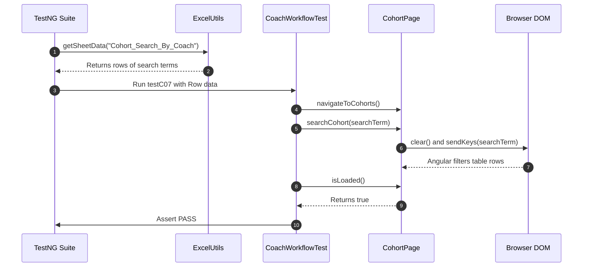

# Ramya's Interview Preparation Notes — Coach Workflow (Part 2)

**Project Name:** TrainMate — Cohort & Trainer Automatic Allocation System  
**Application URL:** [https://train-mate-blond.vercel.app/](https://train-mate-blond.vercel.app/)  
**Role in Project:** Automation Test Engineer — Coach Workflows Lead (Part 2)  
**Assigned Workstream:** Cohort Management, Status Filtering, Editing & Batch Upload (C-07 to C-10)  

---

## Section A: Understand My Work

### What My Module Does
The **Coach Workflow (Part 2)** manages the ongoing lifecycle of training cohorts after they have been created. In TrainMate, a training coach does not just create individual cohorts; they also have to:
1. Search across large repositories of cohorts using cohort codes, skill keywords (like Java, AWS, React), or assigned trainer names.
2. Filter cohorts by their operational status (such as `ASSIGNED`, `UNASSIGNED`, `PENDING`, `ACTIVE`, `COMPLETED`, or `CANCELLED`).
3. Edit existing cohorts when business requirements shift—such as updating required technologies, adjusting trainee headcounts, or extending training end dates—and verify that the allocation algorithm recalculates trainer matching.
4. Perform **Batch Uploads** of entire cohort workbooks (`.xlsx` files) so that dozens of training cohorts can be ingested and allocated simultaneously without manual data entry.

### Why This Module is Required in TrainMate
In an enterprise environment with hundreds of concurrent training batches, manually creating cohorts one by one is inefficient. The batch upload facility enables bulk onboarding, while searching and filtering allow coaches to manage their workloads quickly. Testing this module ensures that batch files are parsed accurately and that editing cohorts does not corrupt existing assignments.

### Which User Role Uses It
The **Coach** role (credentials: `coach01` / `Coach@123`).

### Which Test Cases Were Assigned to Me
I was assigned **Coach Workflows - Part 2**, covering 5 automated test scenarios:
- **C-07:** Search cohort list (Excel-driven across 8 criteria)
- **C-07b:** Coach status filter check (Excel-driven across 6 lifecycle statuses)
- **C-08:** Cohort editing and reallocation (Excel-driven across 9 rows)
- **C-09:** Batch upload validation (UI navigation and upload form verification)
- **C-10:** Batch upload valid cohort workbook (Direct transmission of `.xlsx` file)

*(Source verification: Confirmed in project document `media_1792221253273_d3f004c0.pdf`, Page 6: "Author: Ramya Thirandi (Emp ID: 2521745) - Section 2: Coach Workflows - Part 2").*

### Short Elevator Pitch to Read Aloud in an Interview
> *"In the TrainMate project, I was responsible for Coach Workflow Part 2, automating test cases C-07 through C-10. My focus was on cohort lifecycle management and bulk operations. I automated real-time searching and status filtering using TestNG DataProviders reading from Excel. I also automated cohort editing and dynamic reallocation, validating that modified skills or dates properly trigger algorithm recalculations while blocking invalid inputs. Lastly, I automated the batch upload workflow, testing file ingestion by uploading real Excel workbooks directly into the web application."*

---

## Section B: Explain Every Test Case

---

### Test Case C-07: Search Cohort List

1. **Test Case ID & Name:** `C-07: Search cohort list`
2. **Purpose:** To verify that the Coach can search cohorts in the table using cohort codes, skill keywords, and trainer names driven by test data from an Excel spreadsheet.
3. **Precondition:** Coach is logged in; `testdata.xlsx` contains the `Cohort_Search_By_Coach` sheet.
4. **Steps:**
   - TestNG DataProvider loads search keywords from Excel.
   - Navigate to the Coach Cohorts page (`/coach/cohorts`).
   - Type the search keyword into the search bar.
   - Wait for the table rows to filter dynamically.
   - Assert that the table renders the matching cohorts cleanly without application errors.
5. **Expected Result:** Table updates in real time to show matching cohorts or an appropriate empty-state message.
6. **Actual Automation Code:** `CoachWorkflowTest.java` -> method `testC07_SearchAndFilterCohortList(Map<String, String> data)`
7. **Page Object Methods:** `CoachDashboardPage.navigateToCohorts()`, `CohortPage.searchCohort()`, `CohortPage.isLoaded()`
8. **Test Data:** `testdata.xlsx` -> Sheet: `Cohort_Search_By_Coach` (8 search rows covering codes like `ADM26CS001`, skills like `Java`, and trainer names).
9. **Assertions:** `Assert.assertTrue(cohortPage.isLoaded(), "Table should filter cleanly for search term: " + searchTerm);`
10. **Simple Interview Explanation:**
    > *"In C-07, I automated search functionality on the Coach Cohorts page. My test uses a TestNG DataProvider to read search terms—including cohort codes, skills, and trainer names—from our Excel sheet. For each term, Selenium types the keyword into the search box and verifies that the table filters the results smoothly."*

---

### Test Case C-07b: Coach Status Filter Check

1. **Test Case ID & Name:** `C-07b: Coach Status Filter Check`
2. **Purpose:** To verify that the Coach can filter the cohort list using the status dropdown for all cohort lifecycle states.
3. **Precondition:** Coach is logged in; `CohortStatusfilter_By_Coach` sheet contains status values.
4. **Steps:**
   - TestNG DataProvider loads status values from Excel (e.g., `Assigned`, `Unassigned`, `Pending`, `Active`, `Completed`, `Cancelled`).
   - Navigate to the Cohorts page.
   - Select the status from the dropdown.
   - Wait for table rows to refresh.
   - Assert that the page remains loaded and the grid reflects the selected filter.
5. **Expected Result:** The table updates to show cohorts corresponding to the selected status.
6. **Actual Automation Code:** `CoachWorkflowTest.java` -> method `testC07b_CohortStatusFilter(Map<String, String> data)`
7. **Page Object Methods:** `CohortPage.filterByStatus(status)`, `CohortPage.isLoaded()`
8. **Test Data:** `testdata.xlsx` -> Sheet: `CohortStatusfilter_By_Coach` (6 status rows).
9. **Assertions:** `Assert.assertTrue(cohortPage.isLoaded(), "Cohort table should filter by status: " + status);`
10. **Simple Interview Explanation:**
    > *"In C-07b, I test the cohort status filter. The test reads all supported statuses from Excel—such as Assigned, Unassigned, Active, and Completed—selects each from the dropdown, and asserts that the table re-renders accurately. This verifies that coaches can isolate batches by lifecycle phase."*

---

### Test Case C-08: Cohort Editing and Reallocation

1. **Test Case ID & Name:** `C-08: Cohort editing and reallocation`
2. **Purpose:** To verify that an existing cohort can be edited (updating skills, start date, or end date) and that invalid edits are rejected while valid edits save successfully.
3. **Precondition:** Coach is logged in; at least one cohort exists in the table.
4. **Steps:**
   - TestNG DataProvider loads rows from sheet `Cohort_Editing_By_Coach`.
   - If no cohorts exist, dynamically create a temporary cohort so the test never fails due to an empty table.
   - Click the 'Edit' action button on the first cohort.
   - Check the Excel row's `Expected Output`:
     - **If valid:** update skills and dates, click Save, and assert that the modal closes and table refreshes.
     - **If invalid (e.g. End Date < Start Date):** enter invalid dates, click Save, assert that the edit modal remains open with validation errors, and then click Cancel.
5. **Expected Result:** Valid modifications update the cohort and trigger reallocation; invalid modifications are blocked.
6. **Actual Automation Code:** `CoachWorkflowTest.java` -> method `testC08_CohortEditingAndReallocation(Map<String, String> data)`
7. **Page Object Methods:** `CohortPage.openEditCohort()`, `updateCohortSkillsAndDates()`, `fillCohortSkillsAndDates()`, `saveEditCohort()`, `isEditModalOpen()`, `cancelEditCohort()`
8. **Test Data:** `testdata.xlsx` -> Sheet: `Cohort_Editing_By_Coach` (9 rows of valid updates and invalid boundary tests).
9. **Assertions:**
   - Valid: `Assert.assertTrue(cohortPage.isLoaded(), "Valid cohort editing should save and refresh cohort table");`
   - Invalid: `Assert.assertTrue(cohortPage.isEditModalOpen(), "Invalid cohort editing must be blocked...");`
10. **Simple Interview Explanation:**
    > *"C-08 is a comprehensive test for cohort modification. It opens the Edit Cohort modal and tests both positive updates and negative validations using Excel data. When valid changes are submitted, it confirms they are saved and reallocated. When invalid dates are submitted—such as an end date before a start date—it asserts that the application blocks the save and keeps the modal open."*

---

### Test Case C-09: Batch Upload Validation

1. **Test Case ID & Name:** `C-09: Batch upload validation`
2. **Purpose:** To verify that the Coach can navigate to the Batch Upload portal and that the upload UI interface renders properly.
3. **Precondition:** Coach is logged in on the dashboard.
4. **Steps:**
   - Log in as coach.
   - Click the navigation link for 'Batch Upload' (`/coach/upload`).
   - Switch to or select the 'Batch Upload' tab.
   - Verify that the URL contains `/coach/upload` and that the file upload dropzone is visible.
5. **Expected Result:** The Batch Upload portal loads successfully with all upload controls visible.
6. **Actual Automation Code:** `CoachWorkflowTest.java` -> method `testC09_BatchUploadValidation()`
7. **Page Object Methods:** `CoachDashboardPage.navigateToUpload()`, `BatchUploadPage.selectBatchUploadTab()`, `getCurrentUrl()`
8. **Test Data:** Application route `/coach/upload`.
9. **Assertions:** `Assert.assertTrue(uploadPage.getCurrentUrl().contains("/coach/upload"), "Upload page should be accessible for Coach batch operations");`
10. **Simple Interview Explanation:**
    > *"In C-09, I verify the entry point for bulk cohort operations. My test navigates to the Batch Upload tab and asserts that the page renders properly at `/coach/upload` with the file dropzone and controls ready for file submission."*

---

### Test Case C-10: Batch Upload Valid Cohort Workbook

1. **Test Case ID & Name:** `C-10: Batch upload valid cohort workbook`
2. **Purpose:** To verify that the Coach can upload a valid Excel workbook containing multiple cohorts and that the application accepts the file without crashing.
3. **Precondition:** Coach is on the Batch Upload page; a valid Excel file exists on disk.
4. **Steps:**
   - Navigate to `/coach/upload`.
   - Select the Batch Upload tab.
   - Obtain the absolute system path to `src/test/resources/testdata.xlsx`.
   - Send the file path directly to the hidden file input element (`<input type='file'>`) using Selenium `sendKeys()`.
   - Verify that the application accepts the workbook and remains in a stable state.
5. **Expected Result:** The workbook is accepted and processed by the upload component.
6. **Actual Automation Code:** `CoachWorkflowTest.java` -> method `testC10_BatchUploadValidCohortWorkbook()`
7. **Page Object Methods:** `CoachDashboardPage.navigateToUpload()`, `BatchUploadPage.selectBatchUploadTab()`, `BatchUploadPage.uploadFile(excelPath)`
8. **Test Data:** `src/test/resources/testdata.xlsx` (absolute file path).
9. **Assertions:** `Assert.assertTrue(uploadPage.getCurrentUrl().contains("/coach/upload"), "Batch upload interface should accept workbook");`
10. **Simple Interview Explanation:**
    > *"In C-10, I automated the actual file upload process. Instead of dealing with OS file dialog windows—which Selenium cannot control directly—I used Selenium's `sendKeys()` method on the hidden `<input type='file'>` element to pass the absolute path of `testdata.xlsx`. The test verifies that the system accepts the file cleanly."*

---

## Section C: Explain the Java Code

### 1. Data-Driven Search Test (`testC07`)
```java
@DataProvider(name = "coachSearchData")
public Object[][] getCoachSearchData() {
    String path = ConfigReader.getProperty("testdata.excel.path", "src/test/resources/testdata.xlsx");
    return ExcelUtils.getSheetData(path, "Cohort_Search_By_Coach");
}

@Test(description = "C-07: Search cohort list", dataProvider = "coachSearchData")
public void testC07_SearchAndFilterCohortList(Map<String, String> data) {
    CoachDashboardPage dashboard = loginAsCoach();
    CohortPage cohortPage = dashboard.navigateToCohorts();

    String searchTerm = data.get("CohortCode_Or_Skill_Or_Trainer");
    cohortPage.searchCohort(searchTerm);
    Assert.assertTrue(cohortPage.isLoaded(), "Table should filter cleanly for search term: " + searchTerm);
}
```
**Code Breakdown:**
- **`@DataProvider(name = "coachSearchData")`**: Instructs TestNG to read data from `testdata.xlsx` under sheet `Cohort_Search_By_Coach`.
- **`Map<String, String> data`**: Represents a single row in Excel. The column header `CohortCode_Or_Skill_Or_Trainer` is the map key.
- **`cohortPage.searchCohort(searchTerm)`**: Calls the Page Object method, which clears the search box and types the term.
- **`Assert.assertTrue(cohortPage.isLoaded())`**: Confirms the page remains responsive and rows update.

### 2. Deep Dive: Handling File Upload Without OS Dialogs (`testC10`)
```java
@Test(description = "C-10: Batch upload valid cohort workbook")
public void testC10_BatchUploadValidCohortWorkbook() {
    CoachDashboardPage dashboard = loginAsCoach();
    BatchUploadPage uploadPage = dashboard.navigateToUpload();
    uploadPage.selectBatchUploadTab();

    String excelPath = new File("src/test/resources/testdata.xlsx").getAbsolutePath();
    uploadPage.uploadFile(excelPath);
    Assert.assertTrue(uploadPage.getCurrentUrl().contains("/coach/upload"),
            "Batch upload interface should accept workbook");
}
```
**Why this approach is interview gold:**
- When an interviewer asks *"How do you automate file uploads in Selenium without third-party tools like AutoIT or Robot class?"*
- You can explain: *"In modern web applications, the drag-and-drop zone sits on top of a hidden `<input type='file'>` element. In `BatchUploadPage.uploadFile()`, I locate that input element using `By.cssSelector("input[type='file']")` and use `element.sendKeys(absoluteFilePath)`. This bypasses OS window popups completely and is 100% reliable across Windows, Linux, and CI/CD pipelines."*

---

## Section D: Explain My Page Objects

### 1. `CohortPage.java`
- **Page Represented:** The Coach's cohort management repository (`/coach/cohorts`).
- **Key Elements:**
  - Search field: `input[placeholder*='Search']`.
  - Status dropdown: `select.form-select, select[name*='status']`.
  - Edit Cohort button: `button:has-text('Edit'), .btn-edit`.
  - Edit Modal inputs: `input[name='skills']`, `input[name='startDate']`, `input[name='endDate']`.
  - Save Edit button: `button:has-text('Save'), button[type='submit']`.
- **Key Methods:**
  - `searchCohort(String text)`: Clears and types into the search field.
  - `filterByStatus(String status)`: Uses Selenium's `Select` class to select from the status dropdown.
  - `openEditCohort(String code)`: Clicks edit on the cohort row.
  - `updateCohortSkillsAndDates(...)`: Changes skills and dates, then saves.
  - `isEditModalOpen()`: Returns true if validation prevented the modal from closing.

### 2. `BatchUploadPage.java`
- **Page Represented:** The bulk cohort onboarding portal (`/coach/upload`).
- **Key Elements:**
  - Batch upload tab: `a[role='tab'], button:has-text('Batch Upload')`.
  - File input: `input[type='file']`.
  - Upload submit button: `button:has-text('Upload')`.
- **Key Methods:**
  - `selectBatchUploadTab()`: Switches to the bulk upload view.
  - `uploadFile(String filePath)`: Sends the file path directly to the `input[type='file']` element.
  - `isUploadSuccessDisplayed()`: Checks for success banner or parsed table rows.

---

## Section E: Explain the Supporting Framework

I relied upon the core framework created by Nihar:
- **`BasePage`:** Used `click()`, `type()`, `selectByVisibleText()`, and `waitForVisibility()`.
- **`ExcelUtils`:** Crucial for my data-driven tests. `ExcelUtils.getSheetData()` powered `testC07` (Search), `testC07b` (Status Filter), and `testC08` (Editing).
- **`TestListener`:** Automatically captured screenshots whenever an unexpected condition arose.
- **`ConfigReader`:** Read credentials and configuration without hardcoding sensitive strings.

---

## Section F: Understand the Complete Execution Flow



---

## Section G: Common Interview Questions & Answers

### 1. What was your specific contribution to TrainMate?
> *"I was the Coach Workflows Lead for Part 2, automating test cases C-07 through C-10. My work covered cohort search, status filtering, editing/reallocation, and batch Excel file uploads."*

### 2. How did you automate file uploads in test C-10?
> *"I used Selenium's `sendKeys()` method on the hidden HTML `<input type='file'>` element, passing the absolute path of `testdata.xlsx`. This avoids brittle OS-level file dialog automation and works reliably across headless and CI/CD environments."*

### 3. How did you test cohort editing in C-08?
> *"In test C-08, I automated both positive and negative editing scenarios using Excel data. For positive rows, I updated skills and dates and verified that the modal saved and closed. For negative rows—such as entering an end date before a start date—I verified that the system blocked the save and kept the modal open with validation errors."*

### 4. What if the cohort table is empty when running C-08?
> *"To ensure test independence and avoid test order dependency, my C-08 method checks if `getDisplayedCohortsCount() == 0`. If no cohorts exist, it dynamically creates a temporary cohort first before attempting to edit."*

### 5. How did you implement data-driven searching in C-07?
> *"I created a TestNG `@DataProvider` that calls `ExcelUtils.getSheetData(path, 'Cohort_Search_By_Coach')`. The test receives search terms (codes, skills, trainer names) row by row and asserts that the table updates properly for each term."*

### 6. What dropdown handling method did you use for status filtering in C-07b?
> *"In `BasePage`, we created a helper method using Selenium's `Select` class: `selectByVisibleText(locator, status)`. It waits for the dropdown to be clickable, selects the option by visible text, and triggers Angular change detection."*

### 7. What is the benefit of the Page Object Model in your tests?
> *"It prevents code duplication. The logic for opening the edit modal, filling inputs, and clicking save is written once inside `CohortPage.java`. If the frontend developer changes a CSS selector, I only update `CohortPage.java`, leaving my test methods untouched."*

### 8. How did you verify that the Batch Upload page was loaded in C-09?
> *"I verified that clicking the Batch Upload tab updated the browser URL to include `/coach/upload` and that the file dropzone container was visible on screen."*

### 9. What exceptions did you handle when clicking the Edit button?
> *"We handled `StaleElementReferenceException` and `ElementClickInterceptedException` by using `WebDriverWait` with `ExpectedConditions.elementToBeClickable()`. This ensures Angular has finished rendering table rows before Selenium attempts to click."*

### 10. How does your test suite integrate with Maven?
> *"Our tests are configured in `testng.xml` under `<test name="Coach Workflows">`. We can run the entire Coach suite using `mvn test -Dtest=CoachWorkflowTest`."*

### 11. What is the difference between `@Test` and `@DataProvider`?
> *"`@Test` marks a method as an executable test case. `@DataProvider` is a method that returns an array of objects (`Object[][]`) to feed data into a `@Test` method, enabling data-driven execution."*

### 12. How do you assert that an invalid edit was blocked?
> *"If an edit is invalid, the modal must NOT close. I assert `Assert.assertTrue(cohortPage.isEditModalOpen())`. If the modal had closed, it would mean invalid data was accepted, which would represent a defect."*

### 13. How did you obtain the absolute path for the upload file?
> *"I used Java's standard `File` class: `new File("src/test/resources/testdata.xlsx").getAbsolutePath()`. This ensures the path resolves correctly regardless of whether tests run on Windows, Mac, or Linux."*

### 14. What reporting tool did you use to view results?
> *"We used ExtentReports 5.1. Our custom `TestListener` logs every step, test description, and failure screenshot into an interactive HTML dashboard."*

### 15. How would you debug a failing test in your module?
> *"I review the ExtentReports dashboard to see the failure screenshot, inspect the stack trace in `logs/trainmate-test.log`, and check whether the web element selector changed or if test data in `testdata.xlsx` was modified."*

---

## Section H: A Short Interview Speech (60–90 Seconds)

> *"In the TrainMate project, I was responsible for Coach Workflow Part 2, automating test cases C-07 through C-10. My focus was on cohort management, search, status filtering, editing, and batch Excel file ingestion.*
>
> *I automated data-driven search and status filtering tests using TestNG DataProviders reading from our Excel test workbook, verifying that coaches can search by cohort codes, skills, or trainer names, and filter across all lifecycle statuses. In test C-08, I automated cohort editing, validating that changes to skills or dates trigger reallocation while invalid date ranges are strictly blocked.*
>
> *Finally, I automated the Batch Upload workflow in C-09 and C-10. By targeting the underlying HTML file input element with Selenium's `sendKeys()`, I successfully automated workbook uploads without relying on OS-level dialogs. My tests are written in Java using Selenium WebDriver, TestNG, Apache POI, and the Page Object Model."*
