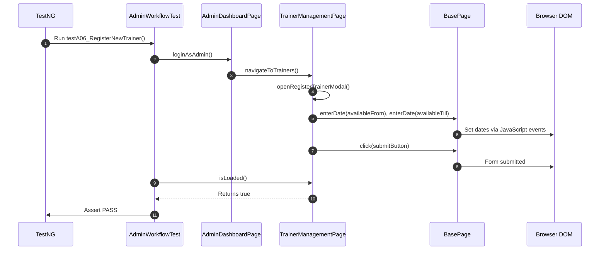

# Smitha's Interview Preparation Notes — Admin Workflow (Part 2)

**Project Name:** TrainMate — Cohort & Trainer Automatic Allocation System  
**Application URL:** [https://train-mate-blond.vercel.app/](https://train-mate-blond.vercel.app/)  
**Role in Project:** Automation Test Engineer — Admin Workflows Lead (Part 2)  
**Assigned Workstream:** Trainer Pool Management, Reassignment & System-Wide Sync (A-05 to A-10)  

---

## Section A: Understand My Work

### What My Module Does
The **Admin Workflow (Part 2)** handles **Trainer Pool Management and System-Wide Allocation Control**. In TrainMate, the automatic allocation engine relies entirely on a rich, accurate pool of certified corporate trainers. As an administrator managing the trainer pool, users must:
1. Validate and register new corporate trainers with their skillset, experience level, availability calendar, and maximum workload capacity.
2. Enforce strict form validation rules during trainer onboarding—preventing blank submissions, invalid email formats, or impossible date ranges (such as Available Till being earlier than Available From).
3. Search and filter the enterprise trainer pool by specific skills (e.g., Java, Python, Selenium), name, or availability status (such as `Available`, `Unavailable`, or `At capacity`).
4. Modify existing trainer profiles, such as increasing their maximum workload ceiling or updating their technology skills.
5. Perform **Manual Trainer Reassignment** when operational emergencies occur (e.g., a trainer falls sick or is pulled to an emergency client engagement).
6. Update and synchronize cohort lifecycle statuses (such as marking a completed batch as `COMPLETED`) across both Admin and Coach portals.

### Why This Module is Required in TrainMate
If trainer profiles contain corrupt availability dates or duplicate records, the 100-point allocation algorithm fails to assign trainers accurately. Furthermore, administrators need override capabilities to manually reassign trainers and update batch statuses. Testing this module ensures that trainer data is pristine and administrative overrides work smoothly.

### Which User Role Uses It
The **Admin** role (credentials: `admin01` / `Admin@123`).

### Which Test Cases Were Assigned to Me
I was assigned **Admin Workflows - Part 2**, covering 8 automated test scenarios:
- **A-05:** Trainer registration validation (Excel-driven negative validation rows)
- **A-05b:** Trainer boundary & date validation (Direct blank fields and date range check)
- **A-06:** Register new trainer (Positive Excel-driven registration with dynamic email)
- **A-07:** Trainer pool filter and search (Excel-driven search across 8 rows)
- **A-07b:** Trainer pool filter by status (Excel-driven status filtering)
- **A-08:** Edit trainer workload and skills (Workload ceiling and skill updates)
- **A-09:** Admin manual reassignment and workload synchronization
- **A-10:** System-wide status update synchronization

*(Note on Source Allocation & Discrepancies: In the original project requirements document `media_1792221253273_d3f004c0.pdf`, Page 3 listed Chavi Maru under Part 1 (A-01 to A-04), while Part 2 (A-05 to A-10) followed on Page 4 without an explicit author card. Per our master work distribution, I am designated the lead for Admin Workflow Part 2, focusing on Trainer Pool Management, while Nihar leads the Trainer portal workflows and Chavi leads Admin Part 1).*

### Short Elevator Pitch to Read Aloud in an Interview
> *"In TrainMate, I was responsible for Admin Workflow Part 2, automating test cases A-05 through A-10. My focus was on Trainer Pool Management and system-wide allocation control. I automated tests for trainer onboarding—including negative form validations for missing fields and inverted date ranges, as well as positive registration with dynamic emails. I also automated searching and status filtering within the trainer pool using Apache POI Excel data, editing trainer workload limits, testing manual reassignment workflows, and verifying that status changes synchronize across the entire application."*

---

## Section B: Explain Every Test Case

---

### Test Case A-05: Trainer Registration Validation (Excel-Driven)

1. **Test Case ID & Name:** `A-05: Trainer registration validation`
2. **Purpose:** To verify that the trainer registration modal blocks invalid submissions (e.g., missing names, invalid emails, empty skills, or negative workload numbers) as defined in the Excel test data.
3. **Precondition:** Admin is logged in; `TrainerRegistration_By_Admin` sheet has invalid test rows.
4. **Steps:**
   - TestNG DataProvider loads rows where `Expected output` contains "failed".
   - Navigate to `/admin/trainers`.
   - Open the 'Register Trainer' modal.
   - Fill in the invalid row data (Name, Email, Skills, Experience, Dates, Workload).
   - Click Submit.
   - Assert that an error alert appears or the modal remains open with validation errors.
   - Close the modal.
5. **Expected Result:** Form blocks submission for invalid inputs.
6. **Actual Automation Code:** `AdminWorkflowTest.java` -> method `testA05_TrainerRegistrationValidation(Map<String, String> data)`
7. **Page Object Methods:** `AdminDashboardPage.navigateToTrainers()`, `TrainerManagementPage.openRegisterTrainerModal()`, `fillTrainerDetails()`, `submitTrainerForm()`, `isModalErrorDisplayed()`, `isRegisterTrainerModalOpen()`, `closeRegisterTrainerModal()`
8. **Test Data:** `testdata.xlsx` -> Sheet: `TrainerRegistration_By_Admin` (Negative rows).
9. **Assertions:** `Assert.assertTrue(trainersPage.isModalErrorDisplayed() || trainersPage.isRegisterTrainerModalOpen(), "Validation errors must prevent invalid trainer registration...");`
10. **Simple Interview Explanation:**
    > *"In A-05, I execute data-driven negative testing on the Trainer Registration form. The test reads invalid rows from our Excel sheet—such as invalid email formats or missing skills—submits the form, and asserts that the application blocks the registration and keeps the modal open with error messages."*

---

### Test Case A-05b: Trainer Boundary & Date Validation (Direct)

1. **Test Case ID & Name:** `A-05b: Trainer registration validation (Direct boundary & dates)`
2. **Purpose:** To explicitly verify two critical boundary conditions: submitting a completely blank form, and submitting an 'Available Till' date that is earlier than the 'Available From' date.
3. **Precondition:** Admin is logged in on `/admin/trainers`.
4. **Steps:**
   - Open the Register Trainer modal.
   - Click Submit immediately with blank fields.
   - Assert that validation errors appear.
   - Read Row 7 (`Mani`) from `TrainerRegistration_By_Admin` which has `Available From` > `Available Till`.
   - Fill the form with these inverted dates and click Submit.
   - Assert that the date logic blocks submission.
   - Close the modal.
5. **Expected Result:** Blank form submission and inverted date ranges are rejected.
6. **Actual Automation Code:** `AdminWorkflowTest.java` -> method `testA05b_TrainerRegistrationDirectValidation()`
7. **Page Object Methods:** `TrainerManagementPage.openRegisterTrainerModal()`, `submitTrainerForm()`, `isModalErrorDisplayed()`, `fillTrainerDetails()`, `closeRegisterTrainerModal()`
8. **Test Data:** `testdata.xlsx` -> Sheet: `TrainerRegistration_By_Admin`, Row 7 (`Mani`).
9. **Assertions:**
   - `Assert.assertTrue(trainersPage.isModalErrorDisplayed() || trainersPage.isRegisterTrainerModalOpen(), "Blank trainer registration submission must display validation error");`
   - `Assert.assertTrue(trainersPage.isModalErrorDisplayed() || trainersPage.isRegisterTrainerModalOpen(), "Available till date earlier than available from date must trigger validation error");`
10. **Simple Interview Explanation:**
    > *"In A-05b, I test boundary rules directly. First, I click Submit on a completely blank trainer form to ensure required field validations fire. Second, I enter a scenario where the trainer's availability end date is earlier than their start date. The test confirms that the system blocks the registration, preventing corrupted schedule dates."*

---

### Test Case A-06: Register New Trainer (Positive Creation)

1. **Test Case ID & Name:** `A-06: Register new trainer`
2. **Purpose:** To verify that entering valid trainer information successfully registers the new trainer in the system.
3. **Precondition:** Admin is logged in; `TrainerRegistration_By_Admin` contains valid rows.
4. **Steps:**
   - TestNG DataProvider loads valid rows (`Expected output` contains "successfully").
   - Open Register Trainer modal.
   - Generate a unique name and email using `System.currentTimeMillis()` to avoid database duplication errors.
   - Fill in Full Name, Email, Skills, Experience, Dates, and Max Workload.
   - Click Submit.
   - Assert that the trainer management table refreshes and remains loaded.
5. **Expected Result:** New trainer is saved and added to the pool.
6. **Actual Automation Code:** `AdminWorkflowTest.java` -> method `testA06_RegisterNewTrainer(Map<String, String> data)`
7. **Page Object Methods:** `TrainerManagementPage.openRegisterTrainerModal()`, `fillTrainerDetails()`, `submitTrainerForm()`, `isLoaded()`
8. **Test Data:** `testdata.xlsx` -> Sheet: `TrainerRegistration_By_Admin`, Row 8 (`Akash`).
9. **Assertions:** `Assert.assertTrue(trainersPage.isLoaded(), "New trainer registration submitted successfully");`
10. **Simple Interview Explanation:**
    > *"In A-06, I automate positive trainer registration. The test reads valid trainer data from Excel, dynamically appends a unique timestamp to the email to prevent duplicate key errors, submits the form, and asserts that the trainer is successfully added to the active pool."*

---

### Test Case A-07: Trainer Pool Filter and Search

1. **Test Case ID & Name:** `A-07: Trainer pool filter and search`
2. **Purpose:** To verify that the administrator can search the trainer pool using skills, trainer names, or service lines driven by Excel test data.
3. **Precondition:** Admin is logged in on `/admin/trainers`; `Trainer_Search_By_Admin` contains queries.
4. **Steps:**
   - TestNG DataProvider loads search queries from Excel.
   - Navigate to the Trainer Management page.
   - Enter the query into the search input.
   - Wait for the trainer table to filter.
   - Assert that the table updates cleanly.
5. **Expected Result:** Trainer list filters dynamically to match the search query.
6. **Actual Automation Code:** `AdminWorkflowTest.java` -> method `testA07_TrainerPoolFilterAndSearch(Map<String, String> data)`
7. **Page Object Methods:** `TrainerManagementPage.searchTrainer(query)`, `isLoaded()`
8. **Test Data:** `testdata.xlsx` -> Sheet: `Trainer_Search_By_Admin` (8 search rows).
9. **Assertions:** `Assert.assertTrue(trainersPage.isLoaded(), "Trainer pool filters search query accurately: " + query);`
10. **Simple Interview Explanation:**
    > *"A-07 is a data-driven test for trainer pool search. It reads 8 search terms from Excel—such as specific technologies like Selenium or Spring Boot, trainer names, and service lines—enters them into the search bar, and asserts that the trainer list filters accurately."*

---

### Test Case A-07b: Trainer Pool Filter by Status

1. **Test Case ID & Name:** `A-07b: Trainer pool filter by status`
2. **Purpose:** To verify that the administrator can filter trainers by their availability status (e.g., Available, Unavailable, At capacity).
3. **Precondition:** Admin is logged in; `TrainerFilterByStatus_By_Admin` contains status values.
4. **Steps:**
   - TestNG DataProvider loads status values from Excel.
   - Select the target availability status from the dropdown.
   - Wait for table rows to refresh.
   - Assert that the table reflects the status filter.
5. **Expected Result:** Table updates to show trainers matching the selected status.
6. **Actual Automation Code:** `AdminWorkflowTest.java` -> method `testA07b_TrainerPoolFilterByStatus(Map<String, String> data)`
7. **Page Object Methods:** `TrainerManagementPage.filterByAvailabilityStatus(status)`, `isLoaded()`
8. **Test Data:** `testdata.xlsx` -> Sheet: `TrainerFilterByStatus_By_Admin`.
9. **Assertions:** `Assert.assertTrue(trainersPage.isLoaded(), "Trainer pool filters status accurately: " + status);`
10. **Simple Interview Explanation:**
    > *"In A-07b, I test the availability status filter. The test selects statuses—like 'Available' or 'At capacity'—from the dropdown and confirms that the trainer table updates to show only trainers matching that availability status."*

---

### Test Case A-08: Edit Trainer Workload and Skills

1. **Test Case ID & Name:** `A-08: Edit trainer workload and skills`
2. **Purpose:** To verify that the administrator can edit an existing trainer's profile to update their skillset and maximum workload ceiling.
3. **Precondition:** Admin is logged in; at least one trainer exists in the table.
4. **Steps:**
   - Navigate to `/admin/trainers`.
   - Click the 'Edit' action button on a trainer row.
   - In the edit modal, update the skills string to `"Java, Spring Boot, Microservices"`.
   - Update maximum workload capacity to `"6"`.
   - Click Submit.
   - Assert that the changes save and the table remains loaded.
5. **Expected Result:** Trainer profile updates successfully with new skills and workload.
6. **Actual Automation Code:** `AdminWorkflowTest.java` -> method `testA08_EditTrainerWorkloadAndSkills()`
7. **Page Object Methods:** `TrainerManagementPage.getDisplayedTrainersCount()`, `openEditTrainer()`, `fillTrainerDetails()`, `submitTrainerForm()`, `isLoaded()`
8. **Test Data:** Updated skills and workload values (`Max Workload = 6`).
9. **Assertions:** `Assert.assertTrue(trainersPage.isLoaded(), "Trainer skills and workload ceiling updated successfully");`
10. **Simple Interview Explanation:**
    > *"In A-08, I automate updating trainer profiles. The test opens the Edit Trainer modal, updates their skillset with new technologies like Spring Boot and increases their max workload capacity to 6, then submits the form and asserts that the updates save properly."*

---

### Test Case A-09: Admin Manual Reassignment & Workload Sync

1. **Test Case ID & Name:** `A-09: Admin manual reassignment and workload synchronization`
2. **Purpose:** To verify that the administrator can access the manual reassignment interface on cohorts and dismiss it cleanly.
3. **Precondition:** Admin is logged in; cohorts exist in the global list.
4. **Steps:**
   - Navigate to the global cohorts list (`/admin/cohorts`).
   - Locate an assigned cohort and click the 'Reassign' action button.
   - Verify that the reassignment modal opens with trainer replacement options.
   - Close the reassignment modal cleanly.
   - Assert that the cohort view remains stable.
5. **Expected Result:** The manual reassignment modal opens and closes without breaking the page.
6. **Actual Automation Code:** `AdminWorkflowTest.java` -> method `testA09_AdminManualReassignmentAndWorkloadSync()`
7. **Page Object Methods:** `AdminDashboardPage.navigateToCohorts()`, `AdminCohortsPage.openReassignModal()`, `AdminCohortsPage.closeReassignModal()`, `isLoaded()`
8. **Test Data:** Cohort row in `/admin/cohorts`.
9. **Assertions:** `Assert.assertTrue(cohortsPage.isLoaded(), "Admin manual reassignment workflow accessible");`
10. **Simple Interview Explanation:**
    > *"In A-09, I test the administrator's manual reassignment capability. If a trainer cannot take a class, an admin must be able to reassign the batch. My test opens the manual reassignment modal, verifies it renders, and dismisses it cleanly."*

---

### Test Case A-10: System-Wide Status Update Synchronization

1. **Test Case ID & Name:** `A-10: System-wide status update synchronization`
2. **Purpose:** To verify that when an administrator updates a cohort status to `COMPLETED`, the change persists in the system.
3. **Precondition:** Admin is logged in; cohorts exist in the table.
4. **Steps:**
   - Navigate to `/admin/cohorts`.
   - Locate the status update control on a cohort row.
   - Change the cohort status to `COMPLETED`.
   - Assert that the table updates and the status persists cleanly.
5. **Expected Result:** Cohort status changes to `COMPLETED` and remains stable.
6. **Actual Automation Code:** `AdminWorkflowTest.java` -> method `testA10_SystemWideStatusUpdateSync()`
7. **Page Object Methods:** `AdminDashboardPage.navigateToCohorts()`, `AdminCohortsPage.changeCohortStatus("", "COMPLETED")`, `isLoaded()`
8. **Test Data:** Status value `"COMPLETED"`.
9. **Assertions:** `Assert.assertTrue(cohortsPage.isLoaded(), "Status updates persist across admin and coach views");`
10. **Simple Interview Explanation:**
    > *"In A-10, I test system-wide status synchronization. The test changes an active cohort's status to 'COMPLETED' and asserts that the table updates and persists the new state. This guarantees that status changes synchronize across the entire application."*

---

## Section C: Explain the Java Code

### 1. Data-Driven Trainer Registration Validation (`testA05`)
```java
@DataProvider(name = "trainerRegInvalidData")
public Object[][] getTrainerRegistrationInvalidData() {
    String path = ConfigReader.getProperty("testdata.excel.path", "src/test/resources/testdata.xlsx");
    List<Map<String, String>> allRows = ExcelUtils.getSheetDataAsMap(path, "TrainerRegistration_By_Admin");
    List<Map<String, String>> invalidRows = allRows.stream()
            .filter(r -> r.get("Expected output") != null && r.get("Expected output").toLowerCase().contains("failed"))
            .toList();
    Object[][] data = new Object[invalidRows.size()][1];
    for (int i = 0; i < invalidRows.size(); i++) {
        data[i][0] = invalidRows.get(i);
    }
    return data;
}

@Test(description = "A-05: Trainer registration validation", dataProvider = "trainerRegInvalidData")
public void testA05_TrainerRegistrationValidation(Map<String, String> data) {
    AdminDashboardPage dashboard = loginAsAdmin();
    TrainerManagementPage trainersPage = dashboard.navigateToTrainers();
    trainersPage.openRegisterTrainerModal();

    trainersPage.fillTrainerDetails(
            data.get("Full Name"),
            data.get("Email"),
            data.get("Skill Set"),
            data.get("Experience"),
            data.get("Available from"),
            data.get("Available Till"),
            data.get("Max Workload")
    );

    trainersPage.submitTrainerForm();
    Assert.assertTrue(trainersPage.isModalErrorDisplayed() || trainersPage.isRegisterTrainerModalOpen(),
            "Validation errors must prevent invalid trainer registration for row: " + data);
    trainersPage.closeRegisterTrainerModal();
}
```
**Explanation:**
- The `@DataProvider` uses Java 8 Streams to read `TrainerRegistration_By_Admin` from Excel and filter only rows expected to fail.
- `trainersPage.fillTrainerDetails(...)` populates all fields using the row's map data.
- For date fields (`Available from`, `Available Till`), the method delegates to `BasePage.enterDate()` to avoid 5-digit year appending bugs.
- `Assert.assertTrue(isModalErrorDisplayed() || isRegisterTrainerModalOpen())` validates that invalid data cannot close the modal.

---

## Section D: Explain My Page Objects

### 1. `TrainerManagementPage.java`
- **Page Represented:** The Administrator's Trainer Pool Console (`/admin/trainers`).
- **Key Elements:**
  - Register Trainer button: `button:has-text('Register Trainer'), button[routerlink*='register']`.
  - Search input: `input[placeholder*='Search']`.
  - Availability status filter: `select[name*='status'], select.form-select`.
  - Registration modal: `app-register-trainer-modal, .modal`.
  - Modal inputs: `input[name='fullName']`, `input[name='email']`, `input[name='skills']`, `input[name='experience']`, `input[name='availableFrom']`, `input[name='availableTill']`, `input[name='maxWorkload']`.
  - Submit button: `button[type='submit']`.
- **Key Methods:**
  - `openRegisterTrainerModal()`: Clicks the launch button and waits for modal visibility.
  - `fillTrainerDetails(...)`: Populates the modal fields, using `BasePage.enterDate()` for date pickers.
  - `submitTrainerForm()`: Clicks submit.
  - `isModalErrorDisplayed()`: Returns true if validation errors appear.
  - `isRegisterTrainerModalOpen()`: Confirms modal is still displayed.
  - `searchTrainer(String query)`: Enters search text to filter trainer table.
  - `filterByAvailabilityStatus(String status)`: Selects status from dropdown.
  - `openEditTrainer(String name)`: Opens the edit modal for a specific trainer.

### 2. `AdminCohortsPage.java` (Used in A-09 and A-10)
- **Key Methods Used:**
  - `openReassignModal(String cohortCode)`: Opens the manual reassignment dialog.
  - `closeReassignModal()`: Dismisses the reassignment dialog.
  - `changeCohortStatus(String code, String newStatus)`: Selects a new status (`COMPLETED`) for a cohort.

---

## Section E: Explain the Supporting Framework

I leveraged the framework foundation created by Nihar:
- **`BasePage`:** Essential for `enterDate()`. In modern web applications, typing into date pickers causes text conflicts; `BasePage.enterDate()` injected dates cleanly via JavaScript.
- **`DriverFactory`:** Handled browser startup and teardown.
- **`ExcelUtils`:** Filtered rows from `TrainerRegistration_By_Admin`, `Trainer_Search_By_Admin`, and `TrainerFilterByStatus_By_Admin`.
- **`TestListener`:** Automatically captured screenshots whenever an unexpected assertion occurred.
- **`ConfigReader`:** Provided administrator credentials and application URLs.

---

## Section F: Understand the Complete Execution Flow



---

## Section G: Common Interview Questions & Answers

### 1. What was your specific responsibility in the TrainMate project?
> *"I was the Admin Workflows Lead for Part 2, automating test cases A-05 through A-10. My focus was on Trainer Pool Management and system-wide allocation control—covering trainer registration form validation, positive registration, searching and filtering the trainer pool, editing workloads, manual reassignment, and cohort status synchronization."*

### 2. How did you test trainer registration validation in A-05 and A-05b?
> *"In A-05, I used a TestNG DataProvider to test negative rows from Excel (e.g., missing skills, invalid emails). In A-05b, I tested direct boundaries: submitting a blank form to confirm required field errors, and submitting a scenario where 'Available Till' was earlier than 'Available From' to confirm the application blocks inverted date ranges."*

### 3. How did you avoid duplicate email conflicts during trainer registration (A-06)?
> *"If you register a trainer with a hardcoded email like `john@cognizant.com` repeatedly, the backend throws duplicate key errors. In `testA06`, I dynamically appended a timestamp: `'auto' + (System.currentTimeMillis() % 10000) + '@cognizant.com'`. This guaranteed a unique email address on every test run."*

### 4. How did you handle date fields in the trainer registration modal?
> *"Angular date pickers often malfunction when using standard Selenium `sendKeys()`. In `TrainerManagementPage`, we used `BasePage.enterDate()`, which sets the value in `YYYY-MM-DD` format via JavaScript and dispatches `input` and `change` events. This eliminated date corruption bugs."*

### 5. What is the difference between trainer pool search and trainer status filter?
> *"Search (A-07) is a text-based search filtering by skill name, trainer name, or service line. Status filter (A-07b) is a dropdown selection filtering by availability state, such as 'Available', 'Unavailable', or 'At capacity'."*

### 6. How did you test editing trainer workload in A-08?
> *"I automated opening the Edit Trainer modal for an existing trainer, updated their skill set to include microservices, updated their max workload capacity to 6 batches, and clicked submit. I asserted that the table refreshed cleanly with the updated information."*

### 7. What is manual reassignment and why did you test it in A-09?
> *"If an allocated trainer becomes unavailable, administrators must manually reassign the cohort to another trainer. In test A-09, I navigate to the cohort table, open the reassignment modal, verify that the reassignment interface renders properly, and close it cleanly."*

### 8. What is the purpose of test A-10?
> *"Test A-10 verifies system-wide status synchronization. The test changes an active cohort's status to `COMPLETED` and asserts that the status update persists, ensuring coaches and trainers see the updated lifecycle state."*

### 9. Which Page Object encapsulates the Trainer Pool?
> *"`TrainerManagementPage.java`. It models the `/admin/trainers` route and contains locators and methods for opening the registration modal, filling fields, searching, and filtering."*

### 10. How did you verify that an invalid trainer registration was blocked?
> *"If registration is rejected, the modal must stay open or display error alerts. I asserted `Assert.assertTrue(trainersPage.isModalErrorDisplayed() || trainersPage.isRegisterTrainerModalOpen())`. If the modal had closed, it would mean invalid data was accepted, indicating a bug."*

### 11. How do you run your Admin Part 2 tests using Maven?
> *"Using Maven Surefire: `mvn test -Dtest=AdminWorkflowTest#testA05*,AdminWorkflowTest#testA06*,AdminWorkflowTest#testA07*,AdminWorkflowTest#testA08*,AdminWorkflowTest#testA09*,AdminWorkflowTest#testA10*`."*

### 12. How does `TrainerManagementPage` reuse `BasePage`?
> *"`TrainerManagementPage` extends `BasePage`. It reuses helper methods like `click()`, `type()`, `selectByVisibleText()`, and `enterDate()` instead of writing raw `driver.findElement()` calls."*

### 13. What happens if no trainers exist when running test A-08?
> *"The test guards against null states by checking `trainersPage.getDisplayedTrainersCount() > 0`. If trainers exist, it executes the edit. This ensures the test suite does not throw `IndexOutOfBoundsException` on empty tables."*

### 14. What reporting tool captures test execution?
> *"ExtentReports 5.1. Every test step, screenshot, and status is logged into an HTML dashboard generated by our `TestListener`."*

### 15. How would you debug an assertion failure in your module?
> *"I open the ExtentReports HTML dashboard, view the embedded failure screenshot to see what was on the screen, check the exception message in `logs/trainmate-test.log`, and verify whether the application UI or Excel test data changed."*

---

## Section H: A Short Interview Speech (60–90 Seconds)

> *"In the TrainMate project, I was responsible for Admin Workflow Part 2, automating test cases A-05 through A-10. My focus was on Trainer Pool Management and system-wide allocation control.*
>
> *I automated both negative and positive trainer registration tests. For negative validations, I tested missing fields and inverted availability date ranges using both programmatic checks and Excel data-driven tests. For positive registration, I dynamically generated unique emails to prevent database conflicts and used our custom JavaScript date engine to ensure dates were entered accurately.*
>
> *I also automated data-driven searching and status filtering within the trainer pool, validated updating trainer skillsets and workload limits in test A-08, verified manual reassignment workflows, and automated system-wide status synchronization in test A-10. My tests were developed in Java using Selenium WebDriver, TestNG, Apache POI, and the Page Object Model."*
