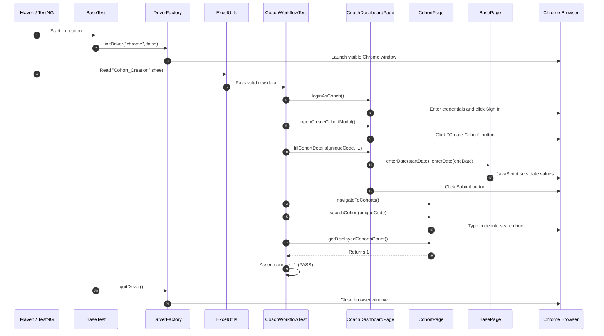

# TrainMate Automation Framework — Simple Beginner-Friendly Guide

**Project Name:** TrainMate — Cohort & Trainer Automatic Allocation System  
**Application URL:** [https://train-mate-blond.vercel.app/](https://train-mate-blond.vercel.app/)  
**Target Audience:** Team Members preparing for Automation Testing interviews  

---

## 1. What is TrainMate and What Does This Framework Do?

**TrainMate** is a web-based corporate training allocation system. In large companies, training coordinators (called **Coaches**) schedule new training batches (called **Cohorts**). When a cohort is created, TrainMate's automatic algorithm evaluates certified trainers in the **Trainer Pool** and assigns the best-qualified trainer based on a **100-Point Score** (covering skills, availability, current workload, and experience). **Administrators** oversee the entire company-wide operation, and **Trainers** log in to view their teaching schedules and notifications.

Our **Automation Testing Framework** is a software program written in **Java** that automatically controls a Google Chrome browser. It visits the website, types in usernames and passwords, clicks buttons, fills out forms, reads data from Excel spreadsheets, and checks whether the website works correctly.

---

## 2. Technologies Used (In Simple English)

| Technology | What it is | Why we use it in this project |
| :--- | :--- | :--- |
| **Java 17** | Programming Language | The core code that writes our tests, logic, and conditions. |
| **Selenium WebDriver 4** | Browser Automation Library | The "robot fingers" that open Chrome, find buttons, type text, and click links. |
| **TestNG 7** | Testing Framework | Organizes our test cases, runs them in order, feeds Excel data via `@DataProvider`, and asserts expected outcomes. |
| **Maven** | Build & Dependency Tool | Automatically downloads all necessary libraries (JAR files) and compiles our project using `pom.xml`. |
| **Page Object Model (POM)** | Design Pattern | A clean way to organize code: one Java class for each web page to hold locators, and separate classes for test logic. |
| **Apache POI 5** | Excel Reader Library | Reads test data, usernames, search terms, and cohort details directly from `testdata.xlsx`. |
| **ExtentReports 5** | HTML Reporting Engine | Generates a colorful, visual web report showing which tests passed, which failed, and embedding failure screenshots. |
| **Log4j2** | Logging Library | Writes timestamped audit records to the console and to `logs/trainmate-test.log` for debugging. |

---

## 3. Project Folder Structure Explained

```text
trainmate-test-1/
├── pom.xml                                  <-- Maven configuration (libraries & plugins)
├── README.md                                <-- Project setup instructions
├── src/
│   ├── main/java/
│   │   ├── base/
│   │   │   └── BasePage.java                <-- Reusable browser actions (clicks, waits, dates)
│   │   ├── pages/                           <-- Page Object classes (one per web page)
│   │   │   ├── LoginPage.java               <-- Login form elements and methods
│   │   │   ├── CoachDashboardPage.java      <-- Coach landing page & cohort modal
│   │   │   ├── CohortPage.java              <-- Cohort list, search, edit modal, scores
│   │   │   ├── BatchUploadPage.java         <-- Bulk Excel upload dropzone
│   │   │   ├── TrainerDashboardPage.java    <-- Trainer metrics and tab links
│   │   │   ├── TrainerCohortsPage.java      <-- Trainer schedule & details popup
│   │   │   ├── TrainerMailboxPage.java      <-- Trainer notifications
│   │   │   ├── AdminDashboardPage.java      <-- Admin summary cards and export button
│   │   │   ├── AdminCohortsPage.java        <-- Global cohorts repository & filters
│   │   │   └── TrainerManagementPage.java   <-- Trainer pool registration & edit modal
│   │   └── utils/
│   │       ├── ConfigReader.java            <-- Reads config.properties
│   │       ├── DriverFactory.java           <-- Creates and closes Chrome browser instances
│   │       ├── ExcelUtils.java              <-- Reads rows and columns from Excel
│   │       ├── ExcelDataInitializer.java    <-- Template builder for testdata.xlsx
│   │       ├── LoggerUtils.java             <-- Log4j2 helper
│   │       └── ScreenshotUtils.java         <-- Captures PNG screenshots on failure
│   └── test/
│       ├── java/
│       │   ├── base/
│       │   │   └── BaseTest.java            <-- TestNG setup (@BeforeMethod) and teardown (@AfterMethod)
│       │   ├── listeners/
│       │   │   └── TestListener.java        <-- ExtentReports listener with screenshot hook
│       │   └── test/                        <-- Actual test classes containing @Test methods
│       │       ├── LoginTest.java           <-- L-01, L-02 (Authentication tests)
│       │       ├── CoachWorkflowTest.java   <-- C-01 to C-10 (Coach tests)
│       │       ├── TrainerWorkflowTest.java <-- T-01 to T-09 (Trainer tests)
│       │       └── AdminWorkflowTest.java   <-- A-01 to A-10 (Admin tests)
│       └── resources/
│           ├── config.properties            <-- URLs, browser type, timeouts, test logins
│           ├── log4j2.xml                   <-- Logging configuration
│           ├── testdata.xlsx                <-- Master Excel test workbook (13 sheets)
│           └── testng.xml                   <-- Test suite runner configuration
```

---

## 4. Key Framework Components (How They Work)

### 4.1 BasePage — The Browser Interaction Engine
In standard Selenium, developers write lines like:
```java
driver.findElement(By.id("submit")).click();
```
If the internet is slightly slow, the button is not ready yet, and Selenium immediately throws `NoSuchElementException` or `ElementClickInterceptedException`.

In our framework, all Page Objects extend **`BasePage`**. `BasePage` wraps every action inside an **Explicit Wait** (`WebDriverWait`):
- `click(By locator)`: Waits until the button is clickable, then clicks it.
- `type(By locator, String text)`: Waits until the text box is visible, clears old text, and types the new text.
- `enterDate(By locator, String date)`: Solved the tricky HTML5 date problem. Typing into date fields with Selenium often duplicated digits (e.g., typing `2026` turned into `20262026`). Our `enterDate()` method uses JavaScript to cleanly assign the value `'YYYY-MM-DD'` and dispatches `change` events so Angular detects the update.

### 4.2 DriverFactory — Thread-Safe Browser Lifecycle
To ensure tests can run in parallel without interfering with each other, `DriverFactory` uses Java's **`ThreadLocal<WebDriver>`**.
- Each test thread gets its own private copy of Chrome.
- Test A in Thread 1 cannot accidentally click buttons in Test B's browser window.
- When the test completes, `DriverFactory.quitDriver()` cleanly shuts down the browser and clears memory.

### 4.3 ExcelUtils — Data-Driven Testing with Apache POI
Instead of hardcoding test data inside Java code, our framework reads real scenarios from **`src/test/resources/testdata.xlsx`**.
- It opens the Excel file using Apache POI's `WorkbookFactory`.
- It finds the requested worksheet (e.g., `Cohort_Creation` or `Cohort_Search_By_Admin`).
- It reads column headers and row data.
- It automatically formats Excel dates into standard `yyyy-MM-dd` text.
- It returns the rows to TestNG's `@DataProvider` as a `Map<String, String>`, where the column header is the key.

### 4.4 TestListener — Reporting and Failure Screenshots
Our `TestListener` implements TestNG's `ITestListener` interface:
- **When a test starts (`onTestStart`):** Creates a new entry in ExtentReports.
- **When a test passes (`onTestSuccess`):** Marks the test with a green PASS badge.
- **When a test fails (`onTestFailure`):** Calls `ScreenshotUtils` to immediately snap a screenshot of the browser, saves it as a PNG file, and attaches it directly into the ExtentReports HTML dashboard so you can see exactly what went wrong.

---

## 5. Walkthrough of a Real Test Run

Let's follow what happens when we run **Test Case C-04** (Creating a cohort with valid details):



---

## 6. How to Run the Tests

You can execute tests from your terminal using Maven commands:

1. **Run all tests in the entire framework:**
   ```bash
   mvn clean test
   ```
2. **Run only the Trainer workflow tests:**
   ```bash
   mvn test -Dtest=TrainerWorkflowTest
   ```
3. **Run only the Coach workflow tests:**
   ```bash
   mvn test -Dtest=CoachWorkflowTest
   ```
4. **Run only the Admin workflow tests:**
   ```bash
   mvn test -Dtest=AdminWorkflowTest
   ```
5. **Run a single specific test case (e.g. C-04):**
   ```bash
   mvn test -Dtest=CoachWorkflowTest#testC04_CreateCohortWithValidDetails
   ```

---

## 7. How to Find and Debug Failures

If a test fails, follow this 3-step investigation process:

1. **Check the ExtentReports HTML Dashboard:**
   - Open `test-output/ExtentReport.html` in any web browser.
   - Look for tests marked in red.
   - Look at the embedded screenshot to see what was actually on the screen at the moment of failure (e.g., an error message banner, a missing button, or an unexpected popup).
2. **Read the Log File:**
   - Open `logs/trainmate-test.log`.
   - Search for `ERROR` to read the exact Java exception (e.g., `TimeoutException`, `NoSuchElementException`, or `AssertionError`).
3. **Verify Locators & Test Data:**
   - If Selenium timed out waiting for an element, check if the website's HTML attributes or placeholder text changed.
   - If an assertion failed, check if the data in `testdata.xlsx` was modified.
